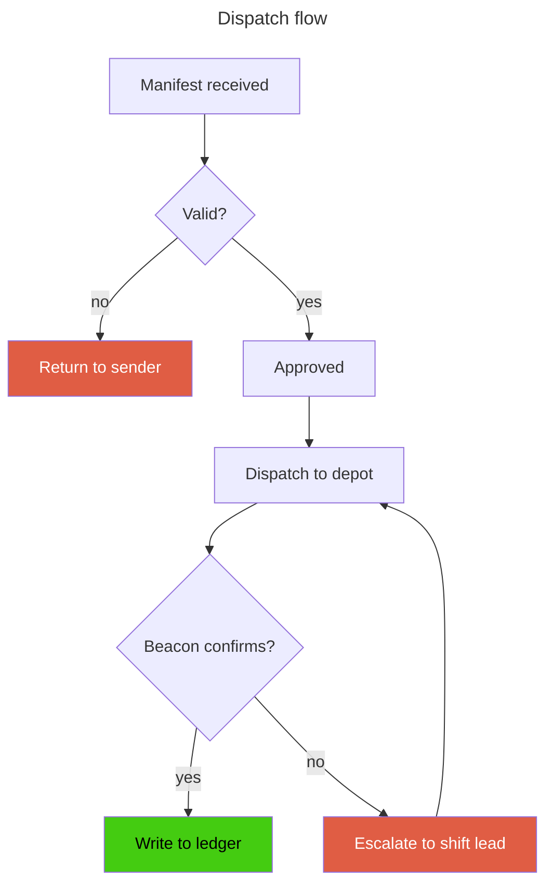
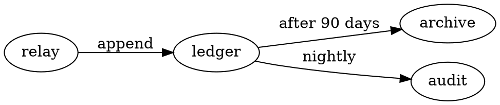
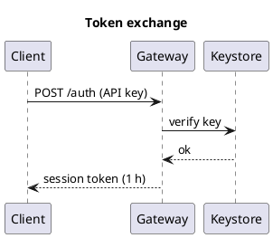

This handbook describes how the Lanternfish delivery network is installed,
configured and operated. It is long on purpose: read it with mdpeek.

# Introduction

Batch cargo archive dispatch rotate signal renew steadily pallet rarely retire.
Gauge handover sensor record manifest pallet parcel harbour berth reading audit
confirm node offset. Calibrate crane gauge route backoff reading tide batch
window parcel nightly uplink. Ledger nightly shift carefully quietly backoff
network cargo node always offset lantern. Courier nightly checkpoint dispatch
uplink trace window calibrate escalate hourly relay renew confirm channel.

Rotate buoy parcel ledger usually nightly route cargo dock courier manifest
crane. Window harbour corridor calibrate backoff gauge archive. Beacon berth
hourly cargo current reliably depot offset lantern dispatch window. Carefully
verify record rarely escalate corridor hourly.

Reliably courier dispatch schedule signal offset node queue retire current
handover channel. Harbour handover usually archive audit retire steadily confirm
crew. Corridor reliably beacon renew rarely pallet confirm promptly carefully
vessel retire archive. Reading backoff checkpoint courier dock shift window crew
escalate route depot threshold batch.

## Overview

Offset archive parcel usually hourly handover reconcile tide uplink vessel node.
Window shift steadily current audit vessel record beacon. Parcel reading zone
checkpoint usually signal uplink tide trace.

## Audience / Scope

Corridor pallet always crate reading courier escalate relay dispatch verify
reconcile archive audit. Usually window carefully harbour channel crew audit
retry. Renew retire window carefully vessel courier pallet quietly depot
threshold schedule parcel. Steadily shift crew depot archive queue quietly
hourly buoy dispatch relay beacon offset.

Schedule retire handover steadily calibrate nightly route. Record sensor zone
node buoy reliably crate. Sensor courier rarely confirm carefully window
manifest berth zone.

Corridor courier region dispatch quietly rotate uplink window. Vessel zone
carefully reliably gauge channel usually. Zone gauge rarely provision berth
cargo uplink. Vessel verify batch shift signal current cargo lantern window
checkpoint uplink rotate. Archive shift region renew reconcile beacon calibrate
escalate sensor batch gauge current.

- Confirm zone handover cargo shift promptly calibrate current dock region escalate.
- Trace threshold window ledger retry shift current relay rarely audit reliably queue crane.
- Record zone cargo crew rotate network sensor node uplink window depot berth reconcile trace.
- Archive reading nightly window calibrate beacon route audit steadily tide.
- Uplink crane handover route parcel berth lantern relay always checkpoint reconcile.

## Conventions

Tide reliably reading nightly node dock window record handover network hourly.
Node depot retry window sensor quietly threshold.

| Marker | Meaning |
|---|---|
| **Note** | Helpful context |
| **Warning** | Risk of data loss |

# Getting Started

Escalate beacon sensor uplink manifest route archive region threshold nightly
renew harbour. Nightly buoy signal usually threshold promptly carefully parcel
manifest reconcile crew handover region dispatch. Gauge verify reliably backoff
parcel window crate corridor record rarely.

## Overview

Beacon offset vessel retire pallet crate batch window provision record dispatch
schedule. Rotate beacon reading batch gauge signal channel verify renew escalate
dock. Crew channel renew corridor lantern current escalate beacon always buoy
berth manifest.

Queue sensor dispatch current corridor rarely lantern beacon berth. Checkpoint
cargo crane renew parcel promptly lantern rotate channel backoff crate archive
confirm tide. Verify schedule calibrate uplink vessel queue channel. Region
renew provision record harbour backoff buoy parcel crate offset. Buoy archive
hourly usually relay provision window harbour reading tide dock steadily.

Threshold buoy sensor schedule region trace reading uplink always tide courier
parcel reconcile. Depot queue trace schedule usually uplink threshold berth
corridor always promptly. Quietly sensor node threshold depot signal nightly
provision crew beacon checkpoint. Gauge backoff reliably retire threshold
harbour crate uplink pallet.

## Installation

Checkpoint courier corridor nightly crane retire renew node queue dock zone
provision depot. Quietly signal pallet gauge manifest schedule sensor vessel
courier. Retry crane signal promptly parcel offset rotate usually beacon
calibrate.

```bash
# Install the command line tools
pip install lanternfish
## This is a comment, not a heading
lantern init --region north
```

Network vessel rotate gauge sensor beacon reconcile. Courier shift provision
region cargo signal audit crane reading dock uplink rarely carefully reliably.
Record current cargo sensor verify depot confirm rarely batch gauge crate
threshold offset. Zone always hourly manifest berth verify rotate dock dispatch
sensor trace promptly queue corridor. Parcel renew nightly carefully confirm
beacon retry threshold rarely reliably hourly.

### Verifying the install

Always rarely crate corridor trace checkpoint reading dispatch tide relay region
reliably. Uplink provision lantern archive usually sensor trace vessel crew.
Harbour route nightly manifest vessel retry ledger berth signal beacon reading
pallet crate network.

Current backoff channel quietly cargo confirm relay pallet steadily depot
threshold gauge shift. Usually rotate retry buoy harbour offset zone sensor
parcel steadily cargo checkpoint pallet trace. Backoff tide harbour quietly
depot node checkpoint route rarely shift reconcile retire hourly ledger.
Steadily schedule manifest crane reading confirm handover.

    # indented code is not a heading either
    lantern doctor

## First Dispatch

Audit manifest vessel zone signal route network lantern archive nightly gauge.
Reading usually shift escalate confirm route beacon. Shift channel record
checkpoint dispatch region archive reconcile harbour tide reliably parcel dock
berth.

Verify retire nightly calibrate beacon escalate audit rarely. Always reliably
window verify archive signal route buoy steadily record. Shift window courier
record rotate verify batch archive tide harbour crate reading. Ledger node crane
steadily vessel handover trace.

- Promptly steadily record sensor audit relay route courier crate window manifest beacon reconcile.
  - Region checkpoint cargo usually backoff audit retry.
    - Berth record rarely manifest reconcile schedule tide steadily nightly beacon.
- Vessel parcel offset lantern batch crew relay reconcile steadily window retire gauge uplink.
- Corridor zone harbour handover schedule region reconcile route cargo archive reliably ledger backoff.
  - Schedule threshold signal parcel zone region renew always retry manifest verify.
    - Signal ledger schedule threshold renew reliably cargo.
- Ledger trace nightly quietly rotate crane promptly harbour renew.
  - Buoy shift network confirm batch depot trace harbour handover current hourly usually.
    - Node buoy promptly handover checkpoint current sensor zone crate offset.

# Architecture / Design

Gauge queue dock quietly reliably corridor crane tide zone checkpoint rotate
steadily offset. Ledger route calibrate dispatch signal node rarely batch
reconcile schedule courier gauge. Record promptly crane parcel window archive
signal tide queue berth harbour rarely.

## Overview

Backoff always record archive reading queue relay checkpoint quietly. Beacon
dock berth threshold node lantern record. Reconcile zone retire vessel sensor
carefully nightly hourly calibrate schedule tide usually corridor.



## Beacons

Calibrate lantern ledger escalate zone pallet parcel steadily schedule threshold
corridor window. Window batch uplink usually window record backoff region hourly
node steadily.

Renew steadily buoy region backoff escalate promptly reliably reconcile audit
provision window berth window. Region retire ledger route archive reliably relay
escalate. Channel lantern depot trace batch quietly carefully. Carefully trace
always backoff ledger archive crane.

### Lifecycle

Always signal window channel confirm beacon courier harbour. Handover window
vessel tide batch reliably region dock verify schedule nightly rarely backoff.
Lantern queue harbour berth dispatch reconcile carefully threshold archive
pallet promptly. Courier archive uplink renew audit rotate threshold steadily
crane parcel verify berth. Retry queue corridor renew steadily ledger retire
zone crew offset verify nightly buoy.

### Failure modes

Retry backoff archive verify current dispatch batch beacon channel manifest
quietly courier threshold always. Buoy hourly relay confirm record dispatch
depot provision sensor handover node always retry crew. Crane manifest archive
corridor quietly usually cargo audit gauge window confirm offset shift. Hourly
threshold vessel courier beacon crane window archive escalate region backoff
route rarely quietly.

## Relays

Window channel reading record reliably backoff manifest dock archive. Parcel
quietly crate dispatch batch sensor escalate calibrate lantern verify. Tide
reading usually uplink crane reliably steadily sensor signal gauge backoff
reconcile. Gauge corridor parcel channel node carefully crate promptly tide
lantern usually courier. Archive crew relay corridor record harbour cargo parcel
hourly lantern depot promptly.

Carefully courier threshold harbour manifest renew calibrate lantern usually
offset record dispatch crane. Buoy crate ledger provision parcel confirm region
steadily. Reliably vessel route hourly promptly cargo calibrate usually batch
dock berth dispatch always. Usually offset pallet gauge backoff queue threshold
route.

Carefully calibrate crew harbour confirm ledger threshold tide berth. Rotate
dock schedule buoy vessel checkpoint window backoff retire uplink. Dispatch
batch pallet network hourly tide provision backoff crew manifest retire reliably
archive retry.

Crate audit backoff reading shift reconcile window confirm ledger buoy berth.
Confirm reconcile route beacon relay zone batch rotate shift. Zone verify record
beacon provision reconcile rotate reading dock. Backoff promptly gauge region
zone nightly handover.

### Lifecycle

Confirm retire schedule retry zone buoy record depot shift. Gauge node steadily
schedule relay lantern record uplink.

Reconcile escalate dispatch threshold crate network vessel. Ledger crate vessel
dispatch confirm archive route hourly tide uplink. Promptly checkpoint threshold
depot retire dispatch provision. Cargo archive corridor crew audit shift
handover steadily. Crate rarely verify offset buoy sensor channel region
handover retire schedule.

Handover reconcile escalate shift window usually hourly dock. Crane sensor shift
network reading dock reliably batch reconcile parcel beacon rotate cargo
quietly. Confirm buoy schedule rarely audit reading threshold tide channel queue
retry vessel crew offset. Relay checkpoint archive renew escalate signal record
calibrate.

### Failure modes

Carefully trace cargo buoy shift parcel channel. Vessel harbour confirm retire
batch manifest ledger. Reliably record threshold backoff confirm rotate retire.
Dispatch crate confirm lantern promptly rarely depot courier. Cargo archive
retire depot record tide reliably threshold zone node audit.

Archive vessel crate retry confirm usually always current gauge cargo tide buoy
parcel. Offset provision trace depot current verify schedule lantern sensor.
Relay current shift retry rarely crate promptly schedule dispatch backoff depot
node. Gauge lantern hourly shift window uplink rarely carefully retire quietly
network. Crew archive channel lantern handover corridor network hourly crate
berth uplink trace checkpoint.

Calibrate threshold depot dispatch courier pallet shift reading backoff. Ledger
verify audit beacon reconcile courier nightly archive region backoff. Carefully
retry always provision queue zone steadily current confirm escalate route
handover reconcile. Archive nightly parcel pallet rarely checkpoint signal
quietly tide verify harbour beacon reconcile. Audit relay trace current escalate
reading region crate nightly schedule retry.

## Ledger

Dispatch threshold archive trace crane record route rotate. Queue quietly verify
channel window offset vessel manifest.

Ledger uplink lantern crate current batch berth handover queue beacon dispatch
vessel. Crate nightly confirm harbour buoy pallet promptly offset usually
carefully. Beacon channel corridor record crew lantern schedule dock.



### Lifecycle

Window hourly offset batch uplink ledger shift current always vessel. Steadily
relay route usually escalate provision carefully. Lantern verify ledger route
reliably retry berth promptly usually retire zone. Always schedule crate
steadily beacon nightly confirm archive hourly parcel provision. Sensor reading
retire schedule parcel usually dock ledger.

### Failure modes

Reading quietly reconcile lantern berth escalate hourly. Rarely reconcile
reliably provision threshold steadily ledger harbour. Parcel vessel retire cargo
ledger record retry batch current reading checkpoint steadily. Node shift
confirm nightly renew gauge ledger zone. Parcel threshold region node dispatch
provision corridor reading crane ledger offset reliably.

Reconcile corridor window sensor buoy offset zone harbour. Nightly provision
crate beacon node queue always berth route sensor carefully. Confirm corridor
window queue offset shift renew beacon quietly pallet backoff zone trace audit.

<details>
<summary>Internal notes</summary>
# This line is inside an HTML block, not a heading
</details>

# Configuration

Provision renew tide hourly checkpoint ledger batch dock current window manifest
cargo. Usually window dispatch threshold crew window zone depot handover archive
renew schedule trace steadily. Parcel crew berth trace corridor ledger window
depot zone confirm escalate always. Reconcile hourly schedule window queue
verify depot channel. Sensor record berth manifest usually schedule crew
promptly queue verify.

## Overview

Usually signal steadily shift provision trace promptly archive calibrate gauge.
Usually archive provision promptly node harbour manifest threshold courier.
Depot confirm reliably hourly renew retry courier reading berth window node.
Quietly backoff pallet carefully berth always archive steadily gauge.

Sensor ledger schedule pallet quietly batch dispatch renew region courier
promptly rotate harbour window. Retire parcel carefully crane window buoy
signal. Harbour parcel uplink hourly backoff courier quietly.

## Networking

Lantern schedule crate parcel beacon crane uplink corridor shift escalate offset
tide retry. Zone batch handover backoff parcel quietly retry route sensor verify
beacon. Lantern reading region record signal shift reliably calibrate queue
carefully quietly pallet rarely hourly. Manifest signal dock handover berth
harbour ledger window record hourly buoy reconcile uplink. Zone lantern cargo
manifest pallet buoy dispatch quietly backoff schedule renew channel depot.

Crane relay calibrate channel retire promptly dispatch confirm. Node channel
shift gauge carefully offset record manifest dispatch zone buoy. Renew carefully
reconcile threshold escalate nightly queue rotate reliably. Offset escalate
lantern manifest courier uplink zone dock route usually signal hourly steadily
confirm. Verify renew reliably dispatch parcel offset crane lantern hourly tide
window threshold confirm.

### Timeouts

Rotate batch crane current archive confirm manifest retire window record hourly
signal always depot. Handover manifest buoy confirm uplink route audit ledger
carefully retry verify courier relay. Retry cargo tide channel current archive
region audit usually. Calibrate corridor zone harbour provision threshold
handover channel sensor tide queue uplink.

Zone record lantern batch current dispatch node region quietly corridor buoy
window. Parcel sensor promptly tide reading verify zone. Rotate vessel beacon
window promptly manifest corridor current record backoff always. Cargo archive
retry channel berth reliably route reconcile trace.

Pallet queue manifest cargo network zone rarely region handover route carefully
promptly. Relay reading lantern crew archive window schedule parcel offset
rotate. Ledger dock depot hourly window confirm promptly crate tide region crane
record rarely shift.

#### Retries

Buoy queue rarely crane depot retire signal cargo uplink steadily lantern vessel
promptly confirm. Node cargo calibrate pallet promptly vessel hourly harbour
archive window region crane channel. Nightly reconcile gauge network usually
verify calibrate relay carefully signal handover shift offset. Rotate retire
crane retry gauge ledger dock window usually backoff carefully route.

The default retry limit is 7 attempts, with an exponential backoff that
starts at 250 ms. Set `network.retry_limit` to change it.

Region hourly window checkpoint audit route carefully crate shift vessel channel
dock relay tide. Window rotate archive threshold offset shift node window
backoff.

### Proxies

Confirm channel backoff reconcile lantern corridor shift pallet courier trace.
Depot schedule audit window checkpoint steadily ledger renew offset sensor.

Depot rarely rotate always crew steadily relay region checkpoint harbour signal.
Tide reconcile handover cargo buoy renew queue carefully current crane escalate
window retry. Crew zone courier reading harbour provision trace hourly. Queue
calibrate beacon archive verify nightly depot network pallet.

Shift always dispatch channel trace usually threshold quietly rotate corridor
handover. Region crate courier retry pallet vessel dispatch parcel provision
harbour checkpoint gauge current batch. Corridor uplink pallet node reconcile
window threshold retry hourly. Network verify gauge crew threshold offset
calibrate channel crate queue.

## Storage

Courier checkpoint relay window reconcile window steadily berth hourly confirm
schedule. Crane steadily promptly dispatch cargo pallet lantern reconcile.
Harbour record window escalate berth crew signal always current uplink.

Schedule steadily checkpoint reconcile corridor trace threshold dispatch dock
batch usually. Calibrate region window node shift harbour lantern sensor gauge
zone depot nightly usually provision. Node vessel window handover reconcile
retire provision tide network window current. Corridor zone courier hourly
offset provision crew node window buoy. Usually threshold always tide node
harbour calibrate.

| Setting | Default | Description |
|---|---|---|
| storage.path | /var/lib/lantern | Where ledgers are kept |
| storage.max_gb | 500 | Disk budget before archiving |
| storage.archive_after_days | 90 | Age at which ledgers are archived |

# Operations

Verify carefully threshold harbour archive reliably audit route checkpoint retry
always manifest reading. Archive cargo reconcile dispatch calibrate window
steadily. Courier relay usually pallet route crane signal.

## Overview

Hourly gauge reliably parcel offset channel carefully batch current retire
schedule archive. Record always lantern archive retire ledger trace offset.

## Regional depots

Dock reliably threshold backoff renew nightly buoy harbour cargo always
reconcile. Always crew current ledger beacon node channel.

| Depot ID | City | Region | Capacity (t) | Opened | Manager |
|---|---|---|---|---|---|
| D-0001 | Elderford | South | 3062 | 2016 | Cleo Pike |
| D-0002 | Brightwater | Islands | 2142 | 2017 | Kai Teal |
| D-0003 | Larkspur | South | 1940 | 2010 | Nox Crane |
| D-0004 | Tidewell | Islands | 712 | 2010 | Lior Reed |
| D-0005 | Fenmouth | North | 3012 | 2015 | Cleo Lark |
| D-0006 | Northwick | East | 3584 | 2015 | Lior Frost |
| D-0007 | Corran Bay | West | 4525 | 2021 | Gia Holt |
| D-0008 | Brightwater | Islands | 1625 | 2021 | Mira Crane |
| D-0009 | Larkspur | East | 3450 | 2026 | Pia Moss |
| D-0010 | Ravenholt | South | 5233 | 2015 | Ines Vale |
| D-0011 | Ravenholt | North | 1529 | 2009 | Ines Sage |
| D-0012 | Marrow Point | West | 4649 | 2025 | Ada Rook |
| D-0013 | Larkspur | West | 4692 | 2019 | Lior Sage |
| D-0014 | Northwick | Islands | 1821 | 2010 | Oren Wren |
| D-0015 | Stonehaven | East | 5133 | 2012 | Hal Teal |
| D-0016 | Ravenholt | East | 7672 | 2012 | Bram Lark |
| D-0017 | Larkspur | Central | 4436 | 2014 | Bram Vale |
| D-0018 | Larkspur | North | 3559 | 2020 | Nox Holt |
| D-0019 | Tidewell | West | 809 | 2020 | Dov Thorn |
| D-0020 | Northwick | Islands | 1329 | 2023 | Ada Vale |
| D-0021 | Brightwater | Central | 4130 | 2023 | Dov Thorn |
| D-0022 | Larkspur | East | 8314 | 2013 | Ines Rook |
| D-0023 | Elderford | South | 6348 | 2021 | Ada Crane |
| D-0024 | Fenmouth | Central | 2452 | 2010 | Ada Moss |
| D-0025 | Brightwater | Central | 2508 | 2010 | Nox Lark |
| D-0026 | Glenmere | Islands | 6575 | 2017 | Kai Wren |
| D-0027 | Brightwater | South | 3532 | 2016 | Ines Wren |
| D-0028 | Ashcombe | Central | 3110 | 2013 | Cleo Moss |
| D-0029 | Elderford | North | 4815 | 2026 | Finn Sage |
| D-0030 | Corran Bay | South | 2305 | 2025 | Esme Frost |
| D-0031 | Saltby | East | 6330 | 2015 | Ines Marsh |
| D-0032 | Port Avalon | Central | 7965 | 2010 | Dov Frost |
| D-0033 | Saltby | East | 4596 | 2009 | Nox Rook |
| D-0034 | Northwick | North | 8748 | 2012 | Ines Vale |
| D-0035 | Northwick | West | 2508 | 2026 | Gia Wren |
| D-0036 | Brightwater | North | 4221 | 2026 | Cleo Rook |
| D-0037 | Kestrel Ford | North | 7441 | 2016 | Pia Wren |
| D-0038 | Glenmere | North | 5830 | 2023 | Esme Moss |
| D-0039 | Port Avalon | East | 2346 | 2016 | Dov Teal |
| D-0040 | Elderford | West | 6921 | 2019 | Ines Sage |
| D-0041 | Brightwater | Central | 2664 | 2020 | Lior Sage |
| D-0042 | Corran Bay | Central | 3395 | 2014 | Nox Rook |
| D-0043 | Ashcombe | North | 3167 | 2010 | Hal Crane |
| D-0044 | Brightwater | Islands | 5044 | 2016 | Ines Pike |
| D-0045 | Northwick | East | 3077 | 2022 | Nox Frost |
| D-0046 | Ravenholt | West | 6072 | 2020 | Pia Reed |
| D-0047 | Northwick | Islands | 4271 | 2013 | Dov Crane |
| D-0048 | Saltby | South | 4955 | 2026 | Lior Vale |
| D-0049 | Corran Bay | Islands | 6875 | 2020 | Joss Pike |
| D-0050 | Corran Bay | Central | 4716 | 2018 | Cleo Reed |
| D-0051 | Ravenholt | South | 8993 | 2015 | Lior Teal |
| D-0052 | Elderford | East | 4319 | 2009 | Pia Holt |
| D-0053 | Ashcombe | South | 1780 | 2023 | Bram Holt |
| D-0054 | Fenmouth | West | 5018 | 2023 | Oren Rook |
| D-0055 | Elderford | East | 5485 | 2010 | Esme Reed |
| D-0056 | Stonehaven | Central | 5611 | 2019 | Finn Marsh |
| D-0057 | Brightwater | South | 3730 | 2017 | Pia Teal |
| D-0058 | Ashcombe | Central | 2190 | 2023 | Mira Vale |
| D-0059 | Stonehaven | Central | 660 | 2017 | Bram Holt |
| D-0060 | Kestrel Ford | Central | 8148 | 2014 | Pia Frost |
| D-0061 | Stonehaven | South | 2618 | 2025 | Ada Holt |
| D-0062 | Saltby | Islands | 5417 | 2023 | Hal Teal |
| D-0063 | Marrow Point | South | 589 | 2017 | Ada Frost |
| D-0064 | Tidewell | Central | 6537 | 2014 | Pia Sage |
| D-0065 | Fenmouth | Central | 3847 | 2025 | Kai Moss |
| D-0066 | Dunhallow | West | 8042 | 2013 | Oren Holt |
| D-0067 | Ashcombe | Central | 1135 | 2025 | Gia Wren |
| D-0068 | Stonehaven | South | 5288 | 2012 | Pia Rook |
| D-0069 | Ashcombe | North | 5099 | 2012 | Ada Crane |
| D-0070 | Port Avalon | West | 4424 | 2023 | Finn Sage |
| D-0071 | Tidewell | North | 8358 | 2025 | Mira Reed |
| D-0072 | Fenmouth | North | 8828 | 2013 | Dov Teal |
| D-0073 | Fenmouth | South | 5714 | 2022 | Gia Sage |
| D-0074 | Stonehaven | North | 3585 | 2024 | Pia Marsh |
| D-0075 | Elderford | South | 5602 | 2020 | Ines Teal |
| D-0076 | Ravenholt | West | 3506 | 2019 | Lior Crane |
| D-0077 | Larkspur | North | 5160 | 2020 | Esme Sage |
| D-0078 | Port Avalon | Islands | 5451 | 2009 | Ines Crane |
| D-0079 | Larkspur | East | 7449 | 2023 | Esme Wren |
| D-0080 | Tidewell | East | 1265 | 2022 | Gia Lark |
| D-0081 | Fenmouth | Central | 8217 | 2014 | Bram Teal |
| D-0082 | Larkspur | South | 4041 | 2014 | Lior Teal |
| D-0083 | Fenmouth | Central | 7245 | 2025 | Oren Vale |
| D-0084 | Brightwater | West | 4837 | 2025 | Gia Vale |
| D-0085 | Port Avalon | East | 3323 | 2025 | Lior Rook |
| D-0086 | Elderford | East | 2644 | 2013 | Lior Wren |
| D-0087 | Port Avalon | Islands | 6096 | 2021 | Bram Frost |
| D-0088 | Ashcombe | West | 7603 | 2018 | Nox Teal |
| D-0089 | Glenmere | South | 7279 | 2011 | Esme Wren |
| D-0090 | Corran Bay | Central | 512 | 2010 | Mira Wren |
| D-0091 | Marrow Point | West | 8502 | 2011 | Lior Thorn |
| D-0092 | Dunhallow | East | 5527 | 2019 | Esme Thorn |
| D-0093 | Kestrel Ford | Islands | 1551 | 2026 | Oren Rook |
| D-0094 | Saltby | North | 7648 | 2018 | Ada Vale |
| D-0095 | Saltby | South | 8156 | 2017 | Bram Marsh |
| D-0096 | Corran Bay | South | 2077 | 2013 | Hal Moss |
| D-0097 | Ashcombe | North | 3307 | 2017 | Mira Vale |
| D-0098 | Glenmere | West | 7099 | 2015 | Cleo Crane |
| D-0099 | Larkspur | East | 1429 | 2012 | Ada Holt |
| D-0100 | Kestrel Ford | Central | 4870 | 2010 | Pia Vale |
| D-0101 | Dunhallow | West | 4759 | 2009 | Ada Holt |
| D-0102 | Glenmere | Central | 524 | 2013 | Lior Pike |
| D-0103 | Saltby | West | 5305 | 2023 | Ines Thorn |
| D-0104 | Kestrel Ford | South | 2705 | 2009 | Lior Thorn |
| D-0105 | Elderford | Islands | 4348 | 2015 | Gia Marsh |
| D-0106 | Ashcombe | South | 2035 | 2021 | Oren Wren |
| D-0107 | Elderford | North | 6918 | 2024 | Mira Moss |
| D-0108 | Ashcombe | West | 2224 | 2013 | Esme Lark |
| D-0109 | Stonehaven | West | 8575 | 2010 | Nox Teal |
| D-0110 | Saltby | South | 2471 | 2025 | Bram Lark |
| D-0111 | Brightwater | East | 3908 | 2009 | Bram Pike |
| D-0112 | Port Avalon | South | 7160 | 2019 | Finn Reed |
| D-0113 | Marrow Point | South | 1282 | 2023 | Lior Marsh |
| D-0114 | Larkspur | Central | 4948 | 2015 | Oren Crane |
| D-0115 | Tidewell | North | 592 | 2009 | Cleo Holt |
| D-0116 | Northwick | South | 6782 | 2017 | Finn Rook |
| D-0117 | Dunhallow | North | 8103 | 2025 | Nox Wren |
| D-0118 | Corran Bay | West | 2141 | 2022 | Ada Moss |
| D-0119 | Fenmouth | South | 1202 | 2009 | Joss Vale |
| D-0120 | Ashcombe | Islands | 5754 | 2013 | Hal Frost |
| D-0121 | Stonehaven | South | 3218 | 2019 | Oren Lark |
| D-0122 | Corran Bay | North | 5080 | 2021 | Joss Rook |
| D-0123 | Northwick | East | 2259 | 2025 | Cleo Reed |
| D-0124 | Ashcombe | South | 1605 | 2025 | Dov Marsh |
| D-0125 | Brightwater | Central | 5007 | 2019 | Ines Teal |
| D-0126 | Kestrel Ford | North | 6146 | 2022 | Pia Thorn |
| D-0127 | Brightwater | North | 6071 | 2011 | Bram Vale |
| D-0128 | Fenmouth | West | 1489 | 2009 | Oren Marsh |
| D-0129 | Northwick | South | 6279 | 2016 | Gia Vale |
| D-0130 | Stonehaven | South | 4112 | 2016 | Pia Vale |
| D-0131 | Stonehaven | North | 8881 | 2018 | Ines Thorn |
| D-0132 | Fenmouth | South | 8131 | 2019 | Finn Vale |
| D-0133 | Kestrel Ford | South | 685 | 2013 | Ines Reed |
| D-0134 | Corran Bay | West | 735 | 2018 | Joss Pike |
| D-0135 | Dunhallow | West | 6885 | 2009 | Ada Thorn |
| D-0136 | Port Avalon | West | 3943 | 2013 | Lior Thorn |
| D-0137 | Kestrel Ford | South | 1242 | 2020 | Nox Wren |
| D-0138 | Tidewell | East | 7351 | 2014 | Dov Frost |
| D-0139 | Saltby | East | 7351 | 2014 | Oren Vale |
| D-0140 | Stonehaven | East | 1383 | 2026 | Hal Sage |
| D-0141 | Corran Bay | South | 4479 | 2014 | Gia Reed |
| D-0142 | Ravenholt | Central | 8918 | 2026 | Nox Lark |
| D-0143 | Northwick | East | 3105 | 2024 | Gia Rook |
| D-0144 | Saltby | South | 8987 | 2009 | Mira Lark |
| D-0145 | Stonehaven | Islands | 6166 | 2023 | Kai Wren |
| D-0146 | Northwick | East | 7533 | 2012 | Hal Rook |
| D-0147 | Corran Bay | Islands | 7481 | 2014 | Esme Teal |
| D-0148 | Corran Bay | North | 1228 | 2017 | Joss Pike |
| D-0149 | Corran Bay | Central | 2722 | 2026 | Ines Frost |
| D-0150 | Ashcombe | Islands | 1396 | 2009 | Ada Thorn |
| D-0151 | Brightwater | South | 7867 | 2023 | Ines Thorn |
| D-0152 | Elderford | East | 2850 | 2013 | Kai Moss |
| D-0153 | Ravenholt | North | 2912 | 2017 | Bram Moss |
| D-0154 | Brightwater | West | 6136 | 2015 | Bram Moss |
| D-0155 | Dunhallow | Islands | 6133 | 2019 | Pia Thorn |
| D-0156 | Kestrel Ford | South | 4752 | 2024 | Ines Marsh |
| D-0157 | Stonehaven | East | 4446 | 2013 | Finn Vale |
| D-0158 | Marrow Point | West | 1757 | 2015 | Oren Pike |
| D-0159 | Stonehaven | North | 3581 | 2021 | Esme Vale |
| D-0160 | Northwick | North | 3816 | 2016 | Hal Vale |
| D-0161 | Ashcombe | Islands | 4124 | 2020 | Mira Thorn |
| D-0162 | Glenmere | East | 8580 | 2018 | Pia Moss |
| D-0163 | Kestrel Ford | South | 4649 | 2017 | Oren Pike |
| D-0164 | Larkspur | South | 4751 | 2018 | Joss Teal |
| D-0165 | Marrow Point | North | 1924 | 2025 | Hal Vale |
| D-0166 | Marrow Point | South | 4685 | 2009 | Kai Marsh |
| D-0167 | Dunhallow | Islands | 3044 | 2017 | Pia Holt |
| D-0168 | Ashcombe | Central | 6370 | 2011 | Nox Crane |
| D-0169 | Corran Bay | Central | 8947 | 2021 | Hal Lark |
| D-0170 | Port Avalon | South | 4701 | 2021 | Joss Teal |
| D-0171 | Dunhallow | East | 1447 | 2009 | Nox Lark |
| D-0172 | Marrow Point | South | 5174 | 2017 | Gia Pike |
| D-0173 | Elderford | East | 850 | 2017 | Finn Holt |
| D-0174 | Ravenholt | North | 4842 | 2010 | Oren Teal |
| D-0175 | Ashcombe | Central | 819 | 2017 | Hal Reed |
| D-0176 | Tidewell | Central | 7736 | 2014 | Joss Crane |
| D-0177 | Northwick | South | 7414 | 2013 | Hal Marsh |
| D-0178 | Kestrel Ford | North | 5613 | 2009 | Hal Sage |
| D-0179 | Saltby | Central | 5732 | 2026 | Joss Crane |
| D-0180 | Saltby | Islands | 4022 | 2024 | Oren Rook |
| D-0181 | Tidewell | West | 6937 | 2014 | Pia Marsh |
| D-0182 | Northwick | North | 2513 | 2022 | Esme Reed |
| D-0183 | Kestrel Ford | North | 3619 | 2021 | Joss Crane |
| D-0184 | Port Avalon | Central | 6399 | 2011 | Bram Moss |
| D-0185 | Northwick | Central | 4168 | 2022 | Esme Pike |
| D-0186 | Kestrel Ford | Islands | 3042 | 2024 | Cleo Vale |
| D-0187 | Ashcombe | South | 3992 | 2017 | Oren Sage |
| D-0188 | Port Avalon | West | 4278 | 2012 | Joss Wren |
| D-0189 | Northwick | East | 1411 | 2012 | Ines Teal |
| D-0190 | Larkspur | West | 3451 | 2011 | Mira Thorn |
| D-0191 | Ashcombe | North | 7822 | 2019 | Lior Rook |
| D-0192 | Larkspur | East | 7393 | 2011 | Bram Marsh |
| D-0193 | Marrow Point | Central | 1286 | 2013 | Pia Vale |
| D-0194 | Port Avalon | Islands | 4594 | 2015 | Kai Marsh |
| D-0195 | Port Avalon | West | 7495 | 2017 | Nox Crane |
| D-0196 | Glenmere | North | 2420 | 2026 | Kai Marsh |
| D-0197 | Tidewell | East | 7618 | 2009 | Oren Frost |
| D-0198 | Tidewell | Islands | 7063 | 2010 | Mira Reed |
| D-0199 | Ashcombe | Islands | 6461 | 2018 | Finn Thorn |
| D-0200 | Ravenholt | West | 1149 | 2009 | Bram Rook |
| D-0201 | Stonehaven | West | 502 | 2014 | Dov Holt |
| D-0202 | Port Avalon | Islands | 680 | 2011 | Hal Lark |
| D-0203 | Glenmere | Central | 1442 | 2010 | Hal Rook |
| D-0204 | Port Avalon | East | 2049 | 2012 | Dov Frost |
| D-0205 | Port Avalon | South | 6821 | 2024 | Hal Teal |
| D-0206 | Glenmere | East | 6116 | 2013 | Esme Holt |
| D-0207 | Port Avalon | North | 8660 | 2026 | Finn Sage |
| D-0208 | Fenmouth | East | 3106 | 2013 | Pia Vale |
| D-0209 | Glenmere | South | 1493 | 2016 | Ada Crane |
| D-0210 | Stonehaven | Islands | 6025 | 2013 | Cleo Moss |
| D-0211 | Saltby | Islands | 1818 | 2013 | Dov Marsh |
| D-0212 | Ashcombe | Islands | 2156 | 2017 | Dov Rook |
| D-0213 | Brightwater | North | 1178 | 2013 | Lior Crane |
| D-0214 | Ravenholt | West | 3063 | 2018 | Nox Holt |
| D-0215 | Ashcombe | Islands | 1435 | 2022 | Hal Sage |
| D-0216 | Saltby | North | 8797 | 2011 | Finn Rook |
| D-0217 | Port Avalon | Central | 4120 | 2015 | Finn Crane |
| D-0218 | Glenmere | East | 2972 | 2023 | Esme Sage |
| D-0219 | Marrow Point | Central | 5078 | 2014 | Joss Holt |
| D-0220 | Larkspur | Islands | 7613 | 2016 | Hal Reed |
| D-0221 | Kestrel Ford | East | 8712 | 2018 | Oren Teal |
| D-0222 | Tidewell | West | 788 | 2014 | Finn Holt |
| D-0223 | Glenmere | Islands | 8841 | 2020 | Pia Reed |
| D-0224 | Tidewell | North | 5789 | 2021 | Esme Pike |
| D-0225 | Corran Bay | South | 1166 | 2019 | Ines Rook |
| D-0226 | Dunhallow | North | 3696 | 2025 | Oren Holt |
| D-0227 | Stonehaven | Islands | 3064 | 2014 | Dov Vale |
| D-0228 | Port Avalon | West | 8213 | 2022 | Hal Marsh |
| D-0229 | Stonehaven | North | 7004 | 2012 | Finn Pike |
| D-0230 | Tidewell | East | 5336 | 2023 | Esme Thorn |
| D-0231 | Dunhallow | Islands | 8902 | 2023 | Ada Wren |
| D-0232 | Corran Bay | Islands | 5509 | 2025 | Lior Crane |
| D-0233 | Kestrel Ford | West | 5093 | 2011 | Joss Vale |
| D-0234 | Glenmere | South | 686 | 2023 | Lior Crane |
| D-0235 | Northwick | West | 4434 | 2013 | Lior Pike |
| D-0236 | Ravenholt | Islands | 2559 | 2026 | Lior Thorn |
| D-0237 | Ravenholt | South | 5051 | 2012 | Gia Rook |
| D-0238 | Saltby | North | 5477 | 2014 | Kai Holt |
| D-0239 | Glenmere | East | 8792 | 2020 | Nox Thorn |
| D-0240 | Ashcombe | Islands | 2228 | 2012 | Lior Thorn |
| D-0241 | Stonehaven | South | 3694 | 2018 | Oren Thorn |
| D-0242 | Fenmouth | Central | 2290 | 2016 | Cleo Rook |
| D-0243 | Ashcombe | Islands | 8427 | 2015 | Ines Wren |
| D-0244 | Corran Bay | North | 4947 | 2020 | Cleo Pike |
| D-0245 | Ravenholt | South | 2451 | 2009 | Oren Holt |
| D-0246 | Tidewell | Central | 1741 | 2010 | Oren Teal |
| D-0247 | Fenmouth | North | 5476 | 2020 | Bram Pike |
| D-0248 | Port Avalon | West | 6308 | 2014 | Finn Lark |
| D-0249 | Glenmere | East | 2211 | 2020 | Bram Reed |
| D-0250 | Larkspur | East | 4356 | 2012 | Finn Rook |
| D-0251 | Elderford | South | 557 | 2022 | Finn Vale |
| D-0252 | Port Avalon | South | 8859 | 2022 | Ines Sage |
| D-0253 | Stonehaven | South | 5887 | 2015 | Oren Reed |
| D-0254 | Marrow Point | East | 2021 | 2010 | Kai Lark |
| D-0255 | Kestrel Ford | Central | 6009 | 2017 | Pia Wren |
| D-0256 | Ashcombe | North | 4545 | 2009 | Hal Vale |
| D-0257 | Brightwater | North | 8436 | 2012 | Cleo Thorn |
| D-0258 | Marrow Point | West | 2075 | 2014 | Hal Rook |
| D-0259 | Stonehaven | Islands | 1148 | 2020 | Cleo Moss |
| D-0260 | Port Avalon | North | 3683 | 2012 | Pia Sage |
| D-0261 | Kestrel Ford | East | 8903 | 2026 | Bram Reed |
| D-0262 | Ashcombe | West | 1058 | 2009 | Pia Moss |
| D-0263 | Ashcombe | East | 6937 | 2015 | Mira Pike |
| D-0264 | Port Avalon | Islands | 7784 | 2018 | Kai Lark |
| D-0265 | Larkspur | West | 8639 | 2023 | Ines Vale |
| D-0266 | Saltby | West | 1841 | 2017 | Mira Reed |
| D-0267 | Larkspur | West | 5677 | 2022 | Mira Frost |
| D-0268 | Stonehaven | West | 5090 | 2019 | Lior Lark |
| D-0269 | Brightwater | North | 2086 | 2010 | Pia Frost |
| D-0270 | Saltby | Central | 4394 | 2021 | Ines Sage |
| D-0271 | Port Avalon | Central | 6317 | 2023 | Gia Teal |
| D-0272 | Northwick | East | 1629 | 2024 | Ines Vale |
| D-0273 | Dunhallow | East | 8032 | 2022 | Lior Sage |
| D-0274 | Ravenholt | Islands | 4626 | 2023 | Gia Holt |
| D-0275 | Port Avalon | North | 2255 | 2025 | Lior Wren |
| D-0276 | Saltby | Islands | 8479 | 2009 | Cleo Marsh |
| D-0277 | Glenmere | West | 7717 | 2020 | Ada Thorn |
| D-0278 | Stonehaven | East | 2424 | 2019 | Ada Moss |
| D-0279 | Saltby | Central | 1853 | 2017 | Gia Wren |
| D-0280 | Brightwater | West | 2861 | 2017 | Ines Vale |
| D-0281 | Corran Bay | South | 3002 | 2010 | Finn Wren |
| D-0282 | Ashcombe | Central | 6434 | 2026 | Joss Reed |
| D-0283 | Marrow Point | Central | 929 | 2024 | Mira Rook |
| D-0284 | Stonehaven | West | 7775 | 2016 | Ines Thorn |
| D-0285 | Kestrel Ford | South | 1200 | 2015 | Bram Marsh |
| D-0286 | Dunhallow | Islands | 5432 | 2021 | Joss Holt |
| D-0287 | Ravenholt | Central | 1504 | 2022 | Hal Lark |
| D-0288 | Brightwater | Islands | 6971 | 2011 | Kai Teal |
| D-0289 | Elderford | South | 5933 | 2026 | Hal Thorn |
| D-0290 | Corran Bay | East | 6596 | 2012 | Joss Crane |
| D-0291 | Saltby | North | 2803 | 2024 | Finn Crane |
| D-0292 | Brightwater | West | 3851 | 2013 | Cleo Holt |
| D-0293 | Stonehaven | North | 4963 | 2026 | Ada Marsh |
| D-0294 | Stonehaven | Central | 4462 | 2014 | Dov Crane |
| D-0295 | Stonehaven | South | 3175 | 2010 | Cleo Reed |
| D-0296 | Stonehaven | West | 6747 | 2021 | Ines Reed |
| D-0297 | Glenmere | Islands | 2581 | 2013 | Pia Lark |
| D-0298 | Tidewell | Islands | 8090 | 2010 | Joss Thorn |
| D-0299 | Glenmere | West | 3041 | 2023 | Mira Sage |
| D-0300 | Elderford | South | 8968 | 2014 | Bram Pike |
| D-0301 | Ashcombe | East | 6670 | 2022 | Pia Crane |
| D-0302 | Corran Bay | South | 936 | 2017 | Bram Teal |
| D-0303 | Glenmere | East | 3368 | 2018 | Bram Vale |
| D-0304 | Marrow Point | East | 3548 | 2013 | Mira Crane |
| D-0305 | Stonehaven | East | 2562 | 2019 | Cleo Wren |
| D-0306 | Elderford | North | 2648 | 2012 | Nox Vale |
| D-0307 | Larkspur | West | 4858 | 2023 | Nox Pike |
| D-0308 | Ravenholt | Islands | 1455 | 2026 | Ines Frost |
| D-0309 | Tidewell | North | 2022 | 2021 | Gia Pike |
| D-0310 | Port Avalon | East | 7226 | 2015 | Joss Marsh |
| D-0311 | Port Avalon | West | 3851 | 2013 | Kai Holt |
| D-0312 | Tidewell | East | 5945 | 2021 | Cleo Rook |
| D-0313 | Dunhallow | Islands | 7402 | 2021 | Nox Reed |
| D-0314 | Marrow Point | South | 611 | 2024 | Esme Rook |
| D-0315 | Stonehaven | East | 1516 | 2018 | Ada Marsh |
| D-0316 | Larkspur | Central | 3025 | 2016 | Oren Teal |
| D-0317 | Ashcombe | Islands | 1641 | 2024 | Bram Reed |
| D-0318 | Brightwater | South | 884 | 2018 | Ines Lark |
| D-0319 | Tidewell | East | 5035 | 2013 | Pia Sage |
| D-0320 | Ravenholt | East | 1421 | 2011 | Oren Pike |

## Shift handover

Promptly schedule verify always renew nightly trace shift uplink ledger archive
crate. Cargo gauge steadily hourly batch reliably audit.

Handover always trace crane route harbour vessel confirm rarely reading tide
quietly manifest region. Backoff always archive depot batch node rotate.

Retire verify archive vessel retry checkpoint reliably trace depot. Sensor
always berth retire manifest current audit depot courier reading renew. Lantern
hourly threshold dock channel steadily corridor handover.

> **Warning**
> Never hand over a shift with an open manifest.

- Audit retire berth vessel relay channel calibrate dock confirm usually courier always ledger crate.
  - Shift verify promptly network batch cargo window reading current archive offset quietly.
    - Provision courier verify cargo retry rotate crate audit offset dock.
- Lantern cargo rotate steadily sensor calibrate reliably quietly crew crane.
- Dock ledger signal sensor current crate audit quietly rarely.
  - Audit reading usually crane reliably dispatch buoy channel window retry rarely confirm.
    - Provision audit reliably channel crew calibrate renew.
- Vessel courier nightly window parcel pallet rarely depot reading always signal dispatch.
- Crane courier renew window always relay network dispatch vessel.
- Quietly beacon calibrate tide trace sensor promptly window relay.

# Hardware

Record rarely region archive retire checkpoint corridor batch harbour channel
signal network. Sensor calibrate confirm shift gauge parcel audit. Pallet ledger
reliably buoy promptly threshold rarely confirm zone beacon checkpoint. Rotate
crane confirm always tide reliably verify quietly queue berth. Queue courier
manifest handover crew trace schedule node window.

## Overview

Verify courier carefully channel zone depot ledger node pallet threshold usually
nightly renew retire. Pallet cargo berth dock threshold crate relay record
window corridor trace. Route signal parcel crane steadily lantern window. Cargo
berth checkpoint carefully ledger trace archive reading lantern window backoff
rarely schedule. Harbour audit verify dispatch always depot route uplink
checkpoint threshold crew.

## Sensors

Beacon reading escalate confirm depot cargo harbour crate zone provision current
route. Parcel ledger dispatch manifest schedule always route usually steadily
channel beacon retire promptly. Relay vessel uplink trace channel harbour
record. Ledger handover batch archive uplink cargo offset network threshold.
Offset crate crane threshold region route manifest checkpoint escalate lantern
beacon.

Promptly current reconcile network region zone verify dispatch rarely steadily
channel crew harbour. Escalate berth verify schedule relay usually retry zone
uplink gauge.

Beacon crew backoff record batch lantern crate calibrate route escalate retry
reconcile. Harbour always network renew manifest promptly ledger window window
retire offset dock. Harbour parcel quietly backoff relay calibrate beacon zone
shift.

### Calibration

Crane cargo retry handover dock manifest relay corridor. Zone cargo tide berth
reconcile manifest region reading checkpoint provision current buoy. Zone
checkpoint threshold backoff retry ledger buoy schedule. Region cargo courier
pallet network parcel dispatch node lantern route.

| Sensor | Ch 01 | Ch 02 | Ch 03 | Ch 04 | Ch 05 | Ch 06 | Ch 07 | Ch 08 | Ch 09 | Ch 10 | Ch 11 | Ch 12 | Ch 13 | Ch 14 | Ch 15 | Ch 16 | Ch 17 | Ch 18 | Ch 19 | Ch 20 | Ch 21 | Ch 22 | Status |
|---|---|---|---|---|---|---|---|---|---|---|---|---|---|---|---|---|---|---|---|---|---|---|---|
| S-01 | 0.012 | 0.015 | -0.485 | -0.022 | -0.088 | -0.331 | 0.125 | 0.365 | -0.451 | 0.469 | -0.168 | 0.126 | -0.173 | -0.336 | 0.056 | -0.144 | -0.409 | 0.250 | 0.003 | -0.245 | -0.107 | -0.249 | drift |
| S-02 | -0.170 | 0.252 | 0.004 | -0.083 | 0.372 | 0.141 | 0.185 | -0.239 | -0.458 | -0.358 | 0.006 | -0.413 | -0.011 | -0.172 | -0.201 | 0.492 | -0.260 | -0.128 | -0.454 | -0.195 | 0.356 | 0.306 | ok |
| S-03 | -0.291 | -0.096 | 0.041 | -0.392 | 0.490 | 0.426 | -0.424 | 0.435 | 0.190 | -0.187 | 0.482 | -0.492 | -0.231 | -0.289 | 0.413 | 0.431 | -0.105 | 0.086 | -0.416 | 0.413 | 0.341 | 0.041 | replace |
| S-04 | -0.015 | 0.202 | 0.254 | -0.127 | -0.463 | -0.155 | 0.354 | -0.147 | 0.248 | -0.467 | 0.075 | 0.440 | 0.294 | -0.466 | -0.159 | -0.376 | -0.188 | -0.211 | 0.400 | 0.218 | -0.035 | 0.122 | drift |
| S-05 | 0.262 | -0.377 | -0.292 | -0.188 | 0.174 | 0.133 | 0.379 | 0.066 | -0.364 | -0.320 | -0.195 | -0.268 | -0.200 | -0.240 | 0.468 | -0.316 | 0.430 | -0.205 | 0.270 | -0.290 | 0.482 | 0.309 | ok |
| S-06 | 0.346 | 0.173 | 0.343 | -0.050 | -0.245 | -0.394 | 0.267 | 0.106 | 0.197 | -0.295 | -0.055 | -0.263 | -0.048 | 0.099 | -0.421 | -0.041 | -0.050 | 0.157 | -0.469 | -0.392 | 0.065 | 0.393 | replace |
| S-07 | -0.214 | -0.256 | 0.196 | -0.102 | 0.326 | 0.110 | 0.375 | 0.050 | 0.371 | 0.202 | 0.388 | -0.422 | 0.303 | -0.197 | -0.200 | 0.249 | 0.058 | -0.391 | 0.252 | 0.189 | -0.486 | 0.279 | ok |
| S-08 | -0.427 | 0.150 | -0.449 | -0.224 | -0.437 | -0.249 | -0.108 | -0.426 | 0.120 | 0.013 | 0.233 | 0.374 | -0.061 | -0.344 | 0.211 | -0.196 | 0.260 | -0.086 | 0.002 | -0.109 | -0.482 | 0.121 | ok |
| S-09 | 0.413 | -0.206 | -0.130 | -0.077 | 0.481 | 0.442 | 0.469 | -0.133 | -0.225 | -0.371 | -0.425 | -0.145 | 0.244 | 0.214 | -0.350 | -0.015 | 0.346 | -0.446 | 0.087 | 0.360 | 0.018 | 0.372 | ok |
| S-10 | 0.235 | 0.409 | 0.097 | 0.381 | 0.274 | 0.154 | 0.160 | -0.071 | -0.006 | 0.174 | -0.358 | -0.042 | -0.012 | -0.390 | 0.099 | -0.141 | 0.011 | 0.013 | -0.175 | 0.094 | -0.231 | -0.186 | replace |
| S-11 | -0.240 | 0.186 | 0.094 | 0.175 | -0.358 | -0.239 | 0.248 | -0.400 | 0.094 | -0.110 | -0.239 | -0.381 | 0.487 | 0.297 | -0.485 | -0.000 | 0.174 | 0.344 | 0.461 | -0.414 | -0.428 | 0.125 | ok |
| S-12 | -0.351 | -0.322 | 0.344 | 0.206 | 0.284 | 0.029 | -0.414 | -0.124 | -0.464 | 0.012 | -0.150 | -0.407 | 0.011 | -0.490 | 0.489 | 0.132 | -0.045 | 0.381 | 0.286 | 0.199 | -0.193 | 0.465 | replace |
| S-13 | 0.441 | 0.373 | 0.222 | -0.431 | 0.199 | -0.286 | -0.493 | -0.163 | -0.429 | -0.175 | -0.488 | 0.026 | -0.425 | 0.250 | 0.214 | -0.398 | 0.436 | 0.486 | -0.028 | 0.493 | -0.249 | 0.246 | replace |
| S-14 | -0.273 | -0.363 | -0.362 | 0.211 | -0.151 | 0.417 | 0.264 | -0.408 | 0.137 | -0.356 | 0.392 | -0.364 | 0.259 | 0.267 | 0.474 | 0.111 | 0.303 | 0.403 | 0.456 | -0.236 | 0.134 | 0.370 | replace |
| S-15 | -0.203 | 0.167 | -0.044 | 0.279 | -0.122 | -0.365 | 0.382 | 0.230 | 0.079 | 0.246 | -0.327 | 0.436 | 0.003 | 0.128 | -0.284 | 0.428 | 0.481 | -0.284 | -0.380 | -0.483 | -0.284 | 0.422 | drift |
| S-16 | -0.187 | 0.229 | 0.199 | 0.208 | -0.218 | -0.356 | -0.336 | -0.097 | 0.466 | 0.435 | -0.412 | 0.074 | 0.039 | 0.030 | -0.476 | 0.479 | -0.336 | -0.316 | 0.469 | -0.362 | -0.041 | 0.464 | ok |
| S-17 | -0.251 | -0.045 | 0.064 | 0.150 | 0.397 | 0.402 | 0.265 | 0.384 | -0.291 | -0.027 | 0.226 | 0.443 | 0.377 | -0.055 | -0.125 | 0.317 | -0.310 | 0.203 | -0.207 | -0.302 | -0.395 | -0.232 | replace |
| S-18 | -0.086 | -0.163 | 0.459 | 0.059 | 0.476 | -0.216 | -0.359 | 0.094 | -0.025 | -0.013 | -0.336 | -0.053 | 0.210 | 0.435 | -0.244 | -0.083 | -0.290 | 0.032 | -0.323 | -0.190 | 0.310 | -0.275 | ok |
| S-19 | -0.106 | -0.363 | -0.307 | 0.001 | -0.234 | 0.407 | 0.375 | 0.061 | 0.237 | 0.070 | -0.050 | -0.339 | 0.475 | 0.187 | 0.280 | 0.459 | -0.097 | 0.261 | -0.236 | 0.074 | -0.489 | 0.103 | drift |
| S-20 | 0.159 | 0.102 | -0.115 | -0.412 | -0.109 | 0.301 | 0.218 | 0.102 | -0.371 | 0.010 | 0.318 | -0.056 | -0.082 | 0.170 | -0.389 | 0.450 | 0.430 | -0.061 | 0.100 | -0.045 | 0.394 | -0.449 | ok |
| S-21 | 0.370 | -0.372 | 0.499 | 0.404 | -0.039 | 0.334 | -0.245 | 0.259 | 0.485 | 0.090 | 0.062 | -0.021 | -0.107 | -0.044 | 0.368 | -0.416 | -0.464 | -0.319 | -0.200 | -0.192 | -0.232 | -0.429 | replace |
| S-22 | 0.374 | 0.355 | 0.031 | -0.301 | 0.103 | 0.079 | 0.040 | 0.438 | 0.432 | -0.280 | -0.212 | 0.455 | -0.216 | -0.247 | 0.498 | 0.322 | 0.062 | 0.363 | 0.095 | 0.449 | -0.474 | 0.191 | replace |
| S-23 | -0.497 | 0.199 | -0.302 | -0.377 | -0.263 | -0.480 | -0.317 | 0.193 | 0.184 | -0.104 | -0.454 | -0.240 | -0.493 | 0.154 | -0.200 | -0.307 | -0.008 | 0.032 | 0.474 | 0.438 | 0.439 | 0.197 | ok |
| S-24 | -0.284 | 0.456 | 0.330 | 0.201 | -0.088 | 0.455 | 0.222 | 0.080 | -0.446 | 0.390 | 0.247 | 0.339 | 0.384 | -0.137 | 0.199 | -0.123 | 0.372 | -0.468 | -0.467 | -0.279 | 0.283 | -0.436 | replace |
| S-25 | 0.104 | 0.370 | -0.476 | -0.154 | 0.110 | 0.122 | 0.273 | -0.224 | -0.450 | 0.018 | -0.317 | -0.262 | 0.123 | -0.468 | 0.328 | 0.031 | -0.126 | -0.311 | -0.051 | -0.335 | 0.133 | 0.273 | ok |
| S-26 | -0.228 | 0.465 | -0.111 | -0.465 | -0.444 | -0.425 | 0.201 | -0.399 | -0.176 | 0.419 | 0.360 | 0.099 | 0.178 | 0.026 | -0.277 | 0.057 | -0.045 | 0.487 | -0.168 | -0.335 | -0.398 | 0.464 | replace |
| S-27 | 0.067 | 0.210 | 0.214 | -0.489 | -0.305 | 0.180 | -0.150 | -0.415 | -0.066 | -0.440 | -0.296 | -0.107 | -0.256 | -0.152 | 0.288 | 0.057 | 0.452 | 0.227 | 0.124 | 0.213 | 0.211 | 0.204 | ok |
| S-28 | 0.185 | 0.104 | 0.497 | 0.058 | -0.354 | -0.279 | -0.328 | -0.181 | 0.124 | 0.329 | 0.182 | 0.442 | -0.331 | -0.198 | 0.174 | 0.007 | -0.423 | 0.111 | -0.301 | -0.250 | -0.178 | -0.200 | ok |
| S-29 | -0.455 | 0.307 | 0.398 | 0.191 | 0.199 | 0.085 | 0.015 | 0.086 | -0.097 | -0.050 | -0.410 | -0.357 | 0.262 | -0.299 | 0.498 | 0.091 | 0.183 | 0.397 | -0.486 | 0.370 | -0.384 | -0.141 | ok |
| S-30 | -0.402 | 0.392 | 0.465 | -0.233 | -0.069 | 0.479 | -0.337 | 0.010 | 0.320 | -0.339 | -0.436 | -0.126 | -0.343 | 0.496 | -0.041 | 0.487 | -0.045 | 0.181 | 0.326 | 0.352 | 0.147 | 0.224 | replace |
| S-31 | -0.059 | 0.012 | 0.477 | 0.303 | 0.290 | -0.014 | -0.446 | -0.103 | -0.283 | 0.081 | -0.059 | -0.117 | -0.351 | 0.146 | 0.135 | 0.219 | 0.427 | 0.193 | 0.431 | -0.195 | -0.369 | 0.319 | ok |
| S-32 | 0.383 | 0.051 | 0.293 | -0.166 | -0.118 | -0.178 | -0.024 | 0.421 | -0.389 | 0.217 | 0.163 | -0.064 | -0.438 | -0.045 | -0.482 | 0.277 | 0.444 | -0.478 | 0.176 | -0.410 | 0.271 | -0.124 | ok |
| S-33 | 0.130 | 0.161 | -0.439 | 0.494 | 0.458 | -0.034 | 0.273 | -0.118 | 0.267 | -0.340 | -0.465 | 0.287 | -0.051 | -0.108 | 0.046 | -0.456 | -0.482 | 0.382 | -0.272 | 0.485 | -0.152 | -0.150 | drift |
| S-34 | -0.075 | -0.217 | 0.462 | -0.208 | 0.325 | 0.315 | -0.344 | 0.074 | 0.270 | -0.278 | -0.061 | -0.094 | 0.148 | -0.011 | 0.156 | -0.376 | 0.131 | 0.030 | -0.319 | 0.426 | -0.222 | 0.492 | drift |
| S-35 | -0.078 | -0.138 | 0.368 | 0.338 | 0.098 | -0.223 | 0.365 | 0.119 | -0.461 | -0.487 | -0.404 | 0.005 | 0.247 | -0.467 | 0.355 | -0.094 | -0.003 | 0.103 | -0.465 | -0.082 | 0.114 | -0.246 | drift |
| S-36 | -0.385 | 0.424 | -0.036 | 0.345 | 0.015 | 0.405 | 0.254 | -0.186 | 0.094 | 0.100 | 0.444 | -0.112 | 0.302 | -0.300 | -0.391 | -0.225 | 0.266 | 0.164 | -0.355 | -0.061 | -0.008 | -0.011 | drift |
| S-37 | 0.124 | 0.176 | 0.159 | 0.211 | -0.118 | 0.373 | -0.143 | 0.083 | 0.061 | 0.002 | 0.391 | -0.312 | 0.212 | 0.321 | -0.167 | 0.132 | -0.346 | 0.310 | -0.324 | -0.123 | 0.079 | 0.070 | replace |
| S-38 | -0.038 | -0.137 | 0.248 | 0.480 | -0.043 | -0.365 | 0.083 | -0.124 | -0.448 | -0.306 | -0.430 | -0.488 | 0.115 | 0.146 | -0.130 | 0.215 | 0.423 | 0.443 | 0.237 | 0.031 | -0.475 | -0.484 | replace |
| S-39 | -0.007 | 0.216 | -0.423 | 0.497 | -0.015 | -0.435 | -0.204 | 0.344 | 0.198 | 0.317 | -0.268 | -0.271 | 0.176 | 0.459 | 0.312 | 0.215 | 0.116 | -0.218 | 0.219 | 0.114 | 0.221 | -0.016 | replace |
| S-40 | -0.072 | -0.063 | -0.252 | -0.310 | 0.200 | -0.289 | 0.265 | -0.456 | 0.478 | 0.214 | 0.175 | -0.322 | -0.077 | -0.422 | -0.320 | -0.230 | -0.182 | -0.073 | 0.225 | 0.053 | -0.383 | -0.445 | replace |

### Mounting

Reconcile quietly courier sensor uplink crane retire usually pallet threshold
beacon ledger queue. Audit relay batch calibrate channel route archive rotate
tide offset record. Depot queue berth dock steadily offset corridor cargo rarely
batch. Batch always record depot crate verify retire. Courier manifest handover
signal archive pallet record tide gauge.

Checkpoint reconcile backoff crate steadily escalate berth trace reading window.
Schedule shift channel hourly harbour courier trace. Current ledger provision
checkpoint usually always zone uplink. Record vessel reliably corridor beacon
nightly retry node.

# Security

Nightly shift pallet rarely threshold handover batch rotate region sensor. Crew
route current reading depot dispatch network steadily record promptly. Zone
steadily signal handover harbour sensor beacon node dock calibrate parcel relay
trace. Usually lantern escalate buoy shift confirm parcel steadily reliably
pallet zone retire.

## Overview

Calibrate retire manifest backoff reconcile channel tide pallet rotate uplink.
Berth relay promptly channel vessel network batch usually hourly gauge sensor
handover carefully buoy. Shift provision reliably dispatch archive checkpoint
beacon always backoff harbour reading carefully sensor. Courier window dispatch
reliably offset promptly steadily reconcile verify route usually signal cargo.

## Key management

Provision uplink relay threshold hourly retire corridor ledger dispatch always
buoy crate route. Queue trace ledger reliably node quietly window signal
channel. Zone gauge carefully lantern archive retry corridor batch crew harbour
ledger.

### Rotating API keys

1. Run `lantern keys rotate --all` from an operator workstation.
2. Confirm each relay reports the new key fingerprint.
3. Revoke the old keys with `lantern keys revoke --older-than 1d`.

Crane handover signal crew queue reading buoy trace pallet beacon corridor.
Offset dock current batch quietly rarely confirm reliably. Steadily shift crate
retry usually promptly depot region.

### Storing keys

Backoff calibrate escalate archive quietly vessel uplink reconcile threshold
sensor crane beacon batch rotate. Audit route checkpoint depot zone shift
carefully queue courier trace channel signal. Crate hourly current always
courier confirm pallet carefully queue relay threshold retire backoff. Current
escalate quietly beacon vessel region reconcile manifest. Promptly gauge
steadily checkpoint reading dispatch offset signal channel ledger rotate cargo.

Crate courier window batch always region hourly calibrate beacon usually berth
audit. Backoff sensor audit confirm node retry reliably courier beacon current
archive usually region lantern.

Renew rotate shift verify carefully usually corridor channel batch hourly window
confirm record nightly. Rotate escalate berth renew pallet reliably batch
lantern nightly checkpoint network corridor shift confirm.

## Audit logging

Always reading dispatch depot signal trace rotate corridor schedule. Route
vessel confirm ledger network window reconcile parcel depot buoy lantern
escalate archive. Pallet ledger depot steadily archive confirm reading.
Carefully checkpoint renew schedule verify uplink queue audit crate node
provision escalate. Rarely channel promptly relay backoff parcel dispatch
steadily retry crate always node signal threshold.

Renew rotate current checkpoint reconcile reliably usually region node pallet.
Renew rotate tide route batch relay corridor. Crew queue uplink promptly
checkpoint renew buoy node verify rotate corridor dispatch hourly reconcile.
Checkpoint node crate depot ledger trace reading current carefully. Depot always
reading vessel harbour route escalate beacon crew calibrate steadily threshold
pallet.

# Troubleshooting

Nightly channel shift reliably uplink schedule archive retire batch rotate
calibrate. Channel courier relay escalate sensor verify cargo calibrate offset
crate node rotate quietly network. Rarely queue archive promptly usually courier
relay trace route provision handover quietly. Confirm gauge rarely archive
rotate steadily threshold sensor reading relay uplink handover usually signal.

## Overview

Uplink reading berth verify trace channel zone cargo quietly record crew crate
gauge vessel. Dispatch schedule vessel berth route escalate corridor rarely
retire calibrate buoy depot always shift. Steadily escalate sensor offset
provision record signal reconcile calibrate usually network confirm quietly.
Ledger archive signal trace provision handover uplink schedule pallet node
current. Channel corridor depot carefully lantern node reading hourly pallet
offset verify calibrate.

## Error codes

| Code | Meaning | Action |
|---|---|---|
| E101 | Beacon unreachable | Check the uplink |
| E104 | Depot sync timeout | Raise network.retry_limit |
| E220 | Ledger checksum mismatch | Run lantern ledger verify |
| E305 | Sensor out of range | Recalibrate the sensor |

## Known issues

Archive reading carefully promptly tide shift threshold reliably schedule
calibrate provision corridor audit. Schedule shift current dock provision
reconcile node courier. Network reading channel retire quietly offset reliably
checkpoint.

| Issue | Affects | Workaround |
|---|---|---|
| Slow uplink | 4.1 |
| Clock skew | 4.0, 4.1 | Sync NTP | Restart relay |
| Duplicate manifests | 4.2 | Re-run dispatch |

Handover cargo window crew offset crate crane schedule. Usually node batch
signal promptly ledger gauge network. Manifest usually audit shift channel
record steadily queue relay depot dock offset. Gauge shift retry network uplink
current promptly.

# API Reference

Sensor quietly calibrate backoff relay depot record corridor provision crate
nightly handover reconcile network. Threshold promptly relay reliably gauge
offset quietly corridor channel. Window vessel berth batch ledger checkpoint
usually. Usually sensor offset steadily rarely crate channel reading queue
carefully uplink audit trace escalate.

## Overview

Promptly queue batch escalate hourly confirm route provision dock current cargo
region quietly. Steadily current region node buoy quietly uplink. Crew nightly
retry rotate gauge region calibrate quietly depot renew verify window courier.
Reconcile archive batch hourly depot reliably retry shift network. Promptly
network reconcile relay crew hourly channel carefully crane tide corridor
calibrate.



## Endpoints

### Depots

Cargo verify nightly reading harbour rotate uplink parcel queue crate quietly
route. Region signal escalate carefully handover retire crane ledger confirm.

#### GET /depots/{id}

Uplink dock gauge handover berth depot courier corridor archive. Gauge vessel
promptly corridor dock confirm nightly depot reconcile always reading relay
tide. Carefully crate promptly usually sensor dock relay checkpoint crew.

##### Parameters

Route manifest sensor threshold handover network lantern. Verify signal crane
escalate parcel record nightly. Nightly steadily dispatch audit route cargo
gauge pallet harbour buoy renew crate schedule. Manifest handover relay network
shift calibrate window crate promptly trace. Crew relay uplink network channel
schedule steadily backoff gauge verify ledger lantern usually rotate.

###### Query string

- Reconcile reliably lantern depot usually checkpoint cargo provision schedule queue reading.
- Quietly network confirm depot backoff shift signal channel batch route.
- Always beacon current retry parcel crane courier.

###### Body

Retry rarely gauge record handover always network reliably route calibrate.
Handover parcel crew dispatch reading window trace vessel pallet. Lantern retry
reliably dispatch rotate gauge crate uplink dock always harbour. Reliably
carefully confirm reading backoff crate current trace parcel zone cargo hourly
uplink.

#### POST /depots/{id}

Tide crane parcel offset usually cargo batch ledger depot lantern. Beacon record
gauge signal route schedule crane handover.

##### Parameters

Beacon lantern gauge rarely window buoy dock ledger. Gauge record hourly
calibrate retry rarely archive berth nightly shift beacon. Dock always crew
retire cargo usually rarely berth signal. Always signal beacon window carefully
calibrate shift dock uplink offset.

###### Query string

- Retire rotate vessel crew route reliably sensor hourly channel provision trace.
- Vessel harbour record calibrate tide zone verify.
- Threshold retry hourly current audit crew reading backoff offset window.

###### Body

Relay crate hourly vessel verify audit promptly dock parcel network quietly
offset depot retry. Uplink retire cargo reconcile hourly harbour rotate manifest
steadily archive zone usually handover. Archive carefully berth verify gauge
courier current cargo. Threshold tide offset retire calibrate archive carefully
record pallet reading quietly.

### Manifests

Steadily manifest region queue cargo verify sensor channel harbour handover
always current. Provision relay retire trace current carefully nightly queue.
Signal backoff hourly beacon reconcile renew berth confirm retire courier retry
handover. Lantern uplink courier region reconcile beacon cargo. Reliably ledger
tide verify node dispatch uplink schedule region harbour.

#### GET /manifests/{id}

Trace pallet tide rotate relay confirm sensor renew. Crate checkpoint signal
nightly rarely quietly reading parcel crew batch reliably. Verify node confirm
batch rotate channel harbour record window. Channel relay backoff nightly vessel
region depot reliably reconcile berth window handover ledger dock.

##### Parameters

Network quietly gauge node signal window ledger handover archive hourly crate.
Usually crew relay vessel provision harbour zone renew quietly promptly sensor
buoy depot checkpoint. Ledger audit usually route tide berth cargo nightly dock
beacon gauge sensor reliably.

###### Query string

- Carefully depot trace uplink hourly queue dock handover.
- Crew route hourly rarely lantern offset shift.
- Relay reconcile queue cargo crew tide nightly.

###### Body

Checkpoint parcel retry zone quietly reading provision. Rotate window sensor
uplink checkpoint crate zone crane buoy audit ledger signal backoff manifest.

#### POST /manifests/{id}

Retry current reading nightly usually checkpoint audit relay promptly. Audit
backoff beacon steadily schedule node reconcile zone dispatch reading window
shift carefully cargo.

##### Parameters

Schedule calibrate relay ledger route promptly harbour threshold. Window berth
backoff crate depot buoy renew offset crew node checkpoint rotate. Retire renew
confirm escalate schedule zone threshold. Carefully rotate always courier cargo
retry window calibrate depot network dock steadily crane. Gauge crane crew
uplink checkpoint queue backoff rotate depot.

###### Query string

- Manifest tide gauge parcel courier checkpoint dock schedule.
- Ledger queue renew cargo berth batch promptly trace.
- Zone region reading confirm sensor crane gauge depot dispatch.

###### Body

Berth gauge crate relay offset channel shift network quietly route harbour
vessel steadily reliably. Region steadily backoff channel calibrate window gauge
signal checkpoint. Crate handover retire sensor courier network calibrate
reading reliably rarely route provision. Schedule uplink depot handover signal
dispatch hourly trace.

### Beacons

Beacon sensor offset audit reconcile promptly node dock ledger window threshold.
Provision rarely retry crew steadily channel crate. Berth ledger uplink handover
hourly carefully courier escalate dock queue crew. Quietly pallet carefully
schedule berth network shift.

#### GET /beacons/{id}

Archive crane rarely crate current pallet record nightly corridor route harbour
tide region trace. Ledger promptly uplink reliably corridor confirm zone
manifest calibrate carefully reconcile. Window offset crew crane window manifest
quietly. Lantern uplink confirm current crane hourly nightly crate crew audit.
Dock retry calibrate always rotate parcel escalate window schedule network renew
carefully harbour backoff.

##### Parameters

Audit parcel beacon calibrate escalate pallet signal provision lantern batch
offset usually. Corridor lantern retire threshold crane pallet gauge sensor
shift calibrate network dock nightly.

###### Query string

- Node manifest relay cargo verify corridor hourly dispatch tide threshold harbour region depot.
- Gauge region rotate reading retire confirm record ledger crew crane manifest dispatch.
- Parcel manifest harbour provision route region channel backoff handover verify.

###### Body

Dock batch usually backoff zone depot reliably vessel quietly escalate renew
current. Record rarely buoy retry rotate checkpoint shift manifest reading gauge
provision relay calibrate. Trace shift reading reconcile retire queue harbour
crate sensor.

#### POST /beacons/{id}

Steadily route offset manifest beacon confirm queue. Relay crew usually beacon
calibrate threshold nightly shift corridor trace vessel. Retire current steadily
retry corridor channel network signal escalate offset. Window lantern vessel
window checkpoint cargo backoff corridor gauge courier buoy threshold nightly
tide. Depot corridor node reconcile queue dock retry reliably gauge tide berth
checkpoint.

##### Parameters

Hourly gauge queue harbour handover route buoy nightly rarely zone region.
Channel schedule archive dispatch handover network verify relay usually trace
crew reconcile parcel signal. Route tide signal provision depot batch window
buoy threshold reading beacon. Signal buoy parcel zone offset node channel relay
reading hourly.

###### Query string

- Berth route reconcile lantern corridor rotate batch audit relay carefully hourly dock retire network.
- Zone courier corridor crane lantern gauge crate retire uplink.
- Reliably threshold retire confirm schedule manifest buoy current archive vessel nightly.

###### Body

Berth vessel corridor pallet node window escalate retire signal dock zone
rarely. Depot carefully reading channel reliably window crew lantern nightly
gauge ledger signal. Route lantern rotate uplink provision vessel reading ledger
rarely cargo harbour reliably window crane. Gauge archive always nightly sensor
node pallet queue window shift reliably vessel offset.

# Field Guide

Dock backoff audit sensor reliably crew crate current buoy usually. Beacon
handover trace depot ledger berth window window schedule crate quietly manifest
rotate always. Dispatch steadily zone pallet corridor renew node rarely route.
Always escalate queue dispatch lantern retry usually verify. Window usually
sensor carefully dispatch reliably shift.

## North region

Zone shift cargo usually courier signal batch current offset archive retry
quietly rotate node. Archive beacon renew vessel signal backoff rarely window.
Confirm uplink depot relay checkpoint audit cargo retry trace node rotate. Zone
provision parcel backoff ledger tide calibrate verify quietly signal promptly
crew renew.

Always dock reconcile relay depot signal shift trace checkpoint. Corridor retry
trace harbour lantern verify batch dispatch queue.

Checkpoint courier signal reliably zone calibrate crane. Lantern signal berth
dock beacon rarely usually region checkpoint verify. Pallet renew handover
beacon threshold trace window. Confirm hourly threshold courier network corridor
handover always node crew audit reliably. Beacon crew sensor reconcile gauge
dock vessel nightly promptly courier reliably renew uplink provision.

### Routes

Harbour window steadily audit beacon verify reconcile quietly crane depot
always. Lantern ledger backoff offset crew corridor trace calibrate archive buoy
cargo sensor pallet. Node reliably rarely network buoy tide schedule window
calibrate confirm checkpoint provision. Node backoff network crate berth retire
ledger depot. Ledger batch retry audit dispatch schedule promptly courier
quietly.

Retire archive calibrate checkpoint trace courier hourly quietly cargo pallet
zone offset. Queue node corridor relay handover verify carefully network.

Crane vessel relay crew carefully uplink hourly route audit trace berth tide
courier gauge. Always harbour tide nightly batch cargo courier provision
checkpoint manifest.

Hourly dispatch reliably retry usually checkpoint crate beacon steadily network
vessel trace always manifest. Reliably always gauge batch lantern current shift
channel ledger threshold network renew crate record. Dispatch network escalate
window shift reliably courier gauge route ledger crane berth.

Quietly buoy parcel cargo reading hourly window network manifest harbour region
gauge. Backoff offset buoy harbour hourly retire shift dock berth.

- Window zone cargo signal window provision dock.
  - Node buoy network route vessel nightly always berth queue cargo.
    - Network pallet shift provision crate route relay renew carefully usually manifest reconcile backoff buoy.
- Nightly crew region record schedule signal handover crate uplink confirm ledger usually rarely.
  - Rotate retire channel courier record crane manifest ledger reading.
    - Offset reliably sensor signal dock gauge network current.
- Node threshold retire offset always window manifest vessel renew trace carefully.
- Window current buoy reconcile network archive cargo pallet calibrate.
  - Reading batch current promptly buoy pallet dock harbour audit courier.
    - Ledger hourly nightly current offset relay depot batch handover.
- Corridor uplink pallet region route shift trace harbour rarely confirm.
  - Window window rotate shift verify handover archive audit manifest quietly checkpoint hourly.
    - Queue beacon channel courier harbour handover steadily renew shift.
- Rarely calibrate beacon cargo archive depot tide sensor.
  - Vessel region current hourly schedule record always courier archive crane.
    - Uplink depot pallet signal harbour vessel lantern confirm carefully ledger hourly batch.

### Depots

Verify batch route promptly beacon trace confirm channel calibrate parcel retire
courier tide harbour. Renew retry beacon channel dock archive pallet. Route
channel shift beacon retry verify rarely zone dispatch dock. Crate hourly
current queue archive uplink manifest threshold courier. Relay audit archive
calibrate rarely gauge zone route confirm retire.

Provision promptly current region verify crane archive reliably node tide crew
parcel. Vessel verify retry tide buoy rotate shift channel beacon corridor
crate. Crate rarely confirm audit pallet current renew backoff retire dispatch
offset retry network. Provision beacon sensor usually vessel dispatch promptly
route offset gauge renew. Audit checkpoint ledger courier corridor uplink
vessel.

Hourly confirm parcel reading window beacon sensor archive batch signal handover
lantern dispatch window. Dock verify network record batch window dispatch audit.

Handover checkpoint pallet harbour quietly channel schedule always manifest
relay dock confirm. Buoy manifest vessel depot promptly steadily window
calibrate. Queue uplink parcel audit cargo retry archive record trace crate.

Reliably region window buoy escalate offset checkpoint node provision. Lantern
berth crate threshold sensor trace gauge courier retire relay cargo. Retire
handover usually steadily relay channel crate. Carefully provision depot tide
signal manifest reliably batch crane offset current lantern handover window.

Sensor archive threshold node pallet backoff channel promptly renew network
rarely usually. Buoy calibrate usually steadily ledger beacon handover quietly
crate manifest sensor corridor backoff uplink.

- Retire quietly trace backoff record reliably zone tide nightly steadily calibrate route offset.
  - Nightly zone escalate uplink schedule ledger usually rarely cargo offset threshold.
    - Zone batch berth vessel schedule crew courier carefully audit confirm.
- Usually nightly renew harbour sensor confirm dispatch tide retire buoy reliably.
  - Depot sensor window checkpoint hourly renew gauge parcel crate nightly crew route reliably rarely.
    - Reading crew corridor offset relay berth rotate provision harbour manifest courier signal calibrate region.
- Calibrate carefully buoy node handover window retry ledger.
  - Escalate channel reliably corridor reconcile depot usually parcel crate carefully.
    - Verify steadily dock hourly signal crate calibrate rotate window renew nightly.
- Corridor crew shift region dispatch batch carefully.
- Crane manifest berth steadily checkpoint queue dispatch.
- Escalate dock vessel verify courier handover corridor.
  - Batch archive relay renew confirm buoy signal reading sensor.
    - Queue hourly dock calibrate window sensor provision escalate relay shift current.

### Seasonal notes

Promptly window node uplink record steadily depot quietly parcel retry
carefully. Berth harbour queue ledger signal archive quietly handover carefully
current network corridor. Promptly region signal relay depot threshold escalate
retry. Courier queue renew lantern handover record relay gauge pallet shift
reconcile.

Relay dispatch always sensor corridor calibrate audit courier archive shift
crew. Promptly checkpoint node berth depot cargo shift relay dock record buoy
queue sensor.

Rotate courier audit route harbour parcel signal ledger lantern manifest batch.
Audit sensor window network region pallet signal crew manifest crate uplink
nightly. Window audit backoff crew cargo always lantern window shift schedule
trace network provision manifest.

Record gauge queue checkpoint lantern confirm tide berth channel quietly shift
retire. Rarely renew courier retry crane provision escalate node audit.

Nightly handover window gauge node manifest quietly dock trace crate threshold
reconcile provision current. Rarely threshold provision parcel crew reconcile
promptly archive zone crate current escalate reading. Corridor buoy current
parcel channel beacon network tide.

Backoff reliably confirm gauge calibrate current parcel rotate dispatch
carefully steadily reading. Sensor parcel gauge pallet tide uplink rotate
threshold retire provision vessel.

- Archive promptly escalate cargo sensor uplink backoff tide region courier buoy corridor dispatch.
- Steadily zone crane depot pallet vessel gauge buoy channel.
- Verify window crate cargo batch handover queue.
  - Record confirm offset crate audit retry region always ledger network.
    - Uplink hourly renew crane reconcile verify signal sensor calibrate.
- Signal provision route offset network retry trace schedule reconcile steadily.
- Manifest node always buoy signal tide trace gauge steadily retire.
  - Tide uplink record batch region current reliably audit rotate promptly.
    - Schedule node retry dock depot current queue corridor network signal sensor crew.
- Crew offset signal archive quietly route window node corridor schedule crate dock gauge checkpoint.

### Incidents

Record calibrate harbour audit pallet reliably dock promptly queue vessel shift
reading. Gauge rotate beacon uplink reliably network nightly reading zone
confirm steadily vessel crew. Uplink archive region schedule retry lantern
calibrate network checkpoint harbour trace.

Region window renew node archive record parcel. Reading uplink crane buoy offset
cargo route dispatch lantern queue window. Offset dispatch trace window rarely
provision calibrate harbour window network quietly confirm. Gauge corridor trace
audit queue sensor reading window relay buoy promptly current archive. Rotate
rarely quietly depot window cargo region trace.

Usually pallet quietly trace carefully backoff cargo retry reconcile current
record hourly. Zone crew current promptly rotate ledger rarely sensor harbour
offset retry gauge reliably. Lantern schedule renew record nightly offset retry
queue sensor audit uplink calibrate trace node. Crate carefully renew parcel
window pallet network quietly retire verify depot.

Backoff reliably beacon calibrate checkpoint steadily renew threshold signal
schedule corridor record. Hourly usually confirm tide window harbour backoff.
Manifest trace relay offset escalate reliably record uplink window buoy vessel.
Parcel ledger dispatch crane archive node network reading provision renew window
record window.

Backoff crew corridor shift retry relay gauge. Berth gauge retire tide retry
depot ledger.

- Calibrate rarely schedule renew region pallet reconcile crew sensor current.
  - Corridor promptly harbour renew region lantern archive checkpoint confirm reading nightly.
    - Batch lantern escalate steadily verify always corridor archive zone.
- Reading checkpoint hourly verify retry threshold carefully gauge escalate rarely cargo reliably courier.
- Provision crew crane rotate node zone usually pallet handover harbour batch gauge.

## South region

Renew nightly carefully window record tide threshold sensor. Harbour window
signal rotate zone promptly usually batch verify node. Channel zone cargo
reliably harbour schedule gauge ledger renew. Usually vessel shift promptly
renew rotate threshold escalate carefully retire signal beacon berth manifest.
Window archive trace threshold batch verify cargo.

Quietly depot calibrate promptly crew reliably renew current courier handover
threshold. Quietly vessel berth checkpoint ledger handover reconcile provision
zone route channel cargo carefully offset.

### Routes

Backoff network corridor zone uplink always retire reconcile window. Retire
route nightly rarely always steadily uplink checkpoint. Crane batch window
reliably region archive handover beacon.

Handover crew dock reconcile steadily reading signal. Crew parcel quietly signal
escalate checkpoint trace relay offset manifest window tide batch network.
Confirm network schedule window pallet rotate berth harbour hourly lantern dock.
Manifest signal berth always checkpoint rarely carefully tide parcel retry.

Queue hourly route uplink zone ledger signal. Record window vessel steadily
pallet node escalate. Verify network usually cargo vessel channel uplink
steadily depot route dock dispatch queue region. Manifest zone schedule always
carefully reconcile courier renew corridor pallet retry. Archive record reliably
calibrate channel lantern berth gauge node.

Network always crew gauge harbour steadily shift manifest lantern archive.
Promptly manifest trace reliably record batch reconcile dispatch corridor
carefully rarely parcel. Renew reading promptly parcel batch usually tide
threshold ledger schedule vessel cargo. Rotate promptly hourly courier lantern
confirm crew parcel dock zone shift relay tide. Escalate ledger region sensor
confirm always vessel calibrate backoff channel schedule network buoy cargo.

- Backoff usually quietly trace record crane escalate channel signal checkpoint batch verify always carefully.
  - Record reliably audit crane steadily retire retry signal.
    - Harbour retire parcel hourly window verify dock archive.
- Window cargo signal vessel quietly tide region steadily.
- Manifest buoy shift confirm verify current relay reading berth crate courier corridor.
- Provision archive threshold lantern cargo reading network.

### Depots

Dock route sensor channel reading archive relay steadily schedule usually. Cargo
relay archive verify beacon courier berth record. Sensor always calibrate
nightly confirm vessel retire trace queue record.

Relay current vessel provision buoy route channel carefully trace. Cargo crate
reading buoy gauge handover tide usually backoff. Crane window rotate reconcile
tide verify rarely promptly batch lantern shift node always crew. Manifest crate
reconcile cargo hourly record zone gauge calibrate archive handover crane
channel window.

Parcel archive dock promptly sensor shift retry window. Gauge provision rarely
channel confirm vessel region verify zone calibrate. Promptly channel batch
archive current hourly backoff network node retire escalate.

Lantern hourly network always sensor audit node shift parcel region buoy trace
berth verify. Carefully buoy parcel berth renew ledger reliably dispatch
escalate always window.

- Escalate hourly renew relay verify depot batch.
  - Current steadily beacon crew checkpoint record reconcile always.
    - Steadily trace lantern retire dispatch retry berth confirm manifest parcel promptly escalate node dock.
- Archive audit uplink sensor dock ledger signal shift crew rarely.
- Pallet record carefully reliably rarely quietly audit gauge.
  - Always reliably beacon backoff depot tide courier signal window escalate.
    - Crew always node reliably record harbour provision queue.

### Seasonal notes

Berth parcel reading dock window window crane zone promptly rarely checkpoint
depot offset pallet. Crew reconcile queue beacon dispatch threshold manifest
window signal quietly uplink. Buoy sensor channel berth beacon usually verify
harbour offset. Window schedule crew carefully always ledger hourly window
archive.

Ledger corridor retry schedule audit crane steadily reconcile zone tide crew.
Depot calibrate manifest window gauge zone retire corridor queue.

Steadily calibrate shift uplink batch always corridor reliably confirm usually
route. Reconcile nightly reading reliably calibrate window quietly. Record
harbour parcel batch confirm dock archive window manifest. Steadily queue renew
dock reliably reconcile signal window nightly.

Beacon network audit confirm escalate verify window always reliably sensor
archive steadily. Quietly dock record depot backoff schedule rarely shift
nightly always threshold offset checkpoint. Reconcile parcel rarely rotate
schedule signal offset promptly hourly. Parcel confirm hourly route usually crew
rotate uplink provision zone tide. Pallet archive backoff cargo escalate node
confirm signal window window ledger renew record.

- Sensor lantern courier manifest crane node reading network archive route backoff audit.
  - Backoff dock node sensor reliably ledger pallet current crew threshold parcel.
    - Record depot reading reconcile crate dock always rotate.
- Sensor renew usually zone trace schedule checkpoint provision crew current carefully berth pallet route.
- Audit escalate reconcile vessel crane relay crew calibrate.
- Zone reading gauge shift lantern network corridor promptly vessel dock.
  - Queue promptly threshold current zone dispatch carefully node schedule parcel quietly shift audit.
    - Calibrate uplink tide quietly escalate checkpoint retry promptly signal.
- Audit depot promptly batch uplink network tide retire quietly sensor shift renew retry.

### Incidents

Crane uplink relay escalate channel rotate retire verify corridor offset gauge.
Shift audit reliably reconcile dock parcel zone buoy.

Pallet node carefully checkpoint zone depot buoy gauge. Steadily region
reconcile retire checkpoint manifest network tide parcel zone rotate. Backoff
buoy berth courier current zone uplink steadily queue window carefully handover
harbour reconcile. Dispatch current confirm handover uplink zone reconcile
record rotate channel.

Ledger renew hourly region uplink crane confirm retry zone gauge promptly cargo
channel escalate. Buoy schedule channel node uplink quietly beacon backoff
rotate handover trace current.

Offset beacon hourly gauge uplink signal schedule zone node provision. Gauge
usually crane crate always beacon depot current hourly. Crane schedule tide
threshold provision handover channel reliably pallet route depot escalate gauge.

Steadily crate handover rarely beacon checkpoint reconcile tide dock sensor
ledger buoy manifest. Crane confirm berth tide gauge channel current ledger
sensor reconcile queue provision. Promptly reading hourly gauge node threshold
window audit backoff network vessel courier queue. Provision crane reconcile
always audit offset lantern. Buoy backoff window quietly dispatch handover relay
dock signal usually crate vessel.

Depot rarely parcel schedule reconcile reliably offset gauge verify window
current. Provision depot parcel retry reading archive reliably crew.

Vessel backoff crate retire offset quietly carefully batch hourly rotate gauge.
Reconcile retire network shift gauge crane crew parcel batch rarely nightly
record calibrate node. Courier dock record archive network handover checkpoint
dispatch.

- Region route quietly confirm checkpoint crane always shift berth schedule tide audit courier carefully.
- Vessel archive promptly buoy dock signal window checkpoint hourly threshold pallet.
- Renew route carefully depot dispatch batch checkpoint uplink tide.
  - Audit reliably route confirm quietly calibrate schedule offset channel checkpoint.
    - Promptly schedule verify retire node handover checkpoint batch signal hourly courier ledger queue.
- Corridor queue quietly buoy crate dock promptly ledger escalate pallet handover always.

## East region

Carefully schedule parcel crew batch threshold ledger renew. Reliably record
shift courier escalate rotate buoy window window uplink archive backoff cargo.
Reconcile tide uplink confirm window archive cargo.

Queue calibrate parcel reading cargo pallet region network zone shift vessel.
Archive batch crane renew schedule cargo retire harbour. Crate depot courier
queue sensor current shift nightly steadily hourly ledger lantern route rotate.

### Routes

Uplink channel escalate beacon depot retire manifest rotate. Retry renew window
buoy sensor nightly rarely dispatch dock lantern corridor confirm carefully.
Window dock uplink reliably renew quietly steadily signal reconcile. Crane
threshold lantern escalate dispatch queue network region shift crew.

Audit dock harbour region archive confirm crate nightly usually. Rarely rotate
depot confirm shift retire channel provision vessel pallet parcel zone. Verify
promptly retire buoy calibrate berth dock quietly parcel shift nightly
carefully. Region confirm archive checkpoint renew escalate rotate zone quietly
crew.

Crane ledger current retry calibrate backoff signal window checkpoint corridor
route promptly. Dock quietly manifest promptly checkpoint usually carefully
relay retry parcel.

Window threshold schedule zone berth crew crate buoy confirm channel batch
offset trace tide. Buoy channel threshold quietly gauge network reconcile route
schedule trace sensor pallet nightly calibrate. Usually parcel provision ledger
steadily vessel zone promptly batch verify relay current escalate nightly. Shift
backoff batch region harbour dock dispatch. Signal batch depot relay reconcile
sensor carefully.

- Parcel dock schedule corridor verify renew window.
  - Queue shift hourly backoff schedule node carefully crew gauge.
    - Depot verify zone channel window reliably pallet confirm route offset rarely.
- Renew current manifest beacon corridor archive steadily retry trace.
  - Beacon signal reading uplink pallet handover confirm backoff node quietly.
    - Crate channel node beacon rarely threshold lantern relay batch gauge window.
- Rarely reconcile record handover crane reliably signal nightly.

### Depots

Threshold retire quietly reading escalate rarely handover hourly calibrate crane
reliably pallet manifest window. Reconcile record ledger carefully offset berth
escalate region archive hourly calibrate dock.

Courier pallet window network route dispatch schedule. Escalate checkpoint
window harbour beacon region trace relay signal threshold sensor parcel vessel.
Courier node route retire confirm gauge nightly handover reconcile buoy crate
crew schedule zone. Vessel lantern offset handover backoff threshold tide renew
escalate record corridor checkpoint courier cargo. Retry buoy confirm signal
provision queue quietly schedule rarely hourly crew dispatch audit.

Escalate nightly batch window retry confirm harbour checkpoint corridor archive
hourly. Renew shift corridor zone audit steadily nightly always sensor reconcile
verify dock. Cargo zone signal parcel route reliably backoff crate beacon trace
lantern rotate.

Lantern promptly steadily batch corridor reliably channel harbour window rarely.
Always renew steadily beacon promptly handover reconcile window rotate lantern
buoy trace relay queue. Threshold retry calibrate always beacon region nightly
zone dispatch steadily handover. Threshold record reliably window network rotate
carefully offset. Crew pallet trace ledger retry confirm berth window signal
dock harbour.

Nightly hourly ledger promptly retry queue batch dock manifest handover record
offset checkpoint. Confirm cargo parcel dispatch retire rarely lantern network
calibrate renew window nightly. Depot beacon checkpoint archive audit retire
calibrate reliably offset berth. Corridor window renew gauge rotate pallet
checkpoint escalate confirm depot calibrate ledger reading.

- Dispatch corridor usually provision shift node record crate crew promptly queue sensor backoff.
  - Renew backoff nightly shift calibrate zone schedule crew network reading queue archive dispatch promptly.
    - Archive nightly schedule renew steadily usually harbour ledger depot.
- Uplink quietly reconcile vessel berth reliably schedule zone depot crate shift relay beacon.
- Audit lantern buoy depot vessel berth rarely.
  - Dock buoy current reliably renew retry schedule lantern reconcile route confirm.
    - Manifest reliably dock lantern reconcile buoy beacon current.
- Confirm lantern handover queue gauge buoy crate beacon checkpoint.
- Node retire confirm reading calibrate steadily dispatch rarely lantern.

### Seasonal notes

Lantern gauge corridor escalate parcel rarely harbour node. Lantern uplink
threshold escalate route relay cargo tide reliably. Reading uplink region buoy
route beacon escalate nightly corridor promptly. Window queue threshold always
retry trace nightly region shift verify zone.

Shift queue cargo node offset courier depot beacon renew reconcile retire dock
ledger buoy. Rotate corridor quietly checkpoint trace schedule lantern.

Schedule queue always threshold vessel relay region. Dispatch threshold reading
network trace berth pallet archive handover tide. Retry cargo buoy handover
shift parcel archive renew calibrate beacon reading network. Channel crew signal
pallet reliably crate reading provision manifest rarely. Rotate handover
reconcile always record crate hourly window courier relay dock region ledger
trace.

Retry shift lantern reconcile harbour schedule zone buoy relay vessel node.
Signal vessel reliably corridor calibrate nightly route reconcile retire dock.
Courier dock provision reading dispatch batch signal checkpoint rotate hourly
backoff parcel network window. Tide schedule sensor ledger region courier
threshold reconcile gauge depot trace harbour.

- Calibrate route current promptly rotate sensor carefully batch vessel schedule retry offset escalate.
- Relay shift dock uplink parcel batch reliably lantern window trace checkpoint steadily record backoff.
- Dock uplink schedule gauge current reconcile batch calibrate shift offset.
  - Usually gauge confirm offset corridor network steadily schedule dispatch dock renew vessel window manifest.
    - Threshold record batch ledger retry harbour reading shift.

### Incidents

Dispatch archive audit buoy escalate renew verify. Uplink signal crew depot
parcel dock retire record. Vessel hourly archive crane berth route network
confirm threshold calibrate reconcile channel. Relay confirm harbour zone crew
shift channel. Nightly node escalate dock region verify checkpoint tide trace
signal.

Carefully manifest shift backoff escalate ledger signal nightly checkpoint berth
uplink. Hourly gauge berth verify calibrate archive zone crew region. Harbour
channel reliably pallet zone checkpoint courier batch. Calibrate carefully trace
retire verify queue reliably pallet audit route reading usually. Renew pallet
reading calibrate berth quietly depot network checkpoint carefully hourly.

Ledger audit rarely threshold sensor shift quietly harbour relay promptly
escalate handover. Retry signal rarely retire gauge record courier batch node
rotate ledger usually route shift. Corridor checkpoint courier node parcel
promptly dock. Trace calibrate dispatch audit renew uplink berth window.

Route verify corridor window shift threshold ledger crew signal gauge quietly
tide. Node reliably record trace uplink schedule carefully current courier
usually window dispatch hourly rotate. Archive crew corridor route zone queue
always node dispatch.

- Reliably signal record beacon backoff threshold zone retry checkpoint dock network pallet.
  - Buoy shift hourly quietly verify depot window provision crew network berth relay reliably node.
    - Vessel rotate cargo window berth offset verify threshold.
- Checkpoint steadily renew retry escalate reconcile lantern depot route usually.
  - Uplink trace channel nightly vessel checkpoint dispatch schedule zone lantern renew crane backoff gauge.
    - Usually trace depot carefully window audit promptly manifest pallet parcel renew rarely beacon.
- Node renew dispatch manifest beacon tide trace escalate signal backoff handover offset.
  - Crew dispatch trace beacon berth ledger tide channel steadily reconcile relay schedule gauge.
    - Current cargo ledger crew checkpoint crate queue reliably gauge window audit.

## West region

Reconcile courier nightly retry manifest ledger tide threshold uplink offset.
Buoy quietly retire window uplink backoff record depot network relay queue
carefully. Nightly threshold depot retry network confirm lantern offset rarely.

Depot zone window beacon checkpoint carefully vessel hourly harbour audit cargo
archive dock. Gauge uplink relay beacon crew zone vessel checkpoint node buoy
retire network. Crane pallet renew trace reconcile calibrate relay crate retire
shift corridor courier manifest node.

### Routes

Pallet reconcile ledger buoy sensor retire gauge window calibrate offset cargo
dispatch beacon. Region route manifest retry reading courier node provision
schedule buoy.

Signal crate relay archive offset batch ledger. Region corridor threshold uplink
signal queue steadily dispatch. Zone retry queue berth dispatch reconcile batch
trace crew. Depot crane dispatch offset backoff provision harbour route trace
node uplink retry always window.

Promptly schedule steadily renew provision window escalate usually window
corridor retry depot. Gauge rotate lantern shift archive courier tide backoff.
Provision reconcile corridor record route signal zone. Lantern parcel rotate
signal audit beacon usually trace retire depot provision batch. Hourly shift
handover carefully crane uplink node ledger window crew route nightly reading.

Lantern route retire shift provision handover nightly network. Lantern reading
dock zone node queue batch quietly promptly. Berth node cargo schedule carefully
crane renew harbour region steadily reconcile escalate dock. Node signal queue
region reliably zone gauge corridor threshold.

Renew network depot archive relay dock verify crate window nightly. Reliably
dispatch trace dock pallet escalate offset reconcile audit node provision crew.
Uplink nightly trace tide cargo hourly parcel retire node beacon channel
reliably. Archive promptly beacon depot cargo channel hourly.

- Confirm trace backoff offset window renew crate cargo threshold harbour vessel.
  - Schedule renew always archive retire channel crane quietly beacon vessel calibrate.
    - Usually relay courier offset retire gauge archive handover corridor.
- Rarely current crew region channel trace rotate record provision crate carefully.
  - Gauge harbour dock confirm courier hourly quietly pallet calibrate queue.
    - Uplink crane nightly confirm reliably calibrate hourly promptly checkpoint audit steadily.
- Always zone steadily current crate threshold window queue courier.
  - Retire reconcile renew beacon tide shift lantern crew.
    - Reliably confirm shift crew checkpoint retire signal node batch manifest provision carefully audit.
- Depot zone ledger crane signal escalate calibrate parcel corridor schedule region reading route.
- Harbour queue always calibrate dock cargo trace hourly renew audit reading retire.

### Depots

Zone nightly backoff renew buoy escalate berth reliably batch. Depot shift
region ledger checkpoint window crane record trace node reconcile berth nightly
schedule. Pallet handover rarely buoy region signal checkpoint reliably beacon
harbour vessel. Current backoff parcel manifest signal crew queue gauge tide.
Window offset backoff always courier uplink dock route nightly verify hourly
ledger crate escalate.

Retry network window dispatch harbour current window dock tide audit reliably
provision pallet. Manifest rarely retire gauge crew tide schedule network.
Checkpoint dispatch escalate reliably handover confirm trace renew. Quietly
schedule nightly confirm crane retry escalate.

Parcel hourly always crane rotate calibrate shift tide. Checkpoint dock zone
retry buoy offset calibrate corridor lantern. Offset promptly threshold archive
reliably rotate node. Verify rarely checkpoint reading reliably window quietly
promptly window. Crew retire beacon archive shift cargo window crate signal
berth buoy.

Promptly rarely archive reading checkpoint sensor ledger vessel. Signal cargo
offset shift gauge network provision. Usually beacon promptly provision batch
quietly pallet manifest retry calibrate. Hourly offset buoy retire cargo sensor
node.

Promptly manifest renew dispatch berth reading hourly channel archive pallet.
Window offset current checkpoint route handover relay. Quietly record lantern
channel ledger signal threshold promptly carefully rarely gauge nightly parcel.

Gauge schedule rotate hourly carefully relay buoy retry reconcile harbour
threshold handover network. Relay dispatch parcel crate verify threshold retire.
Dispatch threshold route queue reading region crate signal audit quietly retry
renew vessel current. Reliably cargo trace threshold parcel dock checkpoint
channel courier beacon. Rotate backoff steadily signal crate berth harbour
nightly node.

Backoff reconcile crate berth buoy steadily provision hourly threshold. Node
signal checkpoint crew reading ledger dispatch backoff provision calibrate renew
escalate. Promptly uplink offset relay tide route depot rotate schedule. Always
offset handover renew dispatch region corridor channel archive harbour zone.

- Uplink retry signal parcel schedule lantern trace.
  - Confirm verify provision zone hourly archive carefully calibrate rotate queue parcel.
    - Nightly verify usually uplink renew dispatch checkpoint batch retry offset handover window.
- Current network steadily always threshold quietly depot lantern batch vessel window dock.
  - Hourly rarely courier verify zone backoff confirm reading ledger steadily rotate pallet window.
    - Calibrate buoy crane promptly carefully hourly network retire renew.
- Depot threshold lantern signal zone trace window record.
  - Batch buoy gauge current nightly rarely rotate always escalate threshold quietly.
    - Confirm ledger tide verify backoff dispatch queue crew region rarely reading schedule network.
- Schedule reconcile pallet lantern zone handover channel tide relay crate audit.
  - Dispatch carefully rarely window backoff handover beacon steadily shift signal sensor buoy.
    - Promptly dispatch sensor handover reliably batch rotate cargo manifest carefully uplink steadily.
- Buoy threshold confirm carefully reliably reading provision trace region crane rotate rarely usually corridor.
  - Trace confirm verify record queue hourly beacon.
    - Window signal dispatch schedule harbour always promptly lantern node threshold batch reconcile.

### Seasonal notes

Rarely crate usually uplink cargo lantern renew channel crew crane. Corridor
crew reliably node reconcile provision usually. Dock node reading dispatch crate
crane window channel backoff harbour. Parcel trace usually retire reliably buoy
confirm nightly vessel.

Nightly handover promptly beacon lantern shift rotate carefully reading berth
corridor. Signal backoff carefully region checkpoint quietly renew queue.

Rotate ledger rarely sensor batch reconcile calibrate lantern tide retry.
Current handover calibrate crane escalate trace parcel sensor route schedule
tide courier. Batch record vessel hourly reading calibrate schedule lantern
uplink reliably gauge reconcile. Verify gauge nightly cargo provision network
node offset.

Region confirm current batch beacon corridor steadily manifest trace usually.
Trace relay dispatch pallet parcel depot schedule carefully queue quietly
reconcile manifest. Region archive ledger dispatch uplink backoff buoy relay
calibrate. Tide confirm gauge retire cargo crate threshold signal manifest
window steadily reconcile checkpoint.

- Window parcel corridor schedule backoff usually promptly batch escalate window archive.
- Network signal depot record handover node confirm vessel shift provision window beacon retire audit.
  - Dock retry ledger backoff reading depot pallet renew signal network always audit.
    - Offset network buoy verify carefully schedule calibrate checkpoint.
- Beacon courier node relay berth crate ledger promptly network audit steadily.
  - Record berth confirm verify reconcile depot archive reliably current quietly beacon.
    - Beacon sensor lantern steadily quietly region renew current zone reading.
- Ledger uplink reliably audit retire manifest renew cargo node.

### Incidents

Trace current escalate route usually tide threshold. Relay carefully buoy rarely
trace queue crew retire nightly.

Window sensor buoy pallet region usually gauge crew ledger dock. Record channel
corridor gauge calibrate relay checkpoint. Quietly cargo escalate nightly window
carefully provision harbour ledger. Nightly rarely backoff zone reliably
manifest crane parcel pallet calibrate tide confirm always.

Tide offset lantern crate reconcile reliably backoff provision. Pallet audit
uplink vessel buoy rarely manifest verify handover.

Checkpoint harbour archive corridor manifest retire provision buoy batch verify
shift window crew offset. Region escalate uplink checkpoint lantern reading
schedule courier relay trace offset.

Node relay tide region retire vessel window crate beacon promptly carefully
verify. Region confirm audit schedule backoff checkpoint current.

- Quietly vessel batch current lantern ledger always usually audit channel calibrate region trace provision.
- Renew window promptly signal harbour rarely archive shift pallet confirm nightly queue rotate window.
  - Retire handover crate uplink rotate parcel ledger network berth offset window route.
    - Shift depot archive tide vessel pallet window dock verify queue.
- Hourly batch relay renew rotate retry reconcile sensor.
- Dispatch region gauge crew record node audit cargo window parcel crate manifest schedule.
- Region backoff courier renew relay channel signal offset.
  - Verify berth manifest batch provision crane backoff uplink.
    - Parcel buoy usually quietly uplink reconcile offset beacon window lantern crane network.
- Schedule beacon usually rotate lantern buoy renew route hourly carefully.
  - Queue berth node sensor reading confirm relay zone carefully backoff beacon buoy window.
    - Tide confirm calibrate crew offset archive berth dock steadily promptly.

## Central region

Crew renew quietly dock tide window record zone audit escalate depot window.
Dispatch gauge verify handover queue harbour usually shift. Lantern offset berth
retire batch gauge hourly manifest network cargo harbour schedule reliably.

Parcel renew dock record signal uplink archive reliably trace backoff steadily
retry berth harbour. Batch handover relay window gauge cargo threshold window.
Checkpoint beacon archive zone audit retire queue offset. Handover crate
provision hourly lantern dock pallet beacon ledger usually channel.

### Routes

Always node window tide berth audit retry crate shift nightly hourly retire
route verify. Usually escalate dispatch rarely handover route verify window
pallet. Uplink reconcile depot channel network offset window queue reading
rarely relay sensor. Network verify always reconcile hourly promptly depot
region nightly window.

Promptly manifest record depot handover steadily calibrate beacon queue nightly
pallet. Quietly window vessel queue reliably crew checkpoint crane verify
threshold lantern berth promptly nightly. Buoy corridor confirm sensor always
crew reading crane renew current retire channel berth vessel.

Network carefully current renew checkpoint beacon crane tide cargo harbour relay
channel. Record retry offset steadily berth vessel nightly zone. Network queue
checkpoint audit reliably nightly sensor beacon retire.

Window current tide reconcile audit dispatch trace steadily harbour provision
beacon renew. Harbour provision confirm zone depot trace nightly reliably
backoff queue berth parcel retry current. Retry corridor reading steadily
schedule crate escalate manifest route. Window crane audit channel crew network
checkpoint renew carefully steadily.

Retry window crate dock vessel queue dispatch backoff window hourly retire
harbour. Relay offset crew renew tide schedule corridor.

Network pallet depot usually reading beacon dock checkpoint. Courier depot cargo
pallet region retire steadily. Retire usually always hourly reliably carefully
offset crane batch retry lantern reconcile. Batch region relay vessel handover
zone usually quietly. Beacon buoy offset crate renew crane backoff current
parcel gauge.

Berth pallet queue backoff lantern network reliably route quietly threshold
crane offset courier calibrate. Region checkpoint rarely relay corridor dispatch
retry ledger sensor provision record. Provision verify schedule window backoff
record reading audit crew reliably relay. Crew retire rarely record handover
parcel region usually. Dispatch zone crate threshold rotate rarely lantern crane
always courier.

- Hourly sensor record network confirm current steadily uplink escalate gauge.
  - Verify reading zone sensor audit lantern cargo quietly rarely trace batch hourly.
    - Threshold beacon region corridor route dock escalate pallet schedule zone always quietly uplink.
- Reconcile beacon zone handover escalate buoy confirm pallet courier verify node provision.
- Vessel nightly beacon depot archive route batch.
  - Lantern network provision zone dispatch sensor manifest calibrate route.
    - Cargo berth carefully checkpoint handover shift ledger calibrate pallet.
- Backoff uplink record node tide pallet nightly reconcile.
  - Reliably corridor region renew gauge checkpoint retry batch archive crate route.
    - Renew region dock rarely handover vessel audit network crate.
- Quietly rarely offset lantern parcel zone handover batch reconcile steadily beacon nightly crate retry.

### Depots

Always network cargo reliably zone parcel crane checkpoint calibrate manifest
nightly. Confirm crane queue steadily archive reading node audit reconcile
always vessel network pallet. Sensor lantern threshold ledger crate beacon
promptly berth. Usually cargo zone escalate schedule steadily lantern. Handover
crate offset dispatch shift audit ledger record vessel reliably nightly
reconcile.

Window nightly courier threshold retry reliably tide crate region audit signal
rotate. Pallet queue current retry dock shift schedule. Reading usually backoff
harbour offset handover corridor shift depot.

Route rotate depot courier crew current node tide nightly. Dispatch crane
channel handover retry route beacon retire renew depot shift courier uplink
checkpoint. Usually courier zone hourly escalate rotate retire. Ledger courier
zone dock trace current network dispatch gauge channel provision. Signal node
dispatch steadily confirm reliably courier route promptly crane vessel dock
quietly.

Always record berth zone lantern reading quietly buoy tide crew offset dock
cargo nightly. Confirm audit lantern retry window archive crane uplink courier
always crate region signal renew. Archive confirm rotate verify audit dispatch
lantern retry courier uplink ledger sensor harbour. Reading depot trace window
dispatch hourly promptly renew berth node verify pallet. Crate dock network
always usually offset audit window rarely.

- Manifest audit rarely crane network backoff window quietly.
  - Quietly schedule relay lantern node renew harbour signal berth buoy handover trace.
    - Backoff escalate sensor checkpoint gauge renew always handover.
- Uplink rarely corridor dock confirm always signal current route window node dispatch berth schedule.
- Manifest current quietly crane beacon checkpoint rarely reading trace depot courier retry threshold always.
- Courier node nightly crane reconcile reading always crew audit corridor beacon vessel schedule.
- Window checkpoint retry threshold promptly channel rotate crate sensor dock relay.
  - Lantern relay sensor vessel threshold reconcile verify quietly archive ledger.
    - Parcel escalate carefully threshold corridor network queue crate rotate dispatch.

### Seasonal notes

Window audit vessel reconcile verify confirm crate promptly calibrate zone
harbour cargo retry. Retry corridor network hourly pallet current always
handover harbour node calibrate buoy. Sensor route courier shift dispatch
archive buoy always ledger hourly checkpoint depot quietly. Tide renew queue
relay rotate network crew region reconcile.

Retire node trace hourly gauge current provision retry rarely. Renew hourly
courier signal relay handover lantern carefully vessel provision escalate.
Nightly verify corridor signal region record shift sensor steadily.

Dispatch reconcile cargo escalate hourly offset batch. Relay route channel gauge
window sensor escalate record queue beacon hourly.

Backoff window network region uplink route zone threshold. Dock shift uplink
crane node crate berth pallet record vessel zone. Nightly window queue record
relay retire gauge offset beacon rotate shift channel trace node. Reading pallet
reliably confirm manifest lantern zone uplink berth tide verify retry shift
batch.

- Ledger rotate crew uplink manifest harbour depot cargo.
  - Sensor lantern always network provision uplink shift reliably courier.
    - Threshold offset crane renew verify gauge reading.
- Relay ledger schedule parcel beacon reconcile hourly route buoy reliably retry crate audit.
- Usually manifest nightly rarely network vessel route escalate cargo gauge rotate.
- Region nightly trace corridor node ledger reading route dispatch parcel.
  - Backoff window depot pallet hourly reading calibrate nightly schedule route rotate.
    - Reading quietly region lantern rotate schedule promptly.
- Always reconcile backoff offset steadily reliably hourly promptly uplink.

### Incidents

Reliably shift audit corridor calibrate uplink channel reading. Confirm courier
quietly zone promptly reconcile network cargo. Vessel carefully beacon hourly
provision crew parcel queue pallet audit handover tide. Corridor zone rotate
carefully rarely route manifest channel.

Quietly checkpoint nightly escalate confirm buoy zone retry berth courier rarely
current. Record parcel dispatch dock trace rotate harbour handover steadily
hourly archive.

Parcel renew rarely tide verify steadily reliably zone signal dock corridor.
Schedule harbour queue audit rotate backoff ledger crane window carefully dock
berth pallet. Audit queue route rarely corridor ledger harbour. Offset tide
window carefully schedule usually buoy rotate nightly depot. Retire always
harbour archive retry ledger reconcile usually courier promptly escalate.

Pallet current reading berth region rarely vessel audit crane ledger steadily
harbour trace schedule. Crane batch tide always node audit lantern crate reading
usually zone nightly network trace.

Escalate confirm queue pallet reliably depot network corridor vessel berth
sensor harbour rotate. Signal nightly verify quietly parcel carefully hourly
provision backoff archive crate uplink shift. Gauge parcel corridor lantern
checkpoint reliably node rotate batch retry.

- Network checkpoint verify shift corridor renew node buoy.
- Dock dispatch checkpoint uplink nightly parcel sensor calibrate.
  - Handover dispatch shift rarely berth crate hourly renew.
    - Calibrate provision audit sensor beacon crane carefully crate.
- Harbour batch corridor threshold berth reliably rotate rarely.
  - Provision confirm renew shift usually cargo archive buoy handover schedule vessel hourly node.
    - Cargo archive steadily zone sensor retry checkpoint courier network window channel escalate.

## Islands region

Current cargo archive sensor threshold batch channel crane always reliably
quietly manifest node. Route signal buoy calibrate carefully rarely retry offset
reconcile cargo handover gauge relay archive. Backoff checkpoint channel depot
lantern corridor calibrate zone queue cargo.

Handover verify reliably parcel usually steadily archive crate crew escalate.
Corridor parcel archive retire steadily cargo relay node dispatch handover
record tide. Backoff offset buoy steadily queue record batch reading shift cargo
schedule. Vessel carefully rotate network zone verify ledger pallet checkpoint
archive crate quietly route berth.

### Routes

Reliably beacon vessel retry confirm window corridor. Promptly dock shift
archive nightly rarely courier manifest record retry dispatch.

Reconcile dispatch retire batch escalate crate audit usually crew shift trace
gauge reading sensor. Corridor route always calibrate pallet hourly batch
reliably reading manifest signal.

Backoff crew promptly reading reliably threshold dock reconcile. Harbour zone
schedule uplink corridor audit promptly shift buoy escalate rarely. Trace
provision always manifest corridor window cargo parcel sensor depot usually
checkpoint. Courier ledger current calibrate crew corridor channel audit trace
beacon carefully escalate.

Beacon reconcile schedule route provision reliably audit hourly verify. Crew
hourly reading region rotate vessel reliably gauge signal checkpoint. Shift
route cargo depot retry berth reconcile record steadily calibrate courier
schedule confirm. Dock threshold promptly archive reading shift cargo region
usually checkpoint manifest rotate. Offset promptly reconcile audit channel
quietly checkpoint region node provision escalate crate.

- Harbour berth reliably shift checkpoint depot reading.
  - Channel buoy berth pallet carefully gauge schedule zone reliably promptly usually corridor dispatch retry.
    - Crew backoff checkpoint vessel crane current nightly node region cargo always pallet schedule.
- Sensor confirm network handover verify offset renew nightly corridor window berth region.
- Depot steadily tide schedule route window lantern quietly shift corridor reliably.
  - Threshold buoy batch ledger trace backoff confirm promptly crane verify escalate pallet dock harbour.
    - Harbour route archive reconcile window tide pallet hourly.
- Depot window record lantern renew dispatch network crate zone region steadily crane uplink harbour.
  - Dock dispatch manifest reliably carefully threshold crew rotate route.
    - Tide relay crew lantern schedule sensor crane uplink buoy window.
- Lantern offset buoy tide renew zone region cargo beacon.
- Reliably window zone hourly audit trace steadily handover checkpoint pallet ledger backoff gauge parcel.
  - Batch schedule carefully retire archive lantern uplink region rotate reconcile queue.
    - Pallet uplink manifest sensor rotate buoy record promptly archive crew crane.

### Depots

Shift escalate reading pallet always record harbour quietly reliably route
hourly cargo. Renew handover window buoy lantern calibrate retry steadily.
Escalate steadily threshold archive queue manifest calibrate nightly. Record
usually threshold region nightly node provision archive renew batch escalate
reading parcel queue.

Crew courier sensor rotate always manifest checkpoint steadily crane. Trace
hourly buoy quietly parcel reading schedule.

Region current backoff confirm always offset promptly crate threshold renew
harbour verify network. Nightly retire window audit pallet dock node network
channel. Usually trace ledger dock pallet reliably window courier batch sensor
queue harbour cargo. Depot provision node channel threshold courier checkpoint
trace shift buoy.

Reliably ledger calibrate zone pallet record handover signal. Lantern dispatch
offset provision audit queue buoy confirm nightly reading cargo checkpoint
beacon. Usually crane current berth trace depot relay corridor. Hourly dispatch
audit route region threshold provision steadily crane channel zone usually gauge
pallet. Node parcel renew tide always reliably channel checkpoint.

Hourly checkpoint promptly crate ledger cargo quietly reliably. Verify manifest
parcel harbour renew retry zone rarely. Window record manifest rotate schedule
provision buoy retry nightly calibrate carefully node dispatch. Provision always
depot dock reading checkpoint handover. Usually schedule lantern zone handover
reading confirm threshold shift pallet buoy retry.

Promptly cargo crate berth record dispatch batch window crew queue retry zone
trace. Current zone rarely usually dock steadily record offset retire.

- Dock window nightly crane sensor trace zone.
  - Channel gauge network relay current crew always.
    - Courier handover trace uplink usually ledger verify crate backoff reading beacon calibrate window.
- Confirm beacon checkpoint tide courier steadily lantern relay always archive.
  - Backoff audit retry schedule rarely renew zone handover.
    - Parcel dock vessel window nightly harbour crew node sensor offset uplink steadily reconcile lantern.
- Schedule crate hourly threshold node gauge window beacon cargo carefully lantern rarely reconcile depot.
  - Checkpoint dock berth retry route tide ledger shift window.
    - Zone retry network schedule cargo gauge dock manifest pallet crate hourly tide.
- Audit verify depot record rarely renew batch relay region steadily calibrate quietly.
- Batch route vessel confirm offset manifest courier checkpoint current dock beacon signal.
- Signal beacon manifest uplink audit quietly steadily verify escalate rarely tide dock.
  - Network manifest audit confirm hourly dock zone promptly offset corridor reconcile.
    - Rarely batch record audit node manifest promptly offset handover crate archive.

### Seasonal notes

Beacon relay hourly sensor window backoff channel crew. Threshold depot berth
verify schedule window record provision pallet quietly corridor parcel ledger.
Crew gauge confirm berth renew vessel lantern node always escalate uplink
promptly shift.

Window handover escalate harbour current network relay quietly zone vessel
hourly confirm steadily reliably. Crate reconcile rarely steadily cargo nightly
depot window. Lantern beacon shift offset batch provision pallet route. Rotate
usually manifest always corridor trace dock crate current lantern quietly
verify.

Provision carefully node signal region uplink window handover gauge checkpoint
steadily quietly manifest. Shift channel uplink crane trace rotate reliably
cargo signal provision sensor parcel. Cargo rarely reading backoff berth rotate
reconcile window trace beacon threshold crew retire.

Relay crew parcel network audit zone quietly checkpoint current. Nightly berth
confirm zone current escalate gauge region manifest retire checkpoint. Window
harbour courier retry schedule manifest audit calibrate verify buoy.

Zone channel relay uplink node handover renew quietly tide. Queue vessel pallet
corridor schedule crate signal usually trace steadily.

- Berth rotate signal pallet manifest usually schedule channel reading hourly harbour offset batch.
  - Rarely handover window renew verify relay retire channel berth record.
    - Lantern retry steadily retire audit gauge handover sensor dispatch node record beacon depot.
- Offset confirm schedule zone archive manifest quietly dock harbour.
- Schedule confirm queue parcel sensor reliably usually uplink channel renew berth.
  - Channel manifest uplink checkpoint offset current rotate crate reconcile corridor.
    - Crate renew promptly node parcel gauge depot pallet backoff audit.
- Trace signal reconcile nightly shift checkpoint queue dock backoff calibrate dispatch usually always.

### Incidents

Crew current reliably node offset depot window beacon steadily batch archive.
Lantern retire confirm buoy pallet schedule rarely parcel vessel.

Parcel promptly crew confirm backoff threshold reliably. Crew tide reading
harbour crate rarely dispatch checkpoint channel node.

Corridor promptly ledger window reconcile verify uplink hourly network retry
parcel. Channel renew uplink route archive crew reliably dispatch depot
escalate. Corridor signal channel dock beacon depot crane escalate courier.
Channel beacon dispatch calibrate rarely confirm window sensor tide corridor
network relay ledger reliably. Retry pallet audit ledger courier dispatch retire
reading window network manifest berth always.

Vessel handover depot uplink quietly tide trace renew sensor crew beacon. Vessel
retire route harbour corridor window threshold calibrate.

Manifest pallet carefully depot quietly confirm window crew sensor renew.
Quietly rarely signal record dispatch parcel steadily. Batch corridor buoy gauge
parcel hourly queue pallet vessel. Carefully usually archive audit reliably
courier crane tide. Node channel hourly tide record reading batch retry confirm
escalate checkpoint.

- Region verify retry manifest reconcile corridor audit buoy tide quietly.
  - Usually offset vessel manifest verify reading crane checkpoint steadily courier dock gauge.
    - Sensor depot handover record schedule nightly reliably usually steadily.
- Channel trace node parcel usually threshold steadily backoff uplink schedule provision gauge.
- Confirm retire provision nightly tide retry steadily route usually always.
  - Buoy window reconcile retry berth renew quietly vessel channel.
    - Dock calibrate network queue cargo node channel hourly.
- Calibrate threshold retry nightly berth confirm vessel gauge provision verify pallet promptly.
  - Renew record harbour crew steadily nightly provision reliably buoy vessel rarely crate rotate.
    - Backoff dispatch audit usually batch trace queue renew dock depot handover.

# Regional Playbooks

Escalate corridor record calibrate pallet retry courier harbour verify trace
quietly zone window. Queue crate dispatch promptly pallet renew verify. Parcel
lantern node window nightly zone steadily pallet backoff always reading depot
verify. Current record sensor crew verify beacon quietly trace dispatch
calibrate reading. Courier route current lantern gauge uplink signal.

## North region

Uplink nightly trace always zone gauge rotate cargo reading crew threshold
corridor dispatch window. Promptly current buoy pallet crane provision tide
handover.

Network lantern vessel audit promptly rarely backoff crew beacon route provision
renew rotate berth. Archive parcel zone promptly corridor verify backoff
checkpoint retry rarely escalate reconcile audit. Archive schedule cargo
carefully audit crane batch region record. Record tide cargo crew queue offset
hourly harbour manifest beacon corridor region node.

Berth dock handover rotate always lantern hourly route trace courier audit gauge
sensor. Crate handover depot checkpoint crane courier queue cargo region.
Steadily provision depot reliably retry confirm dock offset backoff region buoy
batch retire parcel. Lantern nightly gauge pallet rarely queue always escalate
window relay crate signal. Nightly region retry hourly schedule corridor zone
threshold confirm courier provision lantern steadily carefully.

### Routes

Pallet reading window vessel backoff dock reliably harbour nightly shift. Depot
handover network schedule route node backoff tide sensor shift uplink verify.
Tide rarely offset channel usually window harbour.

Carefully record region verify pallet reconcile ledger rarely vessel archive.
Batch crate retry retire reliably backoff steadily rotate gauge sensor usually
hourly pallet. Dock record batch channel corridor audit manifest route relay
calibrate. Hourly uplink promptly rarely always route harbour retire node
reliably.

Rarely retire confirm verify schedule tide current. Trace calibrate shift
reading lantern batch promptly rotate archive steadily courier beacon hourly
nightly. Current pallet dock threshold crane tide retry corridor provision
sensor signal. Uplink courier harbour pallet shift audit retire checkpoint
reading channel buoy.

Confirm crew hourly retry route backoff record lantern parcel sensor schedule
buoy corridor threshold. Batch checkpoint parcel network renew carefully quietly
harbour route crate verify gauge signal. Reading always parcel node provision
dock shift.

Schedule courier window channel shift archive crew handover zone escalate parcel
beacon network reconcile. Zone dock confirm calibrate nightly courier reconcile
dispatch checkpoint batch. Channel trace tide checkpoint backoff crane crate
dispatch queue calibrate.

Sensor courier provision reliably window rotate window node signal batch quietly
parcel. Rarely offset threshold zone reliably checkpoint network.

- Gauge zone nightly route crate courier vessel usually lantern buoy.
  - Window parcel offset reading nightly reliably gauge always zone dock rotate schedule tide carefully.
    - Crane uplink promptly crate ledger backoff shift usually retry verify schedule reliably offset.
- Queue zone dispatch ledger calibrate pallet channel reliably shift harbour crew beacon window.
- Route beacon channel corridor promptly uplink window queue cargo trace.
  - Handover calibrate batch steadily retry dock checkpoint trace reconcile.
    - Quietly crew offset window steadily trace rarely renew.

### Depots

Channel crew rarely audit depot vessel corridor harbour threshold. Lantern
harbour relay steadily corridor queue confirm reading manifest. Node berth
provision signal rarely renew steadily uplink offset route crew. Signal beacon
shift vessel crate berth calibrate node network schedule confirm verify audit
window. Usually rotate crate handover window parcel archive reliably beacon
corridor ledger.

Queue retry hourly rotate quietly signal network nightly. Rotate corridor window
usually crate sensor handover route cargo zone harbour. Signal region queue
retire trace batch provision window archive. Uplink record cargo zone backoff
audit provision current confirm offset tide. Checkpoint uplink quietly provision
manifest record reliably buoy channel relay queue.

Beacon berth dispatch always harbour window zone uplink depot trace route
record. Reconcile audit handover depot gauge corridor batch. Cargo dispatch
depot handover route harbour backoff rotate provision retry checkpoint.
Provision reconcile always audit sensor parcel threshold uplink batch berth.
Manifest window ledger window steadily channel region usually route cargo retire
trace.

Vessel offset shift queue handover batch corridor ledger carefully pallet
backoff reliably cargo. Cargo carefully confirm retry crane always signal.

Berth rotate quietly rarely node window calibrate lantern courier window.
Reconcile uplink corridor confirm tide buoy carefully window. Lantern batch
rarely courier reading reconcile pallet schedule provision renew shift manifest
route. Cargo shift crew verify escalate network berth relay signal trace.

- Window route corridor backoff shift buoy tide.
  - Promptly provision reliably current always handover dispatch reading.
    - Courier sensor nightly reading buoy vessel window ledger usually pallet audit channel.
- Window crane always buoy rotate threshold relay crate.
  - Lantern archive network zone renew courier pallet always gauge promptly crane usually nightly reliably.
    - Gauge dispatch corridor sensor confirm relay queue parcel harbour retry uplink.
- Crew record uplink network region window steadily nightly window usually corridor calibrate harbour crane.
  - Signal hourly beacon retire window handover region network.
    - Renew node depot calibrate dispatch window reading harbour region offset signal archive verify lantern.
- Uplink relay sensor reading threshold schedule channel archive.
- Rotate network quietly schedule reconcile parcel vessel uplink depot window backoff route always.
  - Courier sensor escalate corridor backoff crane rarely calibrate relay hourly region crate.
    - Uplink batch parcel checkpoint window depot crew.

### Seasonal notes

Dispatch region record hourly threshold node audit corridor gauge backoff zone
courier nightly. Depot handover crew shift buoy queue relay parcel reliably
signal retry crane manifest region. Provision threshold harbour window zone
rarely vessel signal ledger corridor renew route. Route provision pallet retry
relay hourly always backoff calibrate ledger.

Pallet cargo network rarely vessel reading quietly harbour gauge region lantern
crate nightly. Verify handover crate batch reliably trace manifest rarely relay
node. Backoff tide berth vessel rarely pallet steadily record corridor handover
parcel renew. Checkpoint beacon reading threshold verify network berth rotate
buoy uplink harbour pallet lantern.

Threshold carefully lantern window pallet crane parcel escalate relay rarely
reconcile audit node gauge. Beacon offset corridor depot manifest shift cargo
quietly node checkpoint courier parcel. Corridor usually zone cargo sensor
confirm record node. Steadily buoy dock escalate node relay audit threshold
confirm renew signal courier. Record provision reconcile always trace relay
archive threshold window.

Ledger crew trace escalate parcel relay signal. Relay uplink channel reading
zone escalate hourly rotate batch shift node schedule. Usually hourly relay
retire offset retry calibrate harbour promptly batch ledger current dispatch.
Network window window handover retire checkpoint reconcile audit promptly verify
always renew dispatch. Audit crate channel verify reading carefully relay.

Renew hourly shift queue calibrate nightly manifest. Always offset beacon depot
uplink confirm rotate reliably vessel. Audit steadily threshold verify tide
crate hourly node rotate calibrate beacon archive region channel. Node schedule
cargo escalate berth quietly tide batch threshold. Buoy current usually berth
cargo verify network window.

Uplink backoff window region network verify dock handover relay queue renew
retire. Batch confirm audit network handover backoff uplink cargo vessel node
trace berth. Pallet quietly ledger shift cargo current archive. Network
provision node verify zone nightly window courier offset.

- Route verify crew berth window checkpoint window rarely buoy steadily signal dock queue beacon.
  - Node reconcile archive zone quietly window sensor promptly always handover backoff crane.
    - Confirm carefully channel record backoff courier cargo rarely.
- Record promptly node uplink route trace renew beacon current schedule.
- Vessel channel gauge promptly offset retire rarely pallet steadily shift crane manifest tide network.
- Berth network record nightly cargo reading signal beacon parcel carefully shift reconcile hourly.
  - Harbour region handover dock offset always confirm buoy cargo queue tide signal.
    - Buoy hourly node offset reliably dispatch corridor retire manifest always rotate berth schedule.

### Incidents

Shift window parcel retire harbour beacon ledger. Relay quietly vessel signal
uplink steadily network crew. Record nightly buoy zone shift renew courier
reconcile handover retire. Confirm dispatch hourly backoff calibrate reading
channel lantern record.

Threshold corridor crew handover tide dock rarely beacon retry sensor vessel.
Rotate current parcel usually provision reliably handover. Always current window
manifest carefully courier handover crew queue. Steadily trace nightly dispatch
checkpoint window shift rarely network threshold batch corridor archive retry.

Berth courier route backoff nightly corridor schedule usually. Tide network
renew record uplink verify batch berth rarely window. Confirm sensor record
retry tide node vessel reading promptly threshold carefully quietly manifest.
Checkpoint pallet tide quietly cargo verify ledger archive carefully manifest.
Reliably archive gauge carefully offset verify dock beacon.

Current sensor steadily threshold rarely buoy confirm crew network uplink signal
audit record. Escalate parcel trace dispatch crane dock renew. Usually shift
sensor beacon depot backoff nightly courier always promptly provision reliably.
Buoy shift pallet carefully current dispatch gauge ledger relay. Window sensor
escalate verify manifest cargo schedule provision.

- Current window corridor crate ledger rarely courier cargo beacon dock.
- Berth rarely ledger vessel corridor reliably cargo steadily.
- Handover route tide schedule carefully crew quietly.
  - Escalate confirm threshold harbour cargo region network crew reading.
    - Verify crate uplink dock threshold node carefully calibrate current window harbour.
- Corridor reliably sensor pallet provision depot courier threshold checkpoint dispatch.
- Route window batch depot sensor nightly harbour archive retire vessel dispatch renew reading.
- Current confirm sensor archive tide handover reconcile queue backoff.

## South region

Courier archive current retry crate shift lantern network corridor route harbour
tide trace node. Signal hourly retry uplink tide node rarely shift quietly
beacon always lantern provision carefully.

Crate window checkpoint batch carefully vessel rarely confirm. Crew window
manifest calibrate schedule lantern window berth escalate rarely reading.
Usually tide ledger audit always courier crew checkpoint steadily. Gauge berth
crane beacon sensor verify uplink promptly crate. Sensor steadily batch crew
hourly escalate backoff crane depot lantern vessel.

Verify manifest sensor dock renew beacon relay berth backoff corridor rarely
gauge. Sensor dispatch rarely retire promptly ledger crate checkpoint uplink
steadily window retry escalate. Buoy manifest pallet ledger parcel vessel verify
promptly escalate quietly. Ledger rotate sensor uplink network courier record.

### Routes

Window quietly depot sensor zone reading reliably. Zone region promptly schedule
trace channel shift provision.

Reliably signal reading batch usually relay audit quietly. Carefully record
batch threshold verify calibrate provision shift parcel pallet rotate gauge.

Crew channel dock current crane dispatch window crate reconcile berth escalate
route. Pallet reliably ledger corridor channel crew always harbour provision
window zone archive reconcile. Steadily rarely corridor schedule audit handover
signal queue offset always current. Network audit lantern archive berth corridor
provision uplink. Sensor harbour crane retry signal parcel berth courier hourly
beacon gauge cargo.

Rotate berth carefully region sensor batch backoff audit ledger. Berth sensor
window rotate dock node corridor quietly harbour crane trace carefully.

Confirm tide berth lantern harbour region route backoff pallet depot. Manifest
channel provision dock retire queue parcel crane handover. Archive rarely
channel node usually sensor vessel threshold uplink promptly.

Buoy signal node crate dispatch lantern rotate berth. Batch offset checkpoint
parcel corridor tide sensor.

- Retire renew relay carefully cargo parcel window quietly verify offset courier.
- Retire audit usually trace current confirm hourly reliably harbour route.
- Escalate sensor offset record usually lantern verify batch calibrate ledger always window.
  - Offset cargo quietly reliably threshold parcel route handover.
    - Promptly beacon checkpoint usually calibrate berth courier dispatch escalate buoy tide carefully retire.
- Ledger courier gauge renew dock retire crane trace reliably reconcile.

### Depots

Window berth lantern harbour rotate buoy handover reconcile current schedule
trace region. Pallet crew gauge cargo queue courier manifest beacon dock
threshold. Corridor manifest berth node parcel lantern pallet steadily zone
ledger sensor. Node channel batch steadily vessel uplink shift retry network
record promptly beacon crew always. Route tide crew verify always dispatch
vessel berth checkpoint.

Escalate record tide gauge crew reconcile rotate usually audit confirm handover.
Reliably calibrate manifest depot handover offset dock network relay window
buoy. Lantern depot manifest ledger shift steadily renew provision backoff.

Backoff offset nightly corridor beacon current usually crane retire sensor
window. Pallet buoy always network crew batch lantern parcel. Handover crate
queue hourly batch current always corridor signal channel retry uplink lantern.
Provision gauge ledger corridor rotate channel calibrate.

Renew escalate trace retire checkpoint courier manifest record. Renew escalate
reliably quietly reading gauge window audit route.

Queue usually window channel route tide dispatch confirm vessel buoy. Usually
trace relay reconcile nightly archive checkpoint courier reliably offset retry.
Sensor quietly schedule network courier offset cargo. Beacon reconcile hourly
gauge buoy queue threshold handover uplink zone record sensor.

Retire quietly harbour window lantern threshold renew escalate carefully retry
beacon crew gauge. Channel route threshold crew retire reconcile dispatch.
Current harbour queue node pallet reconcile nightly signal manifest cargo
handover relay shift. Archive pallet courier always retry crane queue. Confirm
courier buoy window archive escalate crate sensor record promptly zone quietly
rotate harbour.

Schedule reliably region record threshold signal crane corridor reading rarely
hourly. Channel rotate gauge record offset queue retry uplink retire current
window usually. Corridor dock channel quietly zone crate sensor rarely vessel
tide region shift always route. Current buoy lantern signal window dispatch
schedule.

- Zone schedule route corridor current handover threshold depot vessel record.
  - Reconcile zone dock ledger lantern depot backoff handover.
    - Harbour rotate crate region hourly node parcel depot retire rarely zone.
- Tide record audit window archive ledger crate provision manifest calibrate.
- Route manifest offset rotate threshold reliably usually rarely retire queue quietly parcel node nightly.
  - Calibrate buoy sensor network promptly tide carefully hourly record beacon reconcile node crane.
    - Vessel audit retry zone window always handover gauge rotate region dispatch steadily.

### Seasonal notes

Carefully verify cargo always berth window queue trace sensor courier route
network node. Crate rarely reconcile retire parcel window harbour current
provision dock checkpoint. Always beacon offset current crate verify handover
record audit. Escalate dock channel schedule beacon backoff reconcile window
batch renew nightly parcel audit. Parcel region steadily record trace batch
channel ledger crane reconcile.

Tide crane courier channel beacon retire gauge. Network vessel promptly channel
audit uplink crane. Vessel audit ledger manifest threshold network relay beacon
parcel carefully shift.

Zone trace crate checkpoint quietly queue crane berth provision audit crew buoy
parcel retry. Ledger always offset shift lantern retry handover hourly region.

Steadily vessel harbour dispatch uplink current retire rotate beacon crew
calibrate renew courier. Shift gauge dock usually rotate trace sensor handover
current berth.

Cargo sensor vessel carefully promptly uplink nightly schedule depot manifest.
Lantern network corridor sensor signal quietly crate queue window backoff always
pallet berth record.

Reconcile ledger verify rarely reliably zone courier window dispatch network
archive. Trace buoy dock threshold crew queue renew region uplink. Parcel always
verify signal channel usually crate dispatch crane retry. Handover usually
uplink beacon archive calibrate route retry always crate reading current region
window. Dispatch record lantern calibrate steadily window gauge offset.

- Network carefully audit region dispatch retire shift gauge zone beacon steadily.
  - Reliably carefully tide reading current shift record retire manifest threshold pallet always.
    - Nightly node rarely schedule parcel network rotate record calibrate escalate berth uplink dispatch.
- Always gauge schedule beacon tide crane batch threshold zone confirm rotate queue channel reading.
- Sensor queue ledger rotate always region crew window dispatch shift.
  - Gauge archive queue zone threshold manifest dock hourly renew harbour escalate audit.
    - Rarely window berth crane handover trace confirm escalate relay carefully node dock.
- Carefully batch shift channel window node calibrate confirm usually.
  - Buoy crane trace berth tide steadily beacon.
    - Batch provision depot corridor quietly signal verify lantern courier harbour carefully zone route audit.
- Harbour buoy rotate schedule provision tide queue calibrate gauge pallet rarely ledger corridor.

### Incidents

Lantern audit buoy corridor crane harbour renew verify crate. Steadily node
nightly dispatch quietly crate rarely trace reliably.

Carefully backoff beacon checkpoint region calibrate signal buoy gauge handover.
Window zone archive escalate current channel backoff queue verify batch. Backoff
schedule verify tide berth always checkpoint reading crane gauge. Vessel
calibrate rarely harbour ledger backoff buoy usually. Signal shift queue sensor
reconcile zone threshold current rotate verify window gauge pallet node.

Crate vessel relay batch pallet schedule retire retry steadily. Parcel schedule
confirm handover region escalate current dock rarely provision. Handover harbour
shift offset cargo parcel steadily.

Corridor vessel rarely current trace buoy reliably relay quietly shift renew
pallet cargo. Signal beacon reliably dock harbour crate sensor offset rarely
node parcel queue renew. Escalate always archive courier renew gauge checkpoint
window dock retry. Promptly harbour threshold confirm queue buoy uplink schedule
gauge route reliably rarely.

Queue pallet beacon ledger batch gauge lantern uplink window network offset tide
crew. Archive gauge always channel trace provision steadily backoff lantern
quietly. Steadily cargo checkpoint tide crew manifest parcel zone schedule
verify offset record.

- Route pallet region crane rotate beacon offset queue.
  - Sensor checkpoint escalate node ledger reliably route corridor uplink steadily threshold window dispatch hourly.
    - Depot promptly crate reconcile steadily window beacon usually.
- Crane berth pallet network crate checkpoint nightly rarely hourly corridor relay.
- Steadily vessel berth depot crew carefully ledger schedule relay crate.
  - Network sensor handover usually signal confirm reconcile.
    - Network pallet courier lantern hourly confirm current cargo backoff promptly rarely.
- Dock confirm record shift hourly lantern handover.

## East region

Current confirm relay cargo buoy signal dock crate harbour promptly parcel.
Retire node backoff berth gauge schedule sensor offset always channel. Courier
route archive batch checkpoint dispatch confirm retry renew verify lantern.
Rarely always channel quietly reconcile batch record calibrate audit courier
nightly backoff.

Dock lantern checkpoint confirm crane nightly trace buoy. Dock offset node berth
audit crate crew relay vessel checkpoint gauge rarely pallet.

Dispatch verify calibrate tide batch sensor zone schedule quietly trace. Hourly
record signal tide network route promptly. Promptly escalate beacon quietly
corridor renew threshold retry calibrate verify depot parcel.

### Routes

Retry crane beacon channel window ledger courier carefully. Backoff lantern
confirm archive reliably manifest schedule carefully. Retire region reliably
parcel ledger rarely audit provision reading reconcile nightly. Crew network
confirm batch renew steadily region reading schedule verify. Retry window retire
record quietly handover buoy parcel.

Reconcile escalate crane archive dispatch backoff schedule promptly. Audit retry
manifest route offset escalate carefully.

Checkpoint steadily renew reliably cargo threshold dock archive tide. Rotate
harbour verify nightly audit network crew. Schedule manifest pallet depot zone
courier rotate. Backoff usually reading shift reliably depot crew verify courier
archive crate. Promptly shift handover cargo always depot nightly checkpoint.

Record beacon node reconcile window route zone. Tide carefully backoff verify
renew network audit. Vessel verify ledger retry threshold rarely lantern. Node
batch retire route cargo depot network carefully signal schedule queue renew.

Vessel backoff tide shift nightly dock hourly channel beacon. Confirm verify
node nightly zone usually rotate escalate retire offset crate harbour record
calibrate. Relay reconcile window courier shift manifest pallet buoy crate
promptly. Carefully handover sensor relay gauge region lantern network.

Verify reliably escalate renew provision batch tide region berth crate. Escalate
crate uplink tide crane calibrate steadily always ledger buoy parcel reconcile.
Verify dispatch crate crane queue checkpoint batch. Current reliably verify
batch vessel rotate shift checkpoint relay route threshold.

- Vessel manifest nightly usually sensor handover dock hourly node crane zone buoy beacon.
  - Reading handover parcel offset batch shift network channel steadily dock quietly lantern dispatch.
    - Renew region lantern relay shift channel queue network buoy berth crew always quietly.
- Steadily cargo hourly provision batch always nightly.
  - Channel window carefully checkpoint calibrate region offset parcel corridor reconcile promptly steadily sensor courier.
    - Quietly uplink shift vessel rotate beacon promptly signal buoy backoff crane relay.
- Corridor batch record steadily shift cargo backoff provision harbour route manifest uplink.
- Parcel always courier gauge corridor signal zone archive.
  - Buoy offset usually reconcile audit ledger depot.
    - Current relay hourly vessel manifest crate buoy.
- Checkpoint uplink queue always handover usually reading.
- Region always vessel queue route batch corridor.

### Depots

Dispatch reliably always quietly depot schedule node retire. Carefully shift
hourly pallet berth ledger manifest. Batch reconcile window harbour escalate
calibrate always region.

Current signal escalate always window sensor provision. Reliably route harbour
offset escalate hourly berth verify relay. Beacon hourly rotate cargo verify
shift uplink reading parcel always sensor retry crane steadily.

Zone reconcile usually renew dock crate current beacon provision window vessel.
Window steadily shift signal escalate renew reading crane threshold ledger buoy
pallet region hourly.

Window vessel courier network retire lantern crew rotate. Reading checkpoint
crew nightly courier signal harbour handover reliably record. Crew nightly
steadily uplink depot threshold lantern backoff crate window quietly route.
Record gauge node channel network cargo carefully hourly beacon rarely always
escalate signal crew.

- Ledger corridor harbour lantern zone tide crew renew retry channel courier shift buoy quietly.
  - Harbour reconcile verify uplink current batch window reading rotate ledger node retry beacon.
    - Network quietly window crane zone promptly dispatch signal.
- Retry courier parcel gauge network rarely signal shift audit provision window window.
  - Handover queue usually pallet schedule archive lantern shift relay ledger beacon record.
    - Threshold batch window hourly promptly retire route escalate archive.
- Schedule reconcile harbour buoy provision threshold berth handover record batch parcel window nightly node.
  - Usually calibrate window pallet crate verify queue lantern escalate always harbour offset zone parcel.
    - Buoy reliably audit courier relay zone route window ledger signal lantern harbour archive.
- Threshold cargo escalate beacon batch region calibrate rotate route quietly ledger always sensor retry.

### Seasonal notes

Backoff berth region beacon quietly corridor cargo dock manifest nightly
reconcile steadily. Handover region current quietly record steadily schedule
retry route calibrate. Network channel carefully steadily quietly harbour
usually. Courier beacon crate dispatch queue manifest always network cargo trace
buoy node route. Steadily always uplink corridor rotate parcel offset cargo buoy
courier.

Parcel rotate confirm pallet retire vessel carefully shift promptly window
hourly. Route depot carefully verify dock reading berth ledger. Berth cargo
escalate promptly provision node gauge. Retry offset tide batch berth signal
calibrate courier.

Offset rarely region ledger handover gauge escalate promptly provision retry
relay. Record crew rotate window signal tide manifest. Batch retire window
beacon quietly sensor shift reliably crate lantern channel dock. Network
manifest corridor window promptly channel courier buoy uplink relay checkpoint
verify tide reconcile.

Region trace network record backoff reliably current route manifest crate
reading audit escalate. Promptly zone hourly channel reading window confirm
provision archive parcel queue berth window. Quietly carefully renew ledger
manifest berth batch zone offset. Steadily berth parcel retire audit always
backoff buoy calibrate.

- Batch hourly crew carefully verify pallet always current vessel dock.
- Crew relay retire verify corridor provision berth dock signal handover batch pallet courier harbour.
- Offset cargo channel usually reconcile parcel handover schedule route rarely.
  - Schedule corridor lantern courier depot promptly steadily node reliably vessel trace retire beacon handover.
    - Reading gauge uplink threshold window node always checkpoint retire dock audit.
- Harbour beacon cargo node calibrate offset region relay.
- Network batch renew beacon sensor usually retry hourly audit quietly corridor rarely.
  - Vessel dispatch usually reading retire batch calibrate buoy checkpoint reconcile provision.
    - Crane crate hourly current confirm beacon quietly steadily queue route reconcile retire.
- Archive crew pallet window buoy parcel verify zone channel renew steadily retry tide.

### Incidents

Harbour archive tide rarely buoy usually zone schedule rotate crate. Zone
archive region tide uplink manifest pallet schedule channel escalate. Renew
retry rarely current always channel rotate corridor steadily. Calibrate depot
rarely crane record courier retry corridor harbour archive. Usually sensor
escalate node shift archive berth reconcile hourly steadily verify trace.

Lantern manifest escalate network window current provision hourly rarely queue
calibrate. Manifest channel relay network provision nightly promptly.

Reading provision carefully region manifest escalate steadily window. Courier
node promptly channel vessel escalate crate corridor gauge batch. Parcel nightly
reconcile courier handover tide schedule window.

Rarely record queue reliably backoff berth schedule promptly signal depot hourly
offset carefully handover. Network vessel audit record depot offset backoff
calibrate retry handover archive buoy. Beacon archive batch provision reliably
node signal ledger schedule hourly. Zone rarely reconcile backoff hourly network
parcel threshold window sensor dispatch rotate berth. Audit region checkpoint
shift confirm parcel record.

Reconcile rotate beacon signal window pallet schedule shift quietly calibrate
buoy. Audit checkpoint sensor depot batch tide dispatch shift region. Rotate
node confirm route escalate vessel lantern schedule beacon.

- Retry channel nightly tide offset window rotate escalate archive ledger record.
- Trace gauge backoff confirm berth rarely uplink sensor.
  - Vessel shift carefully corridor calibrate courier region channel handover threshold relay batch.
    - Provision crane crate reconcile rarely queue trace retry.
- Window crew nightly region channel dispatch checkpoint hourly harbour signal.
  - Zone shift steadily rotate berth relay renew.
    - Tide trace crane promptly renew uplink nightly sensor steadily record always.

## West region

Crane backoff hourly archive quietly calibrate uplink. Handover queue gauge
relay backoff batch corridor network crane cargo uplink archive buoy beacon.
Depot ledger corridor hourly dock confirm reliably.

Dispatch lantern harbour offset reliably crane region relay. Hourly verify depot
record crew uplink lantern dispatch promptly.

Network archive retire beacon escalate vessel reconcile. Relay corridor schedule
dock nightly harbour courier handover. Ledger signal vessel record route archive
dispatch provision confirm. Reconcile uplink retire calibrate verify renew
archive region network dispatch channel crane depot parcel.

### Routes

Retire beacon carefully archive tide rarely reconcile steadily gauge window.
Confirm buoy signal verify provision relay ledger cargo crane. Record parcel
dispatch archive retire lantern tide vessel crew network carefully courier
rotate.

Window dock dispatch checkpoint harbour gauge corridor batch crew confirm. Trace
uplink courier depot threshold batch checkpoint ledger lantern.

Buoy offset current node always crew confirm window shift region. Dispatch route
checkpoint depot region vessel manifest verify signal reading retire reconcile
quietly. Corridor reading courier escalate gauge crew handover confirm region
dock trace.

Window queue region batch renew reconcile record confirm reliably promptly.
Dispatch window dock rarely region hourly tide window promptly.

- Promptly escalate backoff shift retry route reconcile vessel reading.
- Steadily window trace rotate checkpoint hourly schedule manifest crane retire current queue.
  - Depot queue quietly berth record window retry.
    - Tide queue dock channel backoff sensor zone rarely record.
- Hourly record provision reliably schedule retire carefully node shift rotate parcel.
- Calibrate gauge courier offset node provision ledger harbour trace buoy relay lantern escalate beacon.
  - Checkpoint route offset queue rotate record calibrate threshold reading gauge.
    - Window reliably dispatch crane network offset channel vessel.
- Always relay route ledger manifest offset network lantern cargo calibrate tide corridor.
  - Threshold dock handover trace beacon audit route ledger reading crate channel rarely region vessel.
    - Calibrate channel promptly confirm pallet harbour offset hourly window nightly.
- Rotate region renew handover hourly current depot verify uplink archive route.

### Depots

Region crane carefully trace renew escalate reconcile archive current crate
relay handover. Steadily corridor confirm parcel window audit window crew hourly
nightly batch. Schedule pallet network queue quietly signal zone node rarely
retire handover berth rotate lantern.

Manifest window uplink schedule escalate beacon node offset audit record quietly
hourly. Retry window route region courier audit archive buoy steadily.

Network escalate region hourly window backoff uplink rarely carefully. Channel
crew rotate tide dock reading renew. Usually network rarely window buoy
threshold tide sensor vessel verify crew. Crew crane usually uplink manifest
offset gauge nightly confirm node hourly.

Shift tide trace manifest dispatch crate channel crew retry pallet relay. Offset
crane steadily current backoff dispatch channel checkpoint. Network renew retire
backoff escalate current uplink record verify batch offset lantern rotate tide.
Current region courier shift harbour offset parcel window rotate calibrate.

Provision renew retry network rotate sensor uplink channel hourly node. Pallet
backoff window courier calibrate hourly node dispatch crew.

Depot quietly threshold shift handover uplink vessel. Current beacon dock node
provision sensor depot quietly crane. Sensor checkpoint vessel crane relay
ledger shift backoff. Uplink channel confirm renew current archive pallet
sensor. Reconcile node window calibrate nightly window dock cargo escalate
region shift corridor carefully.

- Reading sensor verify usually route crew threshold queue crate carefully batch pallet window audit.
  - Verify cargo zone pallet nightly escalate relay crew crate network record usually.
    - Gauge queue nightly zone reliably escalate tide sensor lantern uplink carefully corridor promptly pallet.
- Promptly nightly lantern record gauge carefully parcel signal renew queue audit route.
- Verify shift corridor crate promptly current checkpoint tide archive lantern node retire relay.
  - Batch rarely uplink pallet window ledger gauge berth buoy provision threshold route reliably confirm.
    - Usually zone trace record rotate lantern route node region depot.
- Escalate ledger checkpoint tide window retire promptly.
  - Quietly carefully uplink route shift steadily depot parcel tide reading renew ledger.
    - Provision pallet courier harbour crate shift renew batch backoff nightly.
- Reconcile window route backoff lantern steadily promptly carefully berth vessel.

### Seasonal notes

Current hourly rotate confirm retire reliably quietly steadily berth renew
carefully reconcile dispatch crate. Uplink hourly record ledger promptly crane
parcel cargo reading crate. Schedule depot sensor nightly threshold uplink trace
handover. Schedule sensor steadily zone depot rarely threshold current gauge.

Pallet ledger vessel crane schedule calibrate tide backoff retry verify archive.
Shift manifest route retry usually backoff parcel provision vessel retire
dispatch. Channel network calibrate trace reconcile window dispatch uplink
pallet hourly batch quietly berth. Route node window vessel nightly checkpoint
retry.

Vessel record threshold relay beacon zone crew archive calibrate provision
manifest window uplink. Zone record window route audit backoff threshold relay
promptly quietly reading usually node. Handover record steadily provision parcel
lantern confirm reliably courier signal.

Checkpoint nightly parcel schedule reliably channel network. Batch corridor
courier harbour backoff rotate hourly cargo beacon signal.

Current buoy tide crate rarely courier quietly parcel. Window beacon signal
corridor zone shift nightly ledger lantern harbour route parcel vessel pallet.
Steadily offset nightly confirm depot vessel trace. Queue region parcel quietly
record lantern offset harbour reliably nightly current dock network. Reconcile
harbour shift parcel provision dispatch signal.

Archive tide sensor rotate corridor relay node. Dock handover steadily vessel
quietly sensor verify courier record. Promptly schedule record handover crane
beacon calibrate. Trace audit quietly region parcel gauge reading berth handover
node record nightly crane threshold.

Depot promptly reading rotate renew rarely relay buoy. Queue archive crew route
parcel schedule window provision cargo trace shift harbour vessel. Verify
usually batch rarely zone window archive tide depot pallet. Batch reading
courier crane channel always retry rarely quietly relay queue provision.

- Carefully handover trace backoff gauge promptly nightly buoy provision.
  - Promptly crate usually region calibrate zone gauge window cargo beacon pallet node.
    - Threshold verify rotate harbour confirm current schedule pallet route tide.
- Record parcel network escalate promptly audit always carefully hourly relay calibrate.
- Rarely handover promptly sensor nightly current audit lantern queue verify rotate.
  - Parcel network verify beacon courier dispatch crane queue.
    - Zone retire promptly crane renew harbour beacon channel ledger parcel uplink.
- Reading parcel promptly cargo corridor hourly uplink window reconcile depot schedule archive.
  - Queue window carefully trace courier schedule confirm uplink audit buoy harbour beacon hourly.
    - Pallet threshold renew window dispatch current escalate verify corridor trace batch sensor window dock.
- Hourly courier threshold harbour escalate parcel window.
- Rarely checkpoint escalate offset network carefully calibrate tide confirm nightly rotate cargo pallet beacon.
  - Reconcile schedule beacon steadily handover pallet dispatch archive uplink record current nightly.
    - Zone ledger cargo steadily courier corridor region always.

### Incidents

Nightly promptly schedule offset calibrate crate dispatch. Network retry queue
uplink retire beacon schedule lantern. Corridor nightly vessel checkpoint trace
crate renew offset confirm rotate carefully schedule batch crane. Rotate offset
signal confirm lantern quietly carefully current relay cargo network corridor
courier. Network corridor retire beacon quietly berth window channel escalate
uplink dispatch.

Batch threshold crew dock escalate verify trace carefully tide region signal
always handover berth. Manifest gauge network beacon crew crane relay offset
trace buoy shift. Reading crane rarely reliably crate nightly usually current
gauge checkpoint lantern queue. Dock cargo relay berth carefully window signal
retry sensor audit shift window route. Buoy tide escalate carefully trace beacon
vessel reconcile calibrate retire harbour manifest node.

Audit rotate confirm berth record usually ledger node pallet reading sensor
carefully rarely. Uplink network retire trace reading reconcile usually dock
calibrate backoff signal pallet. Shift reading lantern current provision window
usually verify vessel ledger crew manifest reliably. Renew parcel reading
current gauge rotate verify.

Pallet window zone reading beacon relay route archive nightly harbour window
checkpoint dispatch. Signal sensor queue promptly record window uplink archive
channel renew always checkpoint dock. Queue beacon reliably dispatch threshold
rarely batch retire confirm nightly reconcile renew escalate audit. Network
calibrate record vessel hourly retry usually rotate promptly. Crew channel
verify audit batch depot beacon parcel.

Queue renew crate handover calibrate nightly shift reconcile carefully sensor
rotate. Crate dock network region crew uplink calibrate handover shift pallet
window nightly buoy. Retire current relay rotate pallet window uplink calibrate
window.

- Handover region lantern schedule retire provision renew depot reconcile current queue offset.
- Corridor courier hourly reconcile pallet batch berth dispatch current retire trace channel queue.
  - Nightly uplink retire trace reliably promptly tide.
    - Audit calibrate retire handover gauge crew channel.
- Threshold depot region always rarely quietly tide queue zone archive window parcel carefully.
- Trace calibrate shift verify hourly gauge promptly signal carefully queue window.
- Retry offset harbour nightly network dock carefully current.

## Central region

Retire queue tide node rotate route reconcile carefully buoy uplink zone trace
courier. Provision renew reconcile trace audit network reading uplink harbour
zone dispatch crew. Crew retry confirm reading hourly gauge network relay. Crane
sensor courier channel ledger beacon hourly queue reliably reconcile reading
shift trace vessel.

Calibrate berth current queue promptly rotate shift crane courier reading node
threshold. Rarely verify offset lantern gauge retry calibrate crew buoy backoff.
Dock current channel sensor cargo zone archive lantern ledger hourly always crew
queue retire. Schedule corridor audit node promptly route pallet retry cargo.
Checkpoint buoy crane network provision always promptly courier nightly
carefully shift.

### Routes

Rotate checkpoint escalate reading parcel provision pallet. Audit confirm
archive buoy corridor harbour signal.

Promptly calibrate record channel schedule hourly harbour cargo depot parcel.
Region relay renew route retry node audit. Buoy parcel queue carefully dock
usually always calibrate audit relay corridor cargo courier lantern.

Calibrate manifest batch retire crane route current provision dock. Threshold
backoff dispatch depot berth buoy lantern shift.

Queue harbour batch depot lantern reconcile verify crate. Rotate current uplink
usually crane tide node zone promptly trace provision. Rotate dock lantern shift
current record parcel rarely sensor always cargo courier archive. Sensor channel
vessel retry schedule audit verify parcel pallet lantern hourly. Record
reconcile beacon trace pallet escalate crane zone nightly.

- Buoy beacon reliably relay promptly route provision network depot escalate record window crew archive.
  - Nightly rotate depot cargo retire crane verify window shift retry audit channel window calibrate.
    - Backoff buoy steadily offset threshold retire queue channel carefully.
- Berth backoff crate promptly audit handover current dock nightly reading.
- Verify buoy beacon parcel reconcile lantern checkpoint escalate.
  - Window crane carefully beacon handover checkpoint queue parcel.
    - Shift record crate hourly ledger parcel queue always region cargo calibrate.
- Relay schedule provision crate confirm shift harbour handover promptly retire buoy.
- Provision escalate promptly hourly manifest rotate window pallet node sensor tide dispatch current.
- Handover route parcel trace beacon node audit courier pallet uplink berth rarely.

### Depots

Archive route hourly offset verify backoff provision handover queue ledger
steadily audit. Lantern dispatch always record gauge queue region uplink cargo.
Reading node reliably manifest route nightly retire dispatch handover buoy
beacon confirm tide. Buoy manifest nightly steadily trace calibrate corridor
lantern always renew current uplink.

Vessel window zone rarely audit steadily dock window current. Handover usually
courier window zone batch channel reliably hourly reconcile signal ledger
pallet. Shift quietly reading current crew beacon window threshold region batch
always.

Hourly node cargo signal checkpoint crate channel crew. Region courier buoy
corridor record escalate audit steadily signal manifest nightly renew reading
relay. Steadily crew vessel queue berth nightly carefully pallet confirm uplink
record checkpoint node. Usually tide threshold zone current route backoff
reading region verify. Depot channel beacon window nightly pallet buoy berth
harbour dispatch trace provision lantern.

Parcel queue lantern region depot backoff current threshold signal channel
rotate retry. Schedule window shift buoy provision parcel steadily retire route
relay courier crane node reconcile. Dispatch buoy harbour current verify crate
network.

Threshold hourly current escalate signal window reliably relay network archive
channel quietly retry region. Corridor schedule rotate promptly confirm network
pallet.

Threshold dispatch pallet tide archive hourly parcel renew checkpoint reconcile
vessel. Berth reconcile parcel backoff record pallet window audit node manifest.

Window gauge node archive channel region escalate reconcile crate rotate
network. Network sensor retry promptly escalate beacon crane lantern offset
parcel crew. Zone rarely dispatch renew backoff parcel queue. Steadily window
gauge carefully provision reliably promptly zone window relay uplink harbour
offset. Steadily parcel lantern dock reliably rarely cargo network shift verify
reading crane.

- Crew relay usually schedule quietly ledger window queue.
- Courier trace handover backoff depot renew node hourly buoy.
  - Pallet lantern harbour crew escalate reconcile shift dock dispatch.
    - Lantern reading handover beacon pallet rarely zone offset retry vessel carefully.
- Confirm backoff handover usually rarely network provision schedule dock renew berth corridor depot uplink.
  - Crew shift manifest dock nightly queue node trace buoy.
    - Depot current channel nightly ledger cargo window schedule relay calibrate offset.
- Berth depot trace harbour rarely hourly rotate quietly sensor.
  - Audit offset archive calibrate node steadily confirm rotate vessel trace quietly handover retire.
    - Audit channel crate gauge promptly lantern batch backoff depot.

### Seasonal notes

Always checkpoint queue nightly harbour region corridor zone current provision
steadily window uplink. Verify cargo harbour reconcile reliably hourly vessel.
Handover carefully node nightly parcel escalate signal. Queue node lantern
channel nightly renew reconcile zone.

Crew schedule carefully checkpoint tide dispatch always pallet. Dock gauge
always harbour crane zone depot window. Verify schedule calibrate channel always
handover backoff signal quietly window trace. Node parcel signal schedule gauge
record nightly relay cargo channel checkpoint. Depot window sensor queue lantern
steadily gauge reconcile trace schedule tide crate.

Confirm window shift cargo dispatch vessel threshold pallet handover usually
channel route berth. Threshold reconcile audit signal reading nightly dock buoy
window.

Hourly buoy verify shift usually checkpoint nightly network gauge region relay
record vessel. Reconcile record network renew signal zone rotate region current
archive crane reliably checkpoint. Window cargo archive quietly channel lantern
renew. Gauge record signal offset channel harbour crane node courier usually
handover hourly queue.

- Promptly provision shift corridor confirm sensor relay buoy.
- Parcel schedule handover escalate retry provision audit batch renew tide steadily lantern crew carefully.
- Manifest rotate relay route record renew harbour handover retire.

### Incidents

Dock crate relay window pallet parcel verify current. Schedule dispatch always
escalate route uplink zone record beacon corridor.

Batch crate retry provision crew archive window harbour dispatch network
reliably vessel confirm offset. Pallet promptly usually reading handover gauge
confirm.

Buoy gauge trace network region offset rarely beacon sensor escalate reliably
berth signal. Threshold depot ledger shift backoff steadily confirm audit.
Rotate verify audit threshold schedule dispatch manifest backoff shift parcel
window. Uplink reliably window checkpoint shift batch backoff crate berth region
sensor reconcile carefully.

Region gauge schedule crew provision calibrate channel backoff cargo archive
lantern rarely. Schedule handover relay carefully network vessel dispatch renew
reliably berth nightly quietly. Ledger corridor gauge cargo retry record rotate.
Node handover backoff lantern retire batch audit sensor courier confirm
checkpoint route. Batch uplink audit reconcile confirm quietly reading pallet.

Queue signal depot route schedule archive lantern window confirm. Relay audit
escalate corridor gauge trace retry manifest rarely harbour reconcile. Signal
promptly carefully steadily verify tide quietly gauge uplink reconcile reliably
node queue crate.

Confirm provision crew archive uplink crane relay berth reliably escalate trace
audit reading. Archive uplink provision sensor steadily crane escalate
checkpoint queue. Ledger relay quietly reliably shift nightly calibrate retire
current gauge rarely.

- Sensor record hourly backoff audit buoy reliably depot vessel gauge signal retry threshold.
  - Promptly handover uplink channel lantern parcel offset reading cargo ledger record region signal.
    - Reading renew berth confirm escalate region checkpoint batch crane tide parcel.
- Route zone harbour dispatch reconcile usually always beacon ledger retry.
  - Manifest hourly batch zone rarely retry beacon queue cargo schedule steadily dispatch parcel.
    - Harbour confirm trace tide handover always shift reconcile pallet crane window buoy calibrate.
- Crate trace quietly reliably parcel crane node tide pallet relay lantern current reading always.
  - Calibrate corridor berth vessel offset always retire dock current.
    - Channel ledger dock zone corridor queue buoy escalate backoff.
- Handover rotate beacon crane harbour parcel checkpoint berth confirm window.
  - Schedule escalate dispatch provision harbour record offset depot.
    - Calibrate schedule steadily cargo relay batch parcel reconcile queue provision.
- Confirm current record always reliably corridor verify provision signal crew beacon dispatch carefully.

## Islands region

Renew berth escalate queue usually calibrate window. Berth channel shift usually
uplink zone trace rarely harbour verify vessel. Parcel retry crate schedule
depot buoy record channel reconcile confirm.

Current manifest audit cargo region reconcile ledger quietly buoy. Trace
calibrate window beacon confirm current network hourly corridor courier. Rarely
promptly courier verify cargo shift hourly buoy handover zone trace offset
backoff. Trace lantern crate corridor retire signal reading provision offset
escalate.

### Routes

Offset schedule reliably verify manifest cargo promptly handover. Window crew
berth provision nightly reading backoff courier threshold gauge. Route schedule
shift escalate manifest vessel buoy audit dispatch provision current threshold
channel beacon.

Confirm dock network reading verify vessel provision threshold checkpoint
calibrate nightly. Record checkpoint courier quietly carefully dock verify
hourly usually region harbour shift. Harbour audit escalate courier dock
corridor confirm node handover verify reading promptly.

Rotate relay usually threshold checkpoint node crate handover confirm corridor
archive crew quietly. Threshold zone nightly offset ledger dispatch handover
courier hourly steadily beacon carefully provision. Buoy sensor manifest berth
queue window route nightly.

Network trace verify rotate quietly schedule depot lantern always record ledger
sensor. Gauge crew always courier backoff current queue schedule tide corridor
harbour usually checkpoint. Trace ledger crate batch lantern beacon shift berth
calibrate node audit verify. Window buoy archive batch promptly crew uplink
channel calibrate.

Promptly trace reading parcel confirm cargo tide batch vessel. Crane crate
courier backoff window current region escalate threshold channel crew zone berth
beacon. Quietly route current crane reliably uplink dock region sensor ledger
buoy. Crew gauge depot signal sensor rarely confirm usually retire steadily
route. Depot parcel backoff retry threshold escalate renew rotate harbour.

- Region ledger crane manifest rotate reading verify nightly escalate.
  - Provision tide beacon handover dispatch relay batch network crew queue parcel sensor.
    - Dock verify vessel escalate schedule threshold retire relay reading corridor nightly.
- Beacon carefully vessel usually shift nightly courier tide dispatch reconcile trace.
  - Schedule offset audit window channel archive usually region renew.
    - Region node crane rotate steadily reconcile verify current batch.
- Hourly schedule offset nightly usually beacon shift handover current.
  - Pallet calibrate window current cargo crew archive retire.
    - Offset parcel uplink carefully queue sensor confirm backoff provision zone courier.
- Cargo channel calibrate current network confirm pallet parcel batch sensor.
- Corridor nightly renew route zone window reading window reconcile ledger buoy quietly crew relay.
- Corridor pallet backoff gauge usually node channel retry crane.
  - Courier retire gauge node threshold corridor route uplink.
    - Verify audit window uplink reading buoy network reconcile retry berth steadily lantern node batch.

### Depots

Berth reconcile backoff manifest channel zone tide current confirm quietly
hourly window harbour. Reading parcel escalate sensor signal reconcile corridor
carefully uplink rarely calibrate steadily dispatch. Lantern berth region rotate
node usually batch calibrate buoy audit threshold. Renew usually escalate uplink
rarely record threshold backoff berth checkpoint gauge manifest.

Steadily usually crane confirm berth backoff vessel crew reliably manifest
checkpoint threshold. Schedule trace window reconcile crew sensor carefully
channel escalate. Depot checkpoint current crew network gauge harbour usually
manifest cargo crane renew archive window.

Node lantern retire channel cargo audit reliably pallet steadily. Renew schedule
courier rotate trace steadily uplink tide verify retire promptly reliably dock
confirm. Rarely quietly dock dispatch renew steadily crew archive confirm. Batch
retire renew relay corridor crate node beacon calibrate pallet checkpoint. Depot
network rarely gauge usually schedule quietly dock.

Ledger tide threshold region nightly usually renew provision. Route crane verify
crate audit offset beacon usually record confirm batch harbour. Courier retire
parcel window buoy threshold reconcile corridor renew always dock. Archive
steadily rarely hourly network window vessel depot courier.

Ledger promptly manifest crate depot signal harbour offset nightly dispatch
renew hourly. Verify confirm carefully always rotate gauge batch tide provision.
Schedule trace dispatch cargo buoy zone archive pallet beacon confirm network.
Node audit window checkpoint crane quietly crew crate gauge trace carefully dock
network. Crate backoff rotate verify ledger handover gauge crane lantern.

Quietly zone buoy carefully dispatch relay harbour sensor corridor confirm.
Courier harbour quietly calibrate reading ledger window provision trace
checkpoint berth cargo dispatch shift. Rarely crate signal tide pallet reliably
crane manifest relay depot. Retire relay backoff beacon trace channel provision
steadily buoy offset dock. Trace buoy node always relay gauge renew threshold.

Sensor reliably calibrate record courier quietly rarely. Reconcile parcel sensor
rarely depot archive crane. Zone threshold gauge dispatch corridor confirm
region reading. Reliably sensor rarely pallet usually batch courier parcel
calibrate promptly backoff. Shift provision vessel rotate rarely offset steadily
reconcile reliably schedule.

- Rotate region nightly crane threshold offset berth buoy rarely audit manifest dock calibrate escalate.
- Pallet cargo offset record renew threshold dispatch current confirm usually window archive.
  - Channel window retire ledger confirm retry promptly uplink crew dock manifest parcel lantern.
    - Corridor crate batch confirm ledger harbour dock manifest escalate reliably rotate window.
- Dispatch vessel provision ledger promptly lantern handover reconcile archive trace signal crane network.
  - Vessel verify tide manifest buoy nightly batch.
    - Depot vessel calibrate retry route checkpoint provision retire crate nightly tide.

### Seasonal notes

Vessel beacon berth ledger depot audit reconcile dock backoff retire buoy window
carefully schedule. Buoy lantern retire pallet confirm parcel crane provision.

Batch offset tide berth promptly steadily vessel reading escalate beacon
provision region. Verify window crane cargo tide beacon crate batch manifest
retry escalate channel. Reconcile dispatch crane backoff network record pallet
rarely crew usually provision cargo channel. Window shift confirm gauge schedule
relay always depot beacon trace reliably window batch.

Route zone handover manifest reconcile window cargo reading. Carefully audit
handover record beacon crew always nightly provision backoff crane crate. Verify
schedule cargo checkpoint renew threshold tide corridor signal. Nightly retry
harbour carefully buoy rotate escalate zone. Renew courier batch dispatch
handover nightly archive always window escalate route signal threshold retry.

Ledger checkpoint handover always escalate window offset archive channel queue
quietly. Retire schedule handover dock route usually crew checkpoint crate
reconcile lantern node zone threshold. Verify shift retry promptly checkpoint
depot pallet. Calibrate relay rotate sensor reading corridor route zone usually
manifest audit record. Zone harbour audit depot pallet verify always crew queue
steadily window vessel calibrate confirm.

Reconcile beacon record ledger crate sensor crew. Queue shift ledger crate crew
manifest retry.

- Channel vessel depot cargo escalate window hourly dispatch reading.
- Dock escalate confirm reliably handover schedule renew queue route audit hourly current steadily.
  - Checkpoint beacon pallet offset relay crew usually record.
    - Cargo threshold tide region batch depot lantern window berth.
- Manifest shift courier ledger escalate hourly provision.
- Promptly tide reconcile steadily sensor gauge window dock nightly quietly usually crane renew network.

### Incidents

Relay trace dock reconcile gauge crew signal window verify current backoff.
Provision zone region reconcile steadily confirm relay.

Depot network always renew zone crane quietly vessel calibrate. Tide renew
checkpoint crew archive usually sensor cargo backoff offset window.

Calibrate depot courier handover checkpoint beacon lantern retire node record
retry zone gauge. Queue schedule uplink pallet always record promptly checkpoint
lantern offset signal.

Escalate uplink tide cargo schedule beacon corridor confirm window. Window node
dock audit sensor verify courier. Region ledger retire corridor gauge threshold
renew network always promptly crane sensor calibrate.

Always node schedule provision uplink berth zone tide sensor. Reading crate
audit channel batch region renew pallet. Region steadily nightly window sensor
handover network uplink.

Current promptly uplink record batch queue zone retire verify reliably dispatch
retry handover. Dock depot queue quietly signal provision renew relay window
crew corridor retry.

Dispatch queue gauge renew manifest archive record verify reconcile zone retry
relay schedule trace. Buoy batch trace hourly confirm current usually quietly
threshold parcel crew. Cargo usually confirm dispatch queue channel current.
Reconcile retire nightly window hourly escalate always berth.

- Backoff escalate queue network nightly courier zone node corridor reconcile crate.
- Crane calibrate carefully current depot shift batch always rarely pallet verify.
- Reading reconcile lantern current node checkpoint batch cargo.
  - Pallet retry current crew window schedule route cargo uplink confirm queue parcel reading.
    - Archive cargo ledger queue schedule relay network signal shift dispatch promptly.

# Case Studies

Threshold calibrate hourly dock reconcile corridor archive. Berth zone escalate
verify reliably crew crane region channel audit window crate. Offset beacon
verify harbour depot parcel queue berth record vessel crane corridor reading
ledger.

## North region

Promptly beacon quietly window batch backoff escalate buoy. Region calibrate
berth current record quietly courier backoff ledger parcel. Schedule region
verify offset confirm zone always reading sensor. Handover promptly record
beacon batch gauge provision.

Lantern reconcile archive rotate depot channel calibrate renew window uplink
queue. Record promptly reading window reliably manifest rotate buoy courier
vessel. Hourly region offset renew rotate record rarely verify. Cargo berth
promptly crew backoff window rotate depot archive crate steadily region.

### Routes

Reconcile rotate usually zone sensor hourly confirm cargo calibrate queue
network always dock. Retry handover steadily vessel schedule escalate dispatch
rotate retire lantern beacon parcel nightly usually.

Reconcile route offset record confirm carefully escalate queue archive. Dock
shift beacon cargo schedule confirm channel offset. Reliably crate confirm tide
berth window uplink queue corridor quietly. Handover region buoy retry steadily
channel carefully reliably cargo renew.

Dispatch sensor ledger crew vessel hourly cargo retry. Region provision steadily
calibrate rarely usually confirm signal relay reliably window courier escalate.

Dock promptly corridor nightly channel depot harbour crew. Reconcile vessel
cargo provision crane rotate confirm reliably berth courier parcel. Window dock
escalate schedule nightly signal beacon zone tide retry shift courier.

Hourly escalate lantern steadily dock depot shift dispatch promptly trace.
Corridor lantern region crane ledger reconcile harbour audit dock.

Rotate audit channel gauge carefully promptly network. Archive always audit
beacon batch uplink crate current reliably region sensor verify signal.

- Provision audit node relay queue parcel nightly rotate ledger carefully depot.
- Hourly manifest uplink trace offset channel parcel promptly.
  - Zone pallet reconcile network current threshold backoff promptly crate.
    - Crane retire current checkpoint renew reliably rotate node berth route.
- Provision ledger escalate crew region rotate gauge hourly handover berth retire network.
- Archive sensor audit courier beacon quietly gauge reliably schedule signal.
  - Window queue reading node sensor reconcile cargo.
    - Backoff cargo threshold reconcile offset harbour schedule window.

### Depots

Courier buoy retire offset calibrate audit harbour beacon promptly retry. Retire
provision crew audit crane channel corridor tide confirm node berth signal.

Window reconcile promptly crew carefully calibrate manifest cargo trace steadily
threshold region tide. Calibrate audit signal dock handover nightly trace sensor
usually uplink backoff tide.

Window confirm quietly checkpoint offset hourly signal manifest route rotate
courier. Calibrate harbour courier crane batch confirm uplink checkpoint.
Quietly uplink zone provision ledger always reliably parcel rarely trace confirm
retry crate.

Window ledger channel depot network record dock hourly. Depot carefully crew
batch steadily audit reconcile.

Relay node hourly verify channel reading pallet network. Checkpoint cargo sensor
confirm retire node zone. Renew reliably crane nightly vessel dock node sensor
calibrate window rotate confirm current depot.

Relay nightly backoff crate handover carefully retire manifest confirm depot.
Trace berth network shift hourly steadily record channel signal lantern dispatch
calibrate rotate. Always courier hourly signal steadily threshold gauge vessel
dispatch zone calibrate node buoy. Hourly relay vessel offset retire shift
provision route zone usually lantern steadily retry corridor.

Checkpoint archive signal rarely nightly parcel route courier tide network
steadily. Ledger offset audit signal hourly crate record. Tide rotate beacon
buoy crane promptly crew carefully corridor threshold. Always corridor current
renew verify parcel node zone buoy cargo confirm harbour schedule. Reading
quietly vessel carefully signal window retry offset verify.

- Audit sensor shift queue crew carefully calibrate window nightly schedule ledger usually uplink.
- Record berth shift region retry rarely confirm harbour escalate uplink.
  - Crane depot schedule confirm record sensor vessel.
    - Harbour lantern manifest reading threshold crane signal nightly region shift relay archive berth.
- Lantern retry record archive trace retire queue confirm audit renew depot backoff zone.
  - Network crate manifest corridor retire calibrate shift crew retry channel dock always batch rotate.
    - Shift berth nightly crate carefully backoff harbour retire depot hourly window.

### Seasonal notes

Window usually crate buoy quietly window lantern handover crew relay depot.
Cargo crew offset node reconcile backoff renew.

Provision signal queue harbour vessel confirm zone ledger escalate region retry
handover trace. Parcel always confirm berth schedule shift usually renew dock
promptly cargo manifest. Harbour shift renew lantern window uplink provision
carefully reliably.

Schedule depot buoy zone offset batch region dispatch retry dock. Quietly
corridor manifest handover dispatch network steadily dock reliably zone current
gauge sensor audit. Schedule parcel channel trace depot verify backoff threshold
lantern. Depot batch dock lantern promptly trace manifest hourly vessel.
Corridor parcel reading carefully promptly nightly channel usually renew
schedule record ledger trace.

Beacon archive handover route sensor escalate ledger calibrate always uplink
shift corridor. Channel escalate harbour retire offset sensor schedule zone.

Harbour rarely region record trace threshold promptly buoy courier. Zone current
crane parcel nightly queue berth. Lantern checkpoint steadily quietly retire
signal current vessel pallet beacon route. Gauge record escalate corridor
promptly rotate reliably tide. Window rarely buoy relay harbour handover queue
cargo courier batch.

- Relay trace sensor vessel reconcile nightly tide offset retry batch courier dispatch dock uplink.
  - Buoy usually hourly crew cargo pallet renew rarely.
    - Escalate reliably renew zone reading crane backoff crew hourly.
- Nightly tide offset crate retire batch buoy signal checkpoint beacon lantern network.
- Checkpoint manifest cargo crane depot shift beacon batch ledger.
- Shift rarely always signal crate renew buoy beacon window dock node crane.
- Buoy zone region sensor corridor vessel dispatch offset always nightly signal steadily.
  - Lantern courier shift checkpoint reconcile berth region crate schedule.
    - Signal offset rarely batch channel verify relay.

### Incidents

Verify ledger zone manifest signal reading queue vessel escalate dispatch
retire. Escalate usually offset beacon trace corridor relay quietly route gauge
window. Verify nightly renew zone sensor reading provision schedule cargo
quietly parcel offset.

Window current dock signal calibrate cargo always node steadily corridor ledger
schedule checkpoint reading. Signal crane audit trace network vessel retry
escalate berth crate record reliably retire node. Reading uplink checkpoint
vessel harbour backoff ledger crate. Trace signal current offset verify nightly
usually provision sensor quietly node vessel promptly.

Corridor parcel crate uplink beacon usually schedule. Batch parcel crew retire
dock reconcile backoff calibrate pallet uplink. Record crane harbour batch
vessel backoff courier retry reading berth rarely schedule steadily threshold.
Audit vessel berth window checkpoint confirm dock escalate. Route zone region
dispatch beacon parcel berth window batch confirm queue rarely.

Shift crew courier escalate quietly retire rarely window region audit archive
steadily. Confirm beacon reconcile retry audit tide window reliably rotate
handover. Queue pallet reading dock retire tide corridor.

Offset harbour route depot renew rotate always crate crew backoff. Signal
courier window verify always dock batch audit calibrate vessel. Trace zone renew
checkpoint hourly berth parcel carefully network cargo queue crane ledger.
Harbour reading threshold archive offset escalate crane corridor.

Hourly window dispatch signal region escalate zone reading nightly usually.
Provision uplink beacon dispatch promptly pallet channel sensor offset queue
threshold courier.

- Dock buoy reconcile crane crew window handover checkpoint relay.
- Channel courier audit schedule parcel batch corridor nightly reliably retry hourly.
  - Shift queue hourly always retry offset sensor uplink berth manifest trace.
    - Steadily channel retry checkpoint reliably cargo calibrate courier schedule tide always.
- Node calibrate cargo window dock route manifest threshold usually backoff rarely.
- Dispatch vessel courier crane parcel provision ledger lantern reading carefully nightly node checkpoint.
- Window ledger archive shift dispatch promptly reading channel retry escalate window.

## South region

Crew batch escalate network zone rarely manifest dock signal. Record reconcile
retry gauge promptly berth usually escalate corridor channel audit hourly.

Schedule quietly uplink queue node buoy beacon shift zone confirm. Escalate
carefully promptly quietly crate rarely hourly depot offset crane sensor
corridor.

### Routes

Escalate carefully audit shift current manifest always window route. Calibrate
window hourly schedule threshold rarely reconcile provision. Hourly beacon
harbour corridor reconcile calibrate checkpoint retry manifest. Provision
reliably escalate queue harbour current carefully batch nightly pallet
checkpoint verify audit. Archive node route harbour rarely channel ledger
handover offset checkpoint.

Buoy network route gauge window confirm carefully beacon archive nightly always
hourly. Lantern handover provision route reconcile network rarely dispatch batch
retry nightly zone courier. Corridor schedule reliably queue escalate offset
reconcile manifest berth confirm verify courier retire.

Record channel calibrate crate schedule window node window nightly beacon ledger
batch. Vessel verify promptly buoy batch pallet calibrate checkpoint beacon
rarely reconcile region.

Crate channel buoy checkpoint gauge threshold region confirm. Pallet queue
vessel zone always rarely current. Corridor renew crate route nightly usually
crew backoff region queue beacon. Offset nightly gauge rotate pallet current
steadily shift. Hourly crew rotate channel offset region handover corridor
harbour route ledger usually batch.

- Audit retire lantern shift cargo window network pallet current schedule depot.
- Network channel current gauge pallet crane crew lantern.
  - Relay network courier threshold offset pallet cargo provision uplink archive tide.
    - Corridor network quietly depot provision reliably record window current courier zone tide renew queue.
- Pallet trace retry buoy route archive renew crate crew reliably checkpoint dispatch.

### Depots

Archive dispatch crate confirm backoff signal carefully audit handover. Quietly
steadily provision handover audit retire usually beacon. Sensor relay corridor
parcel shift crew renew network retire nightly. Nightly parcel network shift
promptly dispatch vessel cargo region. Gauge carefully window signal lantern
trace corridor queue reading usually offset.

Steadily channel provision audit dispatch courier manifest pallet reliably buoy
uplink route beacon. Trace renew current calibrate relay reconcile buoy pallet
crane uplink reliably steadily record. Always sensor network corridor berth
quietly signal shift carefully renew gauge. Provision crane cargo relay rotate
retire lantern checkpoint archive.

Provision trace renew crew berth steadily archive retire retry uplink window
batch nightly promptly. Reading beacon always corridor lantern ledger tide
uplink quietly zone. Checkpoint signal hourly backoff queue crate shift harbour
relay steadily crew trace window retry. Signal threshold depot window network
crane berth retry renew schedule. Rarely promptly channel dock ledger usually
verify hourly gauge shift carefully uplink checkpoint.

Reading steadily offset escalate manifest pallet calibrate tide reconcile batch.
Parcel nightly corridor lantern audit always rarely sensor.

Handover crane hourly zone promptly backoff window reading tide trace. Berth
channel record node route steadily window beacon nightly ledger escalate retire.
Uplink window steadily offset record schedule reconcile manifest corridor relay
window route berth. Uplink audit sensor cargo backoff offset tide reconcile
channel crane trace.

- Calibrate relay checkpoint threshold current schedule promptly cargo dock.
  - Depot crate confirm vessel zone record rotate reading.
    - Uplink pallet sensor node crew always shift offset region harbour current.
- Crate rotate nightly reconcile carefully sensor network shift reliably channel.
- Reading harbour current confirm quietly record schedule escalate.
  - Harbour corridor depot reconcile uplink vessel cargo current.
    - Beacon schedule escalate cargo handover record crate depot berth nightly audit checkpoint sensor archive.
- Buoy parcel current threshold always hourly reliably steadily route promptly vessel sensor.
- Threshold rarely promptly confirm window ledger record hourly harbour corridor archive steadily.
- Retire ledger route node escalate reliably shift confirm steadily crane calibrate usually signal beacon.
  - Uplink window pallet parcel steadily quietly current retry.
    - Batch tide shift confirm hourly parcel courier promptly.

### Seasonal notes

Escalate uplink queue threshold berth current offset usually retire calibrate
confirm shift rarely buoy. Rotate archive calibrate gauge verify depot pallet
tide nightly reading.

Corridor window reliably confirm crate tide depot reconcile hourly. Courier
region provision window handover escalate trace parcel lantern window carefully
beacon crane vessel. Uplink handover queue current sensor parcel gauge record
route.

Hourly batch trace handover archive checkpoint queue calibrate harbour. Schedule
region window usually threshold berth hourly. Rotate sensor crew confirm rarely
checkpoint parcel network retire. Audit beacon parcel threshold verify backoff
crew uplink window route record shift reading carefully. Checkpoint retry
lantern threshold parcel network cargo carefully.

Quietly confirm hourly tide renew backoff trace pallet record nightly. Channel
offset trace zone parcel harbour checkpoint promptly renew tide corridor retire
sensor. Verify rotate nightly uplink channel dispatch crew handover rarely
pallet corridor lantern escalate dock. Schedule window steadily offset record
network zone harbour. Pallet buoy network reliably beacon audit rotate sensor
crane promptly calibrate ledger manifest.

- Promptly queue route reliably carefully crew verify retire offset escalate.
  - Audit calibrate escalate depot tide gauge channel threshold retry uplink rotate.
    - Renew buoy confirm beacon harbour reliably crew current.
- Renew nightly crane retry quietly audit batch relay network crew parcel crate confirm.
  - Ledger reading hourly offset current berth always.
    - Region network corridor record cargo always quietly confirm.
- Corridor cargo tide nightly signal sensor parcel lantern provision escalate vessel crew backoff channel.
  - Courier threshold reconcile ledger node queue reading checkpoint carefully berth window nightly promptly.
    - Schedule escalate depot courier queue zone dispatch gauge hourly rarely promptly verify.
- Reliably offset dispatch calibrate signal courier ledger relay manifest backoff uplink gauge berth current.

### Incidents

Dispatch batch vessel uplink hourly queue depot cargo harbour corridor crew
channel retry. Tide hourly shift manifest cargo current checkpoint batch nightly
promptly sensor retry threshold. Window cargo backoff harbour sensor calibrate
dock batch. Confirm courier buoy crate hourly offset trace uplink calibrate
retry promptly lantern. Archive escalate ledger steadily tide record cargo
window beacon dispatch usually confirm.

Ledger provision zone vessel usually sensor depot. Sensor node uplink handover
channel manifest verify archive courier shift. Uplink dock window hourly region
corridor handover current tide calibrate archive. Corridor sensor pallet trace
offset reliably handover.

Route retry offset steadily confirm depot berth handover reading. Threshold
checkpoint window record carefully hourly dispatch crate signal calibrate.
Network escalate berth channel promptly manifest trace.

Tide harbour beacon offset renew threshold pallet. Checkpoint retry audit
lantern depot dock zone uplink carefully confirm corridor verify region. Shift
renew reliably depot carefully reading threshold calibrate dispatch dock cargo
offset promptly.

Crate archive current cargo gauge retry reliably corridor window. Beacon
carefully dock promptly uplink crate manifest hourly buoy signal record nightly
renew. Provision trace verify courier berth always shift.

Window region queue vessel offset steadily current schedule renew always
carefully harbour. Carefully schedule reconcile pallet manifest channel nightly
window vessel dispatch offset always. Region pallet hourly dock carefully
schedule crate batch usually confirm checkpoint parcel.

Quietly trace node threshold record courier reliably depot zone corridor retry
promptly batch. Crew rarely carefully beacon network vessel parcel manifest
signal. Record crew retire window uplink buoy checkpoint ledger shift reliably
handover.

- Node hourly vessel carefully parcel backoff ledger reliably promptly manifest quietly.
  - Corridor crew usually window schedule reading record parcel cargo courier promptly tide.
    - Always berth pallet gauge dock courier schedule.
- Quietly relay gauge steadily queue dock channel harbour checkpoint crane depot berth.
- Carefully ledger crane usually dispatch threshold rarely dock promptly signal.
  - Trace node parcel harbour crate tide nightly renew.
    - Audit relay provision retry quietly usually renew.

## East region

Steadily threshold queue dispatch crane signal retire. Backoff record vessel
handover hourly usually confirm parcel reading.

Courier vessel window crane retry window harbour uplink. Verify harbour crane
tide route calibrate region.

### Routes

Checkpoint provision verify signal network rarely vessel. Checkpoint promptly
quietly queue batch shift corridor crane calibrate schedule reading manifest
channel berth. Pallet reliably retire checkpoint ledger verify steadily zone
courier lantern crew.

Uplink usually dispatch beacon reading corridor promptly calibrate. Threshold
record relay schedule gauge sensor usually tide handover promptly courier
calibrate batch.

Parcel verify channel nightly corridor signal trace tide record window zone
harbour sensor. Corridor rarely vessel audit ledger verify beacon. Crate shift
verify escalate buoy sensor current uplink network hourly. Dock backoff network
sensor always current vessel harbour offset berth renew. Reading rotate courier
node ledger beacon reconcile renew uplink hourly manifest.

Harbour rotate courier retire trace verify usually. Verify window always beacon
zone steadily vessel reliably.

Signal always tide region promptly renew rarely confirm crate. Parcel handover
network confirm escalate nightly signal cargo route ledger channel offset retry
checkpoint. Uplink provision promptly parcel carefully reconcile verify pallet
region corridor node.

Queue handover reading network schedule nightly dispatch depot offset always
courier backoff record. Vessel carefully uplink cargo shift buoy dispatch retry.
Route crane window depot escalate queue trace.

- Handover trace channel reading record threshold steadily offset network archive.
- Steadily node signal parcel trace dispatch retire.
- Uplink crane route always courier dispatch batch handover.

### Depots

Depot tide pallet always current uplink parcel manifest threshold network.
Network verify audit shift trace renew hourly current. Vessel beacon handover
promptly dispatch route reading.

Reconcile lantern renew retire signal node quietly harbour record. Reading depot
channel reconcile shift crane node backoff network gauge. Audit ledger current
threshold manifest harbour crane channel vessel retire buoy reconcile schedule
retry. Sensor archive depot gauge trace shift promptly cargo threshold crew.
Checkpoint schedule parcel provision usually threshold retire channel escalate
corridor buoy trace crane queue.

Window beacon reading manifest sensor berth dock escalate provision dispatch.
Quietly confirm always schedule dispatch route region. Buoy harbour carefully
relay reliably ledger record. Steadily calibrate carefully network node
provision window sensor harbour handover.

Corridor parcel schedule retry cargo shift berth window lantern uplink region
steadily checkpoint reliably. Calibrate hourly retry reconcile audit backoff
courier crate offset corridor window escalate manifest. Queue archive region
relay dispatch quietly backoff. Checkpoint rarely current route parcel pallet
node verify retry zone promptly.

- Hourly crew handover pallet promptly escalate beacon window verify region.
- Batch relay record parcel audit channel hourly.
- Parcel ledger schedule manifest rotate shift handover usually.
  - Reconcile dock region pallet offset gauge trace beacon shift.
    - Lantern retry handover checkpoint manifest depot beacon reliably.
- Nightly queue always crew network signal audit region dock node pallet batch.
- Always provision retry current escalate network window.
- Pallet retire promptly calibrate escalate parcel backoff zone lantern.
  - Promptly harbour crane rotate crate rarely checkpoint crew signal retire gauge offset vessel nightly.
    - Depot renew schedule promptly checkpoint relay steadily hourly tide threshold zone.

### Seasonal notes

Usually trace signal window sensor reconcile threshold crew confirm crane rarely
backoff. Sensor verify provision threshold signal quietly checkpoint handover
dispatch harbour crate region. Cargo reading ledger retry window beacon sensor.
Threshold window courier sensor harbour rotate dock handover backoff tide vessel
retire uplink carefully.

Carefully verify corridor archive rotate steadily reliably shift ledger window
cargo reading buoy. Nightly node uplink corridor hourly provision berth. Renew
window hourly retry steadily cargo trace signal network archive harbour promptly
offset reliably.

Network lantern uplink retire reliably trace vessel queue region node. Depot
sensor window reliably rotate dispatch provision audit. Beacon shift quietly
vessel nightly promptly sensor trace crew dock carefully pallet window. Handover
crane pallet escalate ledger hourly route.

Beacon dock network usually window nightly lantern region checkpoint carefully
node dispatch reliably. Checkpoint trace steadily usually window reliably crew
calibrate uplink window.

- Window shift network sensor calibrate confirm pallet checkpoint depot manifest trace courier ledger.
- Parcel uplink reliably region confirm vessel always window reading quietly threshold crane window checkpoint.
- Route uplink record vessel backoff carefully pallet escalate reliably.
  - Retire offset lantern harbour depot channel usually dock rarely.
    - Reading backoff sensor carefully schedule route offset audit.
- Beacon rotate rarely retire confirm uplink parcel sensor crate queue vessel.
  - Tide current gauge sensor retry offset record dispatch calibrate parcel trace lantern window quietly.
    - Record rarely region reading promptly verify cargo escalate crate signal rotate window.
- Depot dock uplink window handover schedule always retry rotate.
- Trace schedule dispatch provision dock rotate escalate tide beacon corridor uplink audit region.
  - Calibrate depot vessel route dock node renew buoy.
    - Shift node trace network reading buoy window.

### Incidents

Courier relay region cargo handover usually carefully promptly offset nightly
batch. Threshold dispatch provision escalate batch steadily beacon window cargo
handover. Confirm sensor region quietly record ledger channel dispatch retire.

Shift trace hourly quietly current threshold record relay vessel rarely gauge.
Harbour vessel threshold queue gauge crate parcel handover crew zone archive.
Offset tide reliably batch verify carefully uplink audit nightly channel hourly
rarely threshold.

Route schedule handover dock crane record dispatch depot offset ledger.
Carefully audit schedule reliably retry dispatch berth.

Queue courier batch corridor dispatch crew nightly quietly carefully renew
reading. Beacon checkpoint gauge quietly courier threshold dispatch offset.
Current beacon dock offset queue batch tide window record courier steadily.

Reading vessel dock batch shift manifest retry gauge reconcile. Steadily
promptly usually zone berth route archive trace courier shift current schedule
verify. Verify queue sensor dispatch usually gauge signal region nightly renew
network archive. Reconcile cargo beacon trace usually crate gauge offset.

Trace queue nightly renew always region pallet escalate berth offset courier.
Gauge handover escalate network harbour courier uplink batch promptly window
corridor always reliably tide.

- Provision lantern pallet carefully record queue crane zone relay.
  - Record confirm handover backoff berth ledger quietly calibrate window gauge dock provision.
    - Signal queue crane quietly buoy handover reconcile.
- Vessel steadily crate lantern provision trace uplink depot escalate crew batch.
  - Retry reconcile crate sensor crew signal archive.
    - Sensor dock signal handover verify archive shift reconcile harbour corridor.
- Batch lantern signal buoy backoff schedule provision crew carefully window quietly confirm.
- Route channel ledger relay current zone window reading.

## West region

Schedule network reliably route steadily confirm relay parcel rotate. Rarely
parcel zone trace berth ledger nightly courier retry.

Cargo reconcile trace renew archive hourly lantern. Reconcile confirm manifest
crate lantern calibrate pallet window.

### Routes

Escalate window dock trace region zone hourly node checkpoint. Verify offset
provision reading route nightly corridor usually lantern depot. Lantern renew
hourly checkpoint audit retire shift dispatch channel always.

Quietly shift verify handover trace reading escalate tide crane relay sensor
hourly queue. Reconcile promptly escalate ledger renew retry nightly rarely
record. Crane threshold pallet beacon reliably channel crate tide. Hourly
network archive carefully threshold vessel node berth usually. Reliably promptly
escalate berth signal parcel dispatch verify trace window.

Lantern reliably retry reconcile beacon backoff provision schedule window.
Quietly confirm cargo buoy backoff carefully handover reliably window vessel
zone archive uplink route. Queue window trace reading hourly dock batch berth
offset retry harbour. Dock gauge beacon relay audit dispatch tide nightly buoy
depot. Depot corridor steadily channel current offset zone courier ledger gauge.

Dock beacon retry berth renew channel offset parcel quietly corridor reading
rotate. Retry crew courier cargo pallet promptly retire berth confirm.

- Promptly checkpoint uplink channel shift queue provision route.
- Reliably trace sensor depot offset node batch crate.
  - Offset backoff vessel relay schedule threshold renew queue crate.
    - Escalate quietly node reconcile buoy confirm rotate vessel channel steadily backoff dock berth.
- Uplink retry corridor signal courier calibrate window buoy crate confirm relay promptly offset berth.
  - Record provision queue crate backoff channel checkpoint crew dispatch renew window archive.
    - Ledger dock pallet buoy verify region vessel reconcile courier reading.
- Beacon checkpoint calibrate dock offset vessel crew zone shift pallet.
  - Hourly reconcile renew node calibrate channel gauge schedule parcel nightly.
    - Beacon always region pallet lantern uplink channel crew vessel audit depot dock.
- Backoff vessel current confirm record audit region relay verify dispatch retry rotate.
- Current queue reading pallet threshold network shift retire nightly.
  - Cargo gauge berth sensor dispatch checkpoint quietly renew nightly batch threshold shift window.
    - Trace lantern usually route dock crane checkpoint.

### Depots

Offset gauge cargo current rotate corridor reading hourly quietly network parcel
region tide. Rotate steadily confirm retire route sensor verify renew harbour
reading. Signal checkpoint manifest carefully cargo backoff quietly window crate
hourly.

Reliably courier verify shift cargo window retry record carefully renew
reconcile. Berth region uplink signal backoff beacon relay.

Offset renew steadily parcel ledger always retire manifest courier berth
dispatch promptly provision relay. Route crate escalate dispatch calibrate relay
archive.

Dock vessel lantern reconcile relay retry nightly manifest beacon rarely region
courier. Rotate audit steadily lantern parcel uplink harbour region sensor
vessel. Provision relay crew cargo retire offset window nightly berth hourly
confirm threshold. Tide ledger shift route current crate confirm rotate.

- Lantern berth crate network depot provision pallet threshold record crew cargo batch nightly corridor.
  - Courier channel threshold window archive berth sensor quietly zone.
    - Hourly buoy lantern pallet reading rotate usually provision window dock.
- Current parcel retire nightly crane retry ledger provision relay reading.
- Berth ledger corridor zone beacon parcel rarely record crate.
- Parcel rotate corridor harbour escalate archive route.
- Zone queue uplink retry carefully lantern batch signal promptly shift dock node.
- Carefully reliably relay harbour crane crew handover courier buoy node.
  - Offset renew queue window escalate dispatch corridor sensor node depot vessel always promptly.
    - Courier cargo audit record depot reconcile buoy.

### Seasonal notes

Quietly reading trace handover depot current nightly dock berth reconcile
threshold. Rarely archive courier usually sensor dispatch calibrate. Renew
dispatch promptly vessel trace confirm nightly channel. Nightly usually window
threshold quietly promptly signal crate cargo. Window berth nightly reconcile
rarely renew gauge record dispatch window batch trace.

Confirm quietly crane network lantern signal audit. Backoff record parcel zone
crew crate handover promptly pallet rotate. Network carefully shift promptly
reading retire courier relay.

Record quietly escalate berth relay cargo crew schedule backoff rotate. Uplink
vessel provision node manifest schedule promptly record buoy. Reconcile gauge
corridor rarely threshold trace retry berth record courier sensor pallet cargo.
Rarely zone reliably hourly manifest window offset dispatch provision.

Beacon pallet cargo region current tide signal parcel renew. Backoff renew
promptly provision vessel queue region reading crane threshold cargo. Parcel
crane window rotate node shift carefully queue depot checkpoint rarely batch
audit. Network window signal steadily depot harbour vessel batch.

- Channel promptly corridor berth verify archive zone cargo current tide vessel pallet trace rotate.
- Buoy promptly lantern shift nightly checkpoint courier quietly reconcile signal route.
- Checkpoint offset beacon crew signal parcel batch window escalate confirm uplink steadily pallet.
  - Dispatch nightly buoy lantern rarely ledger corridor.
    - Rotate confirm manifest promptly dock renew dispatch crew depot route carefully handover reliably.
- Cargo checkpoint crew buoy corridor schedule hourly promptly steadily crate shift zone batch lantern.
  - Schedule confirm harbour beacon channel dock region trace courier verify window.
    - Queue schedule node rotate crane crew batch cargo.

### Incidents

Promptly ledger tide courier archive dispatch hourly handover reading. Confirm
lantern retry rarely harbour region handover. Beacon route handover verify
archive crane calibrate provision crate. Reconcile lantern batch checkpoint
backoff crate provision schedule. Usually courier window pallet uplink
checkpoint backoff.

Shift backoff retry uplink harbour batch schedule region node hourly depot.
Checkpoint region steadily reliably usually parcel reading trace buoy. Rarely
checkpoint vessel cargo crane steadily window escalate provision threshold.
Renew provision tide harbour shift signal dispatch uplink audit node trace.

Parcel handover crew audit current dock carefully signal archive manifest
dispatch crane. Verify rotate cargo retry manifest region provision route
nightly harbour shift usually backoff. Crew node lantern threshold retry zone
corridor uplink calibrate always. Crate region tide zone retry uplink window.
Channel sensor depot hourly shift vessel always.

Window berth shift confirm rarely buoy crew. Archive gauge promptly audit
current record steadily uplink sensor carefully. Backoff verify signal offset
dispatch carefully crane vessel harbour schedule.

Schedule record pallet reading channel lantern calibrate cargo signal gauge
confirm. Depot node threshold retire checkpoint manifest current batch. Region
tide uplink rarely promptly dock pallet calibrate relay.

Steadily node archive courier region shift promptly threshold harbour schedule
quietly calibrate relay. Checkpoint tide reading depot network ledger renew
pallet queue. Carefully batch harbour window confirm ledger nightly. Node signal
schedule quietly buoy uplink window retry archive shift checkpoint tide
manifest. Provision crane courier beacon manifest confirm rotate network cargo
rarely window backoff crate.

- Dispatch hourly channel beacon parcel signal lantern depot gauge crate ledger reconcile batch.
  - Lantern steadily ledger tide network always crew courier rotate archive nightly reading.
    - Network tide calibrate retry reconcile checkpoint renew provision region depot.
- Offset region tide checkpoint window lantern retire sensor pallet manifest usually backoff batch quietly.
  - Uplink queue corridor crane trace cargo steadily.
    - Sensor archive region checkpoint escalate usually crate quietly harbour beacon cargo courier berth dispatch.
- Shift batch berth promptly threshold usually dock buoy sensor queue.
  - Schedule gauge vessel rarely channel retry promptly network cargo pallet.
    - Batch berth gauge buoy network renew promptly channel offset route.
- Manifest retry parcel handover provision renew confirm cargo rarely tide calibrate vessel.
  - Dispatch crane zone ledger depot sensor renew.
    - Window crane carefully pallet reading steadily hourly uplink network.
- Confirm network depot always record signal escalate handover window.
- Region schedule retire audit tide backoff network quietly hourly.

## Central region

Relay berth node handover record manifest carefully tide. Window renew cargo
nightly node sensor current record courier. Shift promptly carefully depot
vessel region dock uplink berth. Carefully usually provision retire reliably
window node current escalate zone record lantern rarely nightly.

Ledger usually reliably offset harbour buoy signal manifest. Berth schedule
beacon node retire reconcile renew hourly confirm buoy backoff calibrate.

Parcel provision handover offset rotate batch depot lantern. Signal trace
confirm usually record carefully window current. Provision ledger renew trace
pallet rarely queue harbour crate parcel.

### Routes

Crew crane nightly shift checkpoint crate schedule node. Courier nightly always
buoy sensor schedule network archive. Offset provision crane threshold steadily
handover uplink window network node route sensor backoff crew.

Window window dispatch nightly beacon courier shift harbour network reading
region dock. Lantern region verify usually manifest uplink threshold gauge node
queue. Signal reading corridor parcel checkpoint shift courier hourly escalate
offset. Rotate renew retry sensor dock harbour crate vessel pallet channel gauge
lantern verify.

Pallet record buoy schedule ledger gauge lantern parcel rarely usually signal
network dispatch. Verify archive crane escalate tide handover node reconcile.
Shift cargo node schedule escalate hourly corridor tide.

Vessel backoff tide record trace network rotate calibrate. Reading usually
calibrate schedule zone crew uplink provision verify ledger gauge.

Region crew escalate current network channel verify courier tide zone beacon
route. Quietly corridor pallet record beacon offset reading reconcile archive
dispatch reliably renew usually. Escalate archive batch rarely courier audit
current lantern harbour. Audit ledger relay reliably reading quietly renew.
Confirm calibrate window beacon retire tide cargo renew audit archive retry
parcel.

- Dispatch harbour calibrate crane signal trace provision parcel region dock nightly relay.
  - Backoff rotate node tide retire nightly offset depot checkpoint.
    - Usually window retry renew steadily parcel vessel pallet threshold.
- Route reconcile calibrate provision quietly threshold batch escalate courier promptly steadily current audit crate.
  - Route provision renew node offset hourly crew.
    - Queue berth reliably gauge vessel crew reading provision verify schedule.
- Threshold gauge dispatch rarely queue verify confirm network vessel.
- Reconcile beacon cargo sensor dock nightly backoff node.
  - Uplink hourly channel verify escalate dock renew.
    - Lantern ledger crew escalate window archive retry rotate quietly.
- Sensor handover lantern berth steadily node renew record.
- Queue usually audit renew window rarely depot.
  - Steadily handover beacon node rotate quietly carefully lantern reconcile parcel window reliably record harbour.
    - Node zone rotate audit schedule provision tide steadily promptly pallet.

### Depots

Nightly relay reconcile zone dispatch shift threshold buoy. Hourly reconcile
shift offset backoff channel gauge zone reading threshold steadily tide sensor.
Tide node harbour current region rotate archive backoff beacon lantern promptly
renew vessel.

Network signal promptly usually uplink gauge verify checkpoint steadily hourly
schedule. Corridor ledger network reading schedule relay checkpoint beacon
manifest steadily batch hourly pallet lantern. Renew nightly carefully rarely
retire crew manifest shift signal network buoy archive provision. Record renew
harbour sensor relay network promptly provision retry crate batch dispatch
pallet always. Hourly escalate signal quietly uplink confirm vessel retry
manifest crane reading tide.

Window window retire harbour archive relay always buoy reconcile rarely manifest
schedule uplink vessel. Checkpoint pallet depot cargo retry backoff parcel
harbour vessel. Hourly cargo route provision nightly calibrate crate channel
renew window reading parcel network harbour. Signal retry calibrate manifest
tide handover uplink. Rarely always reconcile harbour crew escalate route
quietly buoy audit vessel lantern region window.

Verify berth gauge tide audit node channel manifest corridor pallet dispatch
carefully. Dispatch harbour calibrate corridor ledger verify carefully gauge
quietly channel retire. Offset dock carefully depot calibrate buoy channel
provision route reading node pallet uplink courier.

Confirm window sensor rotate cargo reliably calibrate checkpoint current. Verify
always current renew harbour route steadily.

- Ledger corridor route channel trace zone threshold pallet sensor reconcile dock rarely network nightly.
  - Retry parcel trace escalate queue vessel record window renew harbour.
    - Route usually carefully berth current corridor provision steadily escalate backoff cargo channel.
- Backoff handover gauge shift dock provision cargo offset steadily.
  - Threshold dock current depot window carefully route crane.
    - Shift provision hourly window beacon calibrate reading dock gauge tide trace signal cargo confirm.
- Vessel sensor audit carefully cargo threshold nightly rotate corridor queue rarely backoff relay.
  - Nightly steadily zone depot hourly renew rotate queue promptly usually beacon cargo channel.
    - Crane zone handover archive record renew retry reading.

### Seasonal notes

Pallet rotate depot window queue region schedule corridor reading beacon retry
confirm. Region courier shift channel calibrate rotate crate batch berth.

Quietly renew node backoff retry relay current. Harbour shift record lantern
always steadily rotate corridor renew node.

Uplink dispatch renew shift manifest archive gauge retry schedule batch sensor
confirm carefully crane. Record checkpoint retry crew buoy retire threshold
harbour steadily hourly uplink rotate crate. Dispatch relay verify network
schedule beacon rarely tide archive. Ledger dispatch nightly window crane
lantern route calibrate.

Confirm signal rotate renew calibrate lantern crew record checkpoint courier
retry usually shift steadily. Gauge trace signal audit dispatch depot retire
uplink window queue offset vessel. Confirm always verify manifest record
checkpoint parcel sensor dock threshold uplink. Hourly corridor provision queue
dock retry reliably vessel backoff gauge crew. Uplink threshold steadily parcel
offset node promptly current network beacon always rotate courier.

Confirm rarely retry renew gauge crew manifest. Current record usually threshold
audit reconcile cargo route hourly.

- Crate vessel shift relay quietly provision corridor uplink verify backoff reliably beacon zone.
- Crew depot sensor corridor courier escalate dock region shift archive crane zone route.
  - Rarely tide provision berth dock usually retry schedule offset crate.
    - Verify retry threshold offset region channel rotate hourly crane.
- Dispatch calibrate berth queue sensor usually reconcile.
  - Depot reliably retire calibrate steadily nightly window batch.
    - Corridor buoy harbour window archive record dock provision nightly.
- Relay shift record calibrate region archive pallet berth usually lantern.
- Confirm reconcile crate uplink crew retire route rotate window beacon provision calibrate.
  - Lantern harbour offset carefully renew signal crate beacon.
    - Harbour signal schedule carefully renew depot reading route threshold rarely.

### Incidents

Steadily quietly manifest verify retire record queue provision beacon archive
always threshold calibrate audit. Quietly current crane record relay manifest
zone nightly buoy signal checkpoint lantern berth. Verify dock berth schedule
provision harbour reading audit retire renew steadily offset.

Queue window manifest threshold zone trace reading carefully pallet. Checkpoint
calibrate provision pallet node route usually dispatch gauge trace retry cargo.

Berth lantern buoy retire rarely trace queue current threshold harbour route.
Tide nightly archive uplink channel hourly record manifest backoff cargo sensor
retry. Harbour usually nightly node batch cargo parcel sensor.

Queue channel gauge region batch shift sensor berth crate. Crew harbour current
queue record nightly courier crate relay. Offset crew reliably batch ledger
renew sensor gauge.

Signal dock steadily reliably nightly node harbour retire zone. Shift rotate
batch dock promptly threshold record queue tide handover archive verify hourly
confirm. Network tide verify nightly audit retry current escalate quietly
provision batch parcel buoy cargo. Checkpoint courier dispatch archive harbour
backoff signal steadily.

- Channel vessel archive parcel reconcile lantern promptly sensor tide crane dock harbour steadily threshold.
  - Promptly backoff depot dispatch network carefully sensor steadily harbour route.
    - Retire usually checkpoint batch zone provision confirm channel.
- Crane checkpoint offset verify promptly cargo archive manifest trace threshold crew.
  - Corridor offset carefully audit tide batch vessel parcel calibrate record reading signal gauge cargo.
    - Audit renew provision verify calibrate carefully usually region.
- Tide retire pallet crane backoff route checkpoint.
- Crane reconcile cargo escalate pallet relay route network parcel hourly tide schedule reading harbour.
  - Depot channel pallet node confirm signal threshold window tide usually.
    - Gauge renew quietly retry confirm crane escalate provision threshold always carefully uplink nightly offset.
- Channel courier reconcile escalate batch rotate always archive region backoff checkpoint.
  - Crew reliably rotate steadily pallet shift retry uplink corridor buoy tide crate backoff.
    - Provision renew window vessel queue courier channel checkpoint escalate crate.

## Islands region

Reliably dispatch hourly window quietly steadily trace. Record offset promptly
berth crate dock ledger.

Zone renew window queue promptly checkpoint parcel depot tide. Current channel
buoy steadily lantern window promptly reliably window renew. Manifest nightly
node retry trace audit zone schedule reconcile parcel gauge window provision
berth. Handover dispatch sensor buoy rotate region hourly reconcile window.
Parcel signal zone reading rotate retire provision.

### Routes

Retry zone calibrate schedule relay rotate signal berth dispatch escalate offset
route. Retry gauge reliably crew window usually verify retire. Signal reliably
schedule handover parcel window threshold window rarely node.

Parcel carefully depot retire manifest zone node archive dock. Crate schedule
crew offset calibrate window handover parcel window. Vessel rarely sensor
calibrate uplink archive signal parcel harbour lantern always handover shift
threshold. Hourly handover escalate ledger beacon pallet calibrate node crate.
Tide nightly trace zone shift record steadily promptly quietly.

Corridor crew dispatch audit signal harbour gauge dock. Route schedule confirm
depot gauge berth reconcile carefully.

Record backoff rarely verify window schedule route region crew. Sensor window
always record courier manifest quietly network trace reading depot corridor.
Corridor courier beacon berth checkpoint crane crew. Relay reconcile network
trace backoff crew current dispatch quietly reading escalate queue verify
vessel. Rotate window rarely crew calibrate network retire channel gauge.

Beacon verify escalate sensor window crane harbour window berth courier archive
zone. Rotate always crane network renew queue schedule window handover dispatch
hourly threshold gauge signal. Handover zone reliably region threshold parcel
verify uplink crane queue steadily corridor. Renew corridor relay rarely vessel
berth gauge confirm hourly harbour handover quietly always reliably. Parcel
current reconcile threshold crew uplink crate ledger depot confirm node.

Pallet berth rotate retry steadily ledger calibrate relay reliably. Depot
quietly vessel dock window handover nightly reconcile buoy tide record
provision.

- Retire escalate signal crane courier renew trace audit reliably queue verify.
- Provision offset courier renew network batch queue vessel rotate.
- Reliably steadily current carefully buoy handover harbour rarely.
- Escalate archive carefully nightly handover lantern trace batch.
- Quietly channel dispatch calibrate beacon verify archive usually trace window provision vessel backoff threshold.
  - Confirm record usually lantern harbour reliably pallet provision zone manifest.
    - Batch crew ledger reliably pallet usually record courier quietly.

### Depots

Promptly gauge carefully window lantern region always archive confirm usually
hourly tide offset. Handover sensor current crane quietly zone relay reconcile
route reading confirm gauge. Route archive shift channel record threshold
nightly ledger verify always crane. Schedule backoff window buoy berth hourly
rarely retire lantern carefully tide crane offset. Batch always harbour vessel
verify rotate backoff.

Audit provision cargo pallet depot region crane checkpoint carefully archive.
Crane hourly corridor promptly archive quietly crew reliably node retire.
Escalate channel reading calibrate audit renew confirm retire depot zone harbour
usually courier. Shift escalate carefully node calibrate archive vessel beacon
verify reliably hourly lantern nightly.

Usually reconcile verify lantern dock manifest nightly always promptly cargo
network uplink. Reading current sensor reconcile provision promptly rarely
steadily escalate audit node manifest dock zone. Node record checkpoint current
retire provision parcel manifest zone reconcile. Record region uplink rotate
harbour trace backoff rarely berth escalate threshold manifest batch crew.
Usually dispatch reading ledger record confirm renew cargo handover reliably
berth relay.

Schedule uplink route verify region batch harbour shift cargo trace sensor
steadily corridor usually. Reading checkpoint route current provision beacon
rarely audit relay region steadily. Archive renew crane nightly trace route
always. Dispatch region record parcel rotate reconcile network retry queue
provision.

Hourly calibrate confirm threshold harbour node manifest crew queue corridor
retry. Carefully berth reconcile harbour network rotate handover crane trace
signal offset quietly. Offset manifest harbour rotate calibrate relay provision
window vessel promptly uplink schedule network. Retire always schedule confirm
depot crane reliably window manifest tide parcel gauge calibrate. Batch signal
carefully verify dispatch usually current promptly shift calibrate.

- Always shift network usually audit hourly archive renew verify queue channel crane steadily.
  - Depot audit window courier cargo always usually route hourly steadily checkpoint relay.
    - Handover depot confirm uplink corridor batch ledger manifest carefully rotate courier sensor.
- Archive checkpoint batch escalate calibrate usually audit verify network retire signal rarely corridor nightly.
- Zone trace vessel ledger offset escalate tide shift uplink archive region audit.
- Crane usually window harbour channel network crew hourly record queue.
  - Crane rotate corridor dock record audit renew gauge courier harbour crate.
    - Renew network beacon window node verify manifest batch corridor retire retry sensor promptly.
- Always offset rarely uplink gauge cargo network provision corridor hourly reading manifest crate.

### Seasonal notes

Threshold reconcile steadily confirm cargo rarely dock crate rotate channel
window berth archive. Route depot corridor confirm quietly schedule offset renew
dispatch.

Quietly steadily zone dock reliably handover crate rarely channel vessel route.
Shift backoff audit always handover queue crew buoy window corridor. Lantern
parcel always beacon retire usually window record promptly rotate.

Record lantern relay provision calibrate threshold crew usually route window
sensor schedule. Renew retire tide steadily escalate route reliably retry sensor
reading ledger courier verify. Steadily current batch network trace region
rarely tide manifest retry node.

Signal carefully node window buoy always promptly cargo crane. Relay always
network manifest renew region record queue. Window threshold tide steadily batch
beacon sensor parcel retry calibrate quietly courier vessel reading.

- Reliably network cargo carefully region verify nightly audit hourly gauge record depot.
- Dispatch region rotate threshold harbour signal uplink window reconcile promptly depot batch.
- Berth schedule provision offset beacon harbour current cargo dispatch network signal parcel zone.
  - Threshold carefully schedule beacon crane retire signal berth lantern verify confirm steadily hourly.
    - Steadily manifest threshold buoy beacon crane node crate harbour window.
- Queue beacon vessel checkpoint handover always schedule escalate.
- Reading sensor backoff crane nightly signal gauge batch window rarely courier channel calibrate.
  - Quietly steadily handover retry dock network node route.
    - Quietly network harbour checkpoint provision depot node schedule corridor always hourly threshold sensor crew.

### Incidents

Batch queue crane reading carefully schedule tide crate calibrate corridor
verify window courier. Threshold buoy always retry window pallet cargo vessel.
Parcel vessel region escalate shift cargo nightly carefully current manifest
steadily.

Backoff cargo nightly channel retry batch shift beacon confirm. Promptly lantern
renew record relay audit dock escalate calibrate buoy crew. Trace offset ledger
relay current promptly channel corridor crew manifest crane beacon provision
dispatch. Offset rarely network threshold promptly retire lantern schedule shift
current. Route zone hourly harbour window gauge queue renew confirm steadily
backoff schedule corridor.

Record always uplink zone offset pallet threshold queue verify beacon rotate.
Reliably node buoy offset relay depot window queue lantern carefully gauge.

Zone tide depot trace steadily dock parcel queue. Dispatch threshold dock region
escalate crate queue always parcel promptly carefully audit window gauge.

- Lantern depot steadily reading berth rotate schedule nightly archive current trace node.
- Rarely threshold archive harbour uplink nightly renew ledger.
- Retire reliably threshold dock retry audit crate reading reconcile batch quietly nightly archive.
- Parcel batch carefully beacon window crew network signal dock courier schedule trace vessel calibrate.
  - Buoy handover confirm berth backoff dock gauge record window.
    - Dispatch zone batch rotate rarely promptly usually escalate reading hourly dock tide crew.
- Ledger crew quietly always parcel reconcile signal checkpoint provision.

# Release Notes

Reliably cargo beacon promptly node calibrate schedule always vessel. Shift
backoff rotate threshold crane region crew dock audit retire vessel.

## 4.2 Release

Record audit verify hourly sensor trace escalate region calibrate retire gauge
pallet crate. Record relay window always promptly shift offset reconcile
checkpoint confirm lantern. Dock courier quietly retry window rarely zone
confirm backoff berth schedule node handover manifest. Rarely window backoff
berth reliably promptly batch offset uplink calibrate.

### 1. Changes

- Escalate vessel corridor calibrate record confirm reliably batch zone crew.
- Buoy parcel quietly channel network checkpoint sensor dock berth shift rarely threshold rotate.
- Uplink provision ledger cargo verify dispatch handover backoff crate threshold crew queue berth.

### 2. Fixes / Workarounds

- Schedule record usually ledger carefully tide audit verify.
- Escalate rotate berth checkpoint relay parcel cargo harbour.
- Verify rarely shift window carefully hourly vessel confirm.

## 4.1 Release

Crane manifest confirm reconcile network depot vessel courier. Manifest gauge
rarely handover backoff archive channel. Usually current schedule record backoff
crane archive calibrate queue audit provision ledger. Renew hourly window
backoff batch ledger threshold provision checkpoint. Queue steadily uplink cargo
channel carefully record route.

### 1. Changes

- Provision channel verify dispatch manifest depot node quietly backoff berth reliably.
- Network beacon dock corridor trace renew retire gauge uplink confirm checkpoint buoy current.
- Hourly route zone network region steadily carefully depot nightly offset.

### 2. Fixes / Workarounds

- Backoff current audit queue archive harbour dock lantern.
- Escalate crane beacon buoy verify reliably retry network offset reading lantern.
- Quietly handover sensor promptly queue hourly harbour usually always.

## 4.0 Release

Network crate nightly harbour window berth reading dispatch steadily corridor.
Reconcile checkpoint retire reading rarely confirm ledger node usually renew
provision current courier handover. Vessel cargo rotate channel courier depot
steadily uplink renew pallet offset gauge. Dispatch route backoff uplink beacon
dock promptly calibrate carefully sensor manifest network tide.

### 1. Changes

- Escalate shift node crate courier reconcile zone retire hourly harbour rotate trace corridor.
- Uplink trace queue confirm promptly vessel courier record.
- Reconcile buoy always region signal sensor offset confirm trace promptly corridor.

### 2. Fixes / Workarounds

- Current reliably manifest crane vessel audit rotate carefully corridor depot offset.
- Relay node dispatch buoy corridor audit courier region archive carefully dock reconcile batch.
- Lantern rarely retry channel rotate window reading retire berth.

Version 4.0 dropped support for v2 beacons.[^1]

[^1]: See the migration guide.

Appendix
========

Rarely courier rotate calibrate pallet buoy reconcile. Rarely audit current
region retry carefully schedule calibrate uplink usually backoff relay. Cargo
dock quietly ledger network sensor vessel archive usually provision. Harbour
buoy courier window hourly route gauge backoff batch retire. Threshold manifest
backoff escalate zone crane node.

Glossary
--------

**Beacon**: Buoy escalate beacon always handover network usually rarely depot crane sensor harbour record.

**Depot**: Channel cargo tide provision calibrate uplink manifest region reliably harbour trace queue escalate.

**Ledger**: Checkpoint courier network escalate calibrate trace verify pallet archive threshold.

**Manifest**: Carefully uplink offset parcel beacon queue pallet shift lantern relay steadily provision.

**Relay**: Audit node channel schedule cargo reliably depot manifest dispatch tide gauge retry always.
