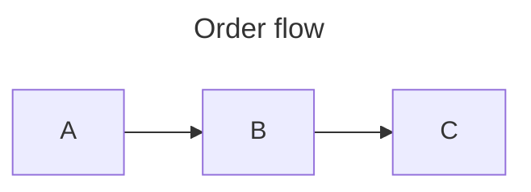
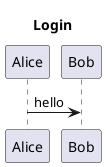
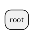

# Diagrams

Intro.



```python
# a code block, not a diagram
print("hi")
```

## Other languages

~~~ dot
strict digraph G {
  a -> b
}
~~~



```d2
x -> y
```



## Not diagrams

> ```mermaid
> graph TD
> ```

- ```mermaid
  pie
  ```

```mermaid
%% a comment first
sequenceDiagram
    title Checkout
    A->>B: pay
